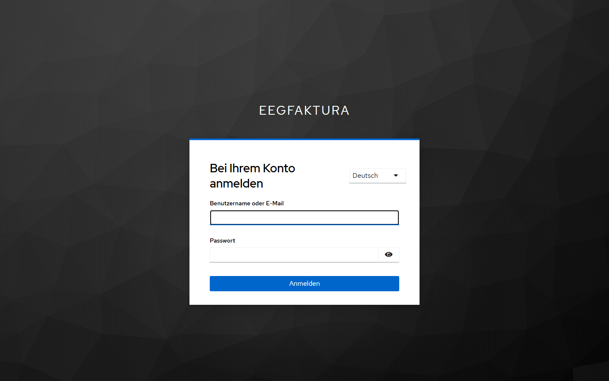
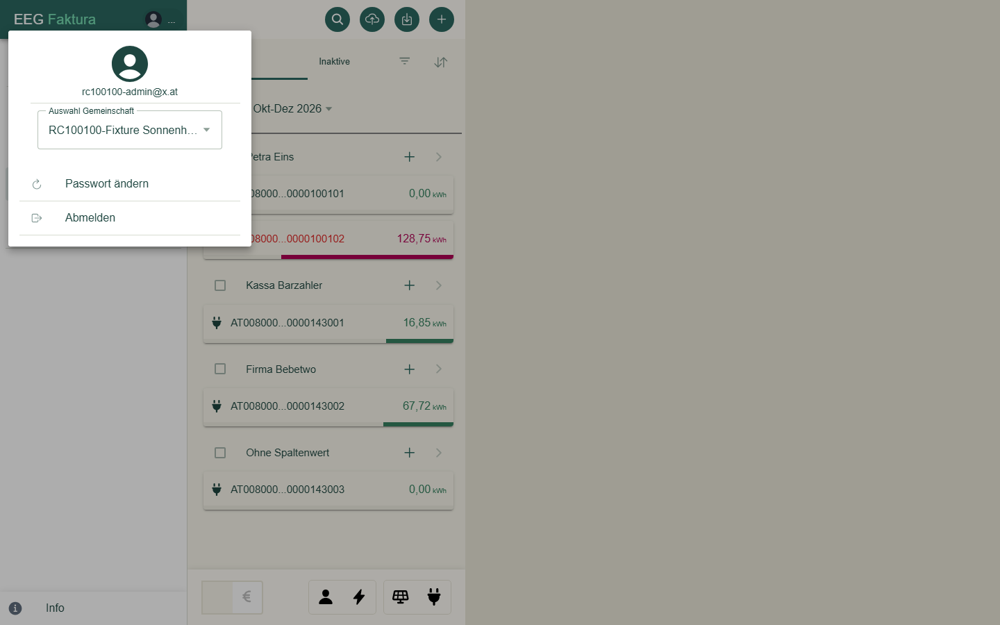
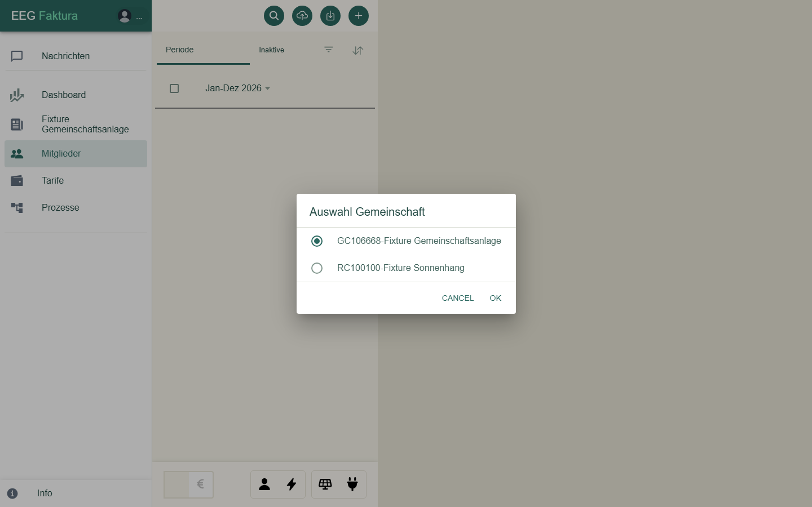
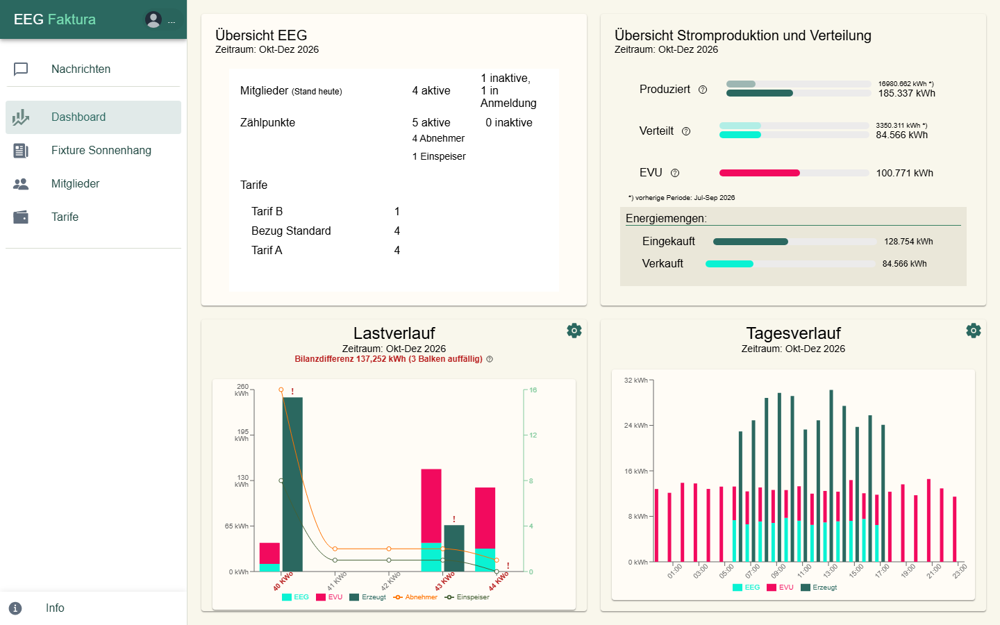
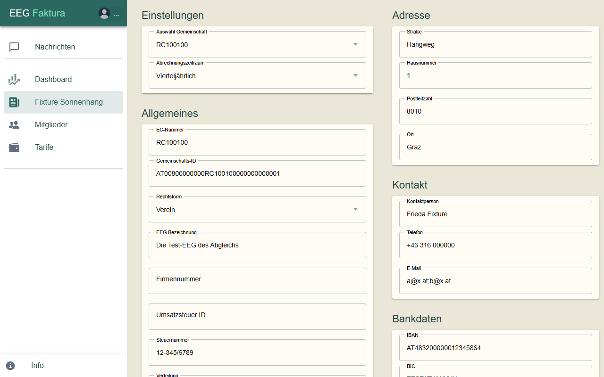

# Anmeldung & Oberfläche

## Anmelden

1. Öffne die Adresse deiner eegFaktura-Installation im Browser.
2. Du wirst automatisch zur Anmeldeseite weitergeleitet.
3. Gib deinen **Benutzernamen oder deine E-Mail-Adresse** und dein **Passwort** ein und klicke auf **Anmelden**.

Nach der Anmeldung landest du in der **Mitgliederliste** deiner Gemeinschaft.

> Passwort vergessen oder noch kein Zugang? Wende dich an den Betreiber deiner eegFaktura-Installation.

## Die Oberfläche

Links ist das **Menü**, rechts davon die gewählte Seite. Oben im Menü steht „EEG Faktura“ mit deinem
**Benutzersymbol**.

| Menüpunkt | Inhalt | Sichtbar für |
|-----------|--------|--------------|
| **Nachrichten** | Rückmeldungen des Netzbetreibers und Hinweise von eegFaktura | EEG-Admins |
| **Dashboard** | Kennzahlen und Diagramme der Gemeinschaft | alle |
| *Name deiner Gemeinschaft* | die **EEG-Seite** mit den Stammdaten der Gemeinschaft | alle |
| **Mitglieder** | Mitglieder und ihre Zählpunkte | alle |
| **Tarife** | die Tarife der Gemeinschaft | alle |
| **Prozesse** | Prozesse beim Netzbetreiber auslösen, z. B. Daten nachfordern | EEG-Admins von Gemeinschaften mit Online-Anbindung |

Ganz unten öffnet **Info** das Impressum.

## Benutzermenü und Abmelden

Ein Klick auf dein **Benutzersymbol** oben im Menü öffnet das Benutzermenü:

- deine **E-Mail-Adresse**,
- **Auswahl Gemeinschaft**: die Gemeinschaft, die du gerade bearbeitest,
- **Passwort ändern**: führt zur Kontoseite, auf der du dein Passwort änderst,
- **Abmelden**: meldet dich ab.

## Gemeinschaft wechseln

Betreust du mehrere Gemeinschaften, wählst du unter **Auswahl Gemeinschaft** im Benutzermenü die gewünschte aus
und bestätigst mit **OK**. Alle Seiten zeigen danach die Daten dieser Gemeinschaft.

Dieselbe Auswahl findest du auch auf der EEG-Seite unter **Einstellungen**. eegFaktura merkt sich deine Wahl für
die nächste Anmeldung im selben Browser.

## Dashboard

Das **Dashboard** zeigt die wichtigsten Zahlen der Gemeinschaft, meist für den gewählten **Zeitraum**:

| Bereich | Inhalt |
|---------|--------|
| **Übersicht EEG** | Mitglieder „Stand heute“ (aktive, inaktive, in Anmeldung), aktive Zählpunkte (Abnehmer und Einspeiser), Tarife mit der Anzahl ihrer Zählpunkte; in derselben Liste darunter die Mitgliedsbeitrags-Tarife mit der Anzahl aktiver Mitglieder und, wenn aktive Mitglieder keinen haben, die Zeile „ohne Mitgliedsbeitrag“ |
| **Übersicht Stromproduktion und Verteilung** | **Produziert**, **Verteilt** und **EVU** (Bezug vom Energieversorger), jeweils mit der vorherigen Periode zum Vergleich; darunter die **Energiemengen** „Eingekauft“ und „Verkauft“ |
| **Lastverlauf** | Balken für EEG, EVU und Erzeugung über den Zeitraum, darüber die **Bilanz** (siehe unten); auffällige Balken tragen ein „!“ |
| **Tagesverlauf** | Verlauf über den Tag (EEG, EVU, Erzeugt) |

Die Fragezeichen-Symbole neben den Werten erklären, wie eine Zahl entsteht.

**Bilanzdifferenz:** Produktion minus Eigendeckung minus Überschuss. Sind alle Energiedaten da, ist sie 0, und
eegFaktura zeigt „Bilanz ausgeglichen“ (sehr kleine Werte sind Rundung). Eine Differenz steht rot da: **negativ**
heißt, vermutlich fehlen Daten von Einspeisern, **positiv**, vermutlich fehlen Daten von Beziehern. Für die
jüngsten Tage ist eine Differenz normal, solange noch nicht alle Daten eingetroffen sind. Fehlen ältere Daten,
kannst du sie unter **Prozesse → Zählpunktdaten nachfordern** anfordern.

**Energiemengen:** „Eingekauft“ und „Verkauft“ zählen nur Zählpunkte mit einem gültigen Tarif der Gemeinschaft; ein Hinweis darunter nennt die Zählpunkte, die deshalb
fehlen.

## EEG-Seite

Der Menüpunkt mit dem **Namen deiner Gemeinschaft** öffnet die EEG-Seite mit ihren Stammdaten:

| Bereich | Inhalt |
|---------|--------|
| **Einstellungen** | Auswahl Gemeinschaft, **Abrechnungszeitraum** (fest eingestellt) |
| **Allgemeines** | EC-Nummer, Gemeinschafts-ID, Rechtsform, EEG Bezeichnung, Firmennummer, Umsatzsteuer ID, Steuernummer, Verteilung |
| **Netzbetreiber** | Netzbetreiber-ID und -Name |
| **E-Mail-Texte** | Zugang zu den [E-Mail-Texten](03-email-texte.md) (nur EEG-Admins) |
| **Adresse**, **Kontakt** | Anschrift, Kontaktperson, Telefon, E-Mail-Adresse der Gemeinschaft |
| **Bankdaten** | IBAN, BIC, Kontoinhaber, Bankverbindung, Creditor-ID |
| **Optional** | Webseite |
| **Abrechnungseinstellungen** | Einstellungen für Rechnungen und Gutschriften, z. B. das Logo |

Ändern können die Felder nur EEG-Admins. Eine Änderung wird gespeichert, sobald du das Feld verlässt; einen
eigenen Speichern-Knopf gibt es nicht. EC-Nummer, Gemeinschafts-ID und Verteilung lassen sich nicht ändern.

> **Tipp:** EEG Bezeichnung, Kontaktperson, Adresse, Telefon, E-Mail und Webseite der Gemeinschaft stehen im
> Kontaktblock der Mails an deine Mitglieder (siehe [E-Mail-Texte](03-email-texte.md)), und die E-Mail-Adresse
> bekommt diese Mails in Kopie. Halte die Angaben aktuell.
