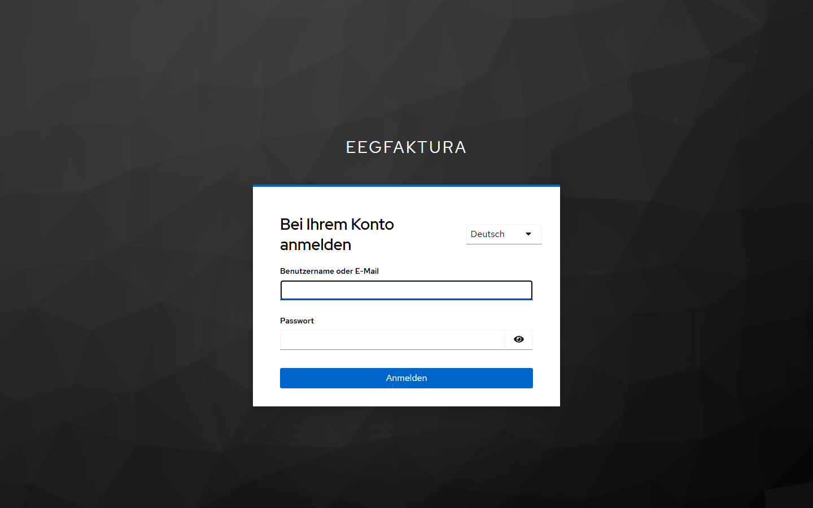
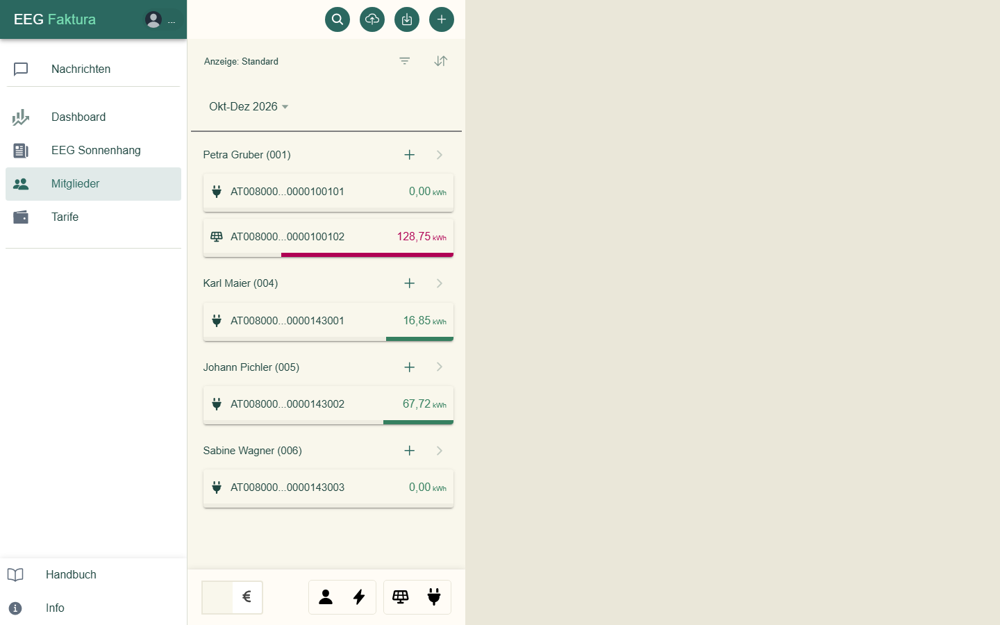
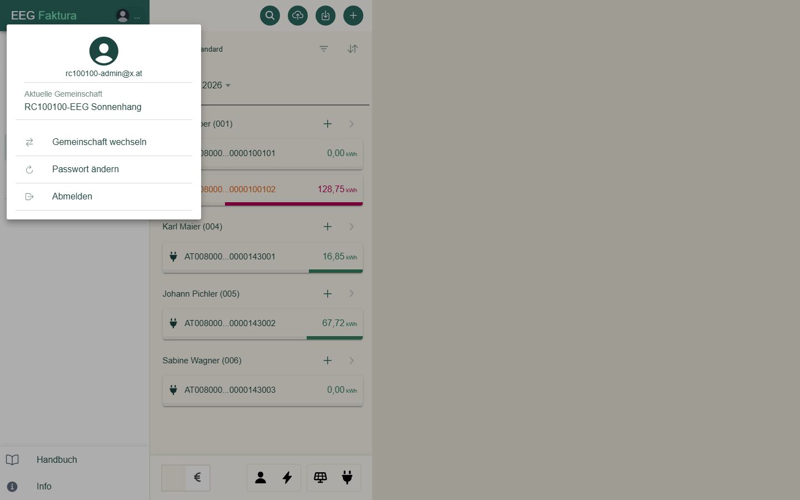
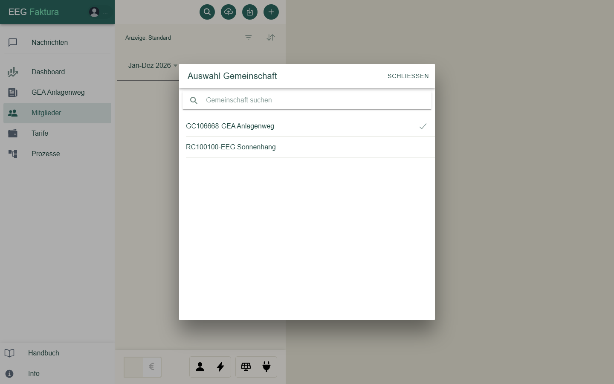

# Anmeldung & Oberfläche

## Anmelden

1. Öffne die Adresse deiner eegFaktura-Installation im Browser.
2. Du wirst automatisch zur Anmeldeseite weitergeleitet.
3. Gib deinen **Benutzernamen oder deine E-Mail-Adresse** und dein **Passwort** ein und klicke auf **Anmelden**.

Nach der Anmeldung landest du in der **Mitgliederliste** deiner Gemeinschaft.

> Passwort vergessen oder noch kein Zugang? Wende dich an den Betreiber deiner eegFaktura-Installation.

## Die Oberfläche

Links ist das **Menü**, rechts davon die gewählte Seite. Oben im Menü steht „EEG Faktura“ mit deinem
**Benutzersymbol**.

| Menüpunkt | Inhalt | Sichtbar für |
|-----------|--------|--------------|
| **Nachrichten** | Rückmeldungen des Netzbetreibers und Hinweise von eegFaktura | EEG-Admins |
| **Dashboard** | Kennzahlen und Diagramme der Gemeinschaft (siehe [Dashboard](dashboard.md)) | alle |
| *Name deiner Gemeinschaft* | die [EEG-Seite](eeg-seite.md) mit den Stammdaten der Gemeinschaft | alle |
| **Mitglieder** | Mitglieder und ihre Zählpunkte | alle |
| **Tarife** | die Tarife der Gemeinschaft | alle |
| **Prozesse** | Prozesse beim Netzbetreiber auslösen, z. B. Daten nachfordern | EEG-Admins von Gemeinschaften mit Online-Anbindung |

Ganz unten öffnet **Handbuch** dieses Benutzerhandbuch in einem neuen Tab, **Info** das Impressum.

## Benutzermenü und Abmelden

Ein Klick auf dein **Benutzersymbol** oben im Menü öffnet das Benutzermenü:

- deine **E-Mail-Adresse**,
- **Aktuelle Gemeinschaft**: Nummer und Name der Gemeinschaft, die du gerade bearbeitest (nur Anzeige),
- **Gemeinschaft wechseln**: öffnet die Auswahl der Gemeinschaften (siehe unten),
- **Passwort ändern**: führt zur Kontoseite, auf der du dein Passwort änderst,
- **Abmelden**: meldet dich ab.

## Gemeinschaft wechseln

Die Gemeinschaft, die du bearbeitest, wählst du im Benutzermenü mit **Gemeinschaft wechseln**. Den Eintrag gibt es
immer, auch wenn du nur eine Gemeinschaft betreust. Es öffnet sich die Liste **Auswahl Gemeinschaft**, die aktuelle
Gemeinschaft ist mit einem Häkchen markiert. Betreust du mehrere Gemeinschaften, steht oben ein **Suchfeld**: Tippe
die Nummer oder einen Teil des Namens ein (Groß- und Kleinschreibung und Akzente spielen keine Rolle, „sonnen“ findet
„EEG Sonnenfeld“). Ein Klick auf eine Gemeinschaft wechselt sofort; alle Seiten zeigen danach ihre Daten. Hast du
gerade ungespeicherte Eingaben, fragt eegFaktura vorher nach.

eegFaktura merkt sich deine Wahl für die nächste Anmeldung im selben Browser.
