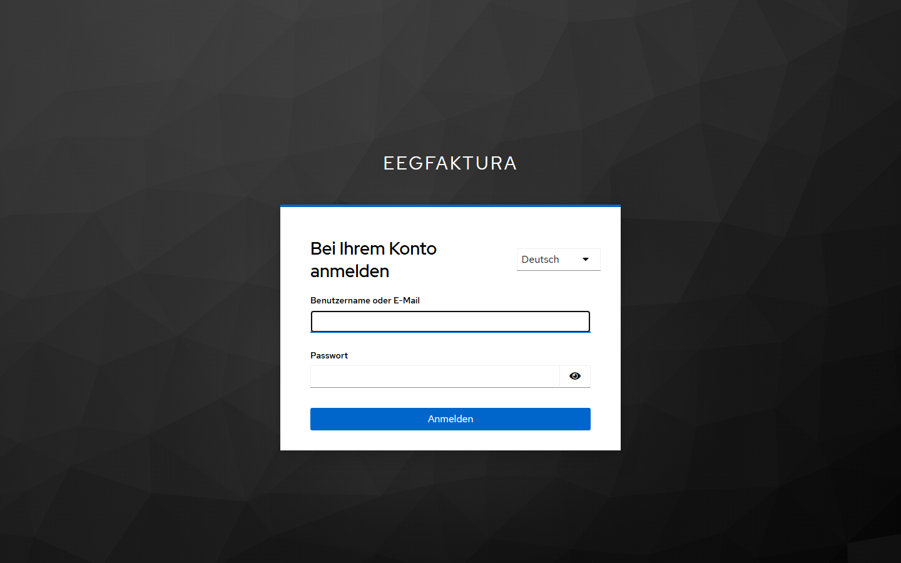
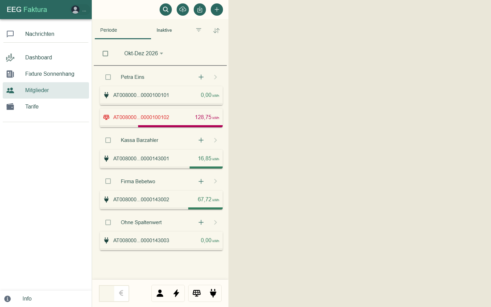
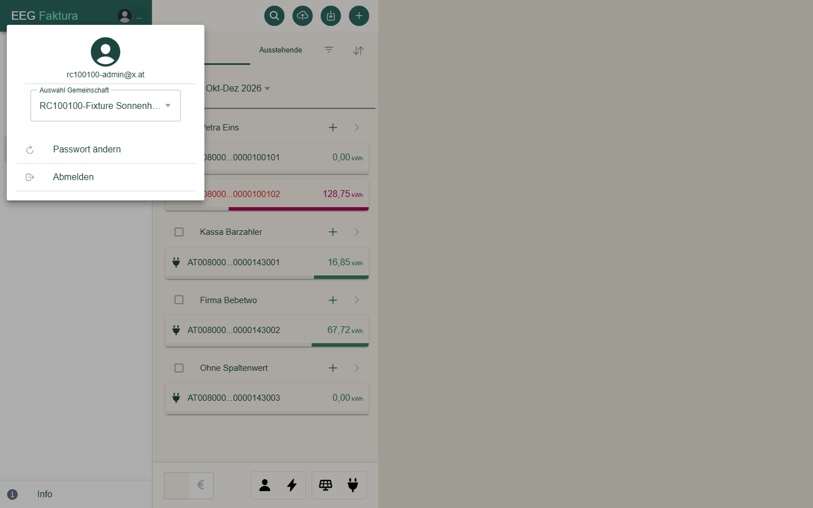
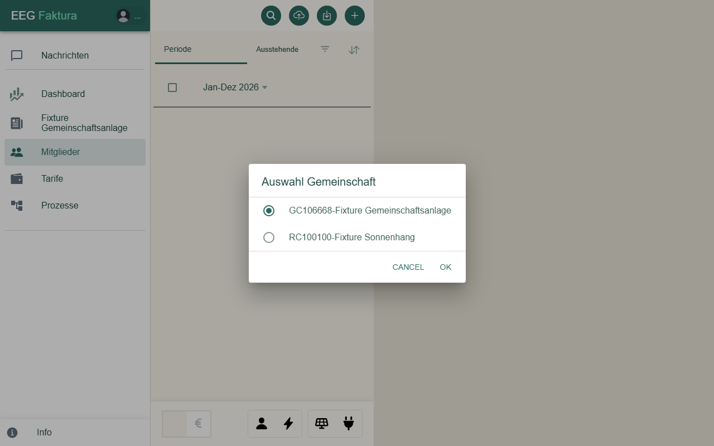
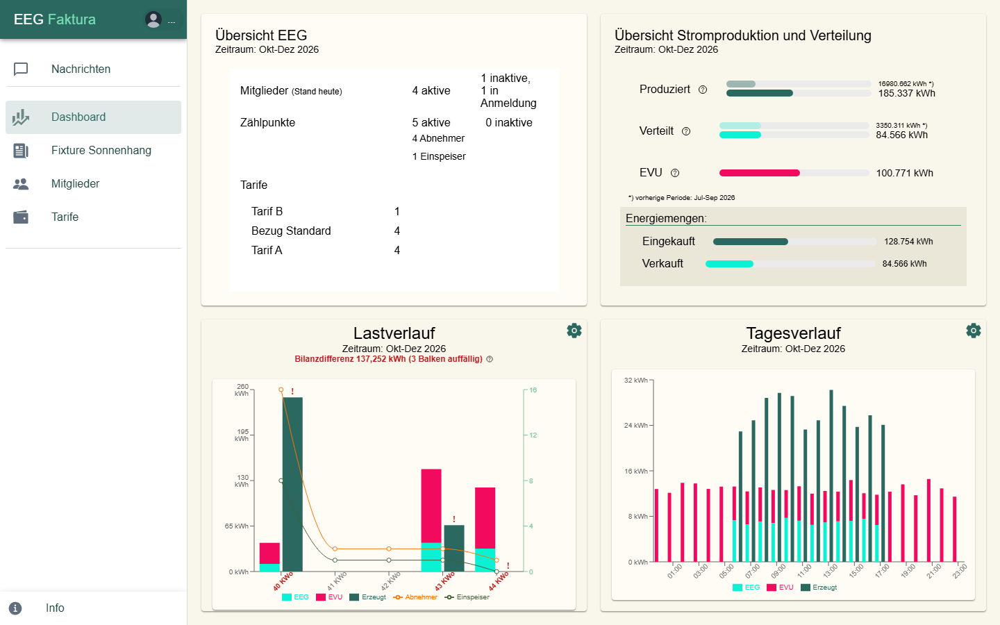
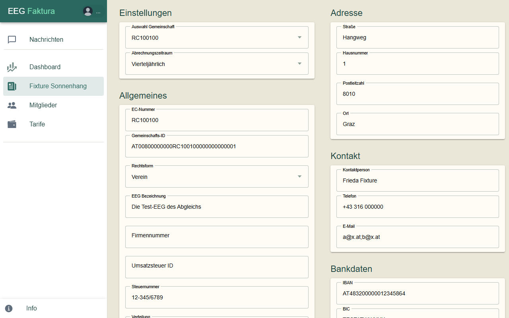

# Anmeldung & Oberfläche

## Anmelden

1. Öffne die Adresse deiner eegFaktura-Installation im Browser.
2. Du wirst automatisch zur Anmeldeseite weitergeleitet.
3. Gib deinen **Benutzernamen oder deine E-Mail-Adresse** und dein **Passwort** ein und klicke auf **Anmelden**.

Nach der Anmeldung landest du in der **Mitgliederliste** deiner Gemeinschaft.

> Passwort vergessen oder noch kein Zugang? Wende dich an den Betreiber deiner eegFaktura-Installation.

## Die Oberfläche

Links ist das **Menü**, rechts davon die gewählte Seite. Oben im Menü steht „EEG Faktura“ mit deinem
**Benutzersymbol**.

| Menüpunkt | Inhalt | Sichtbar für |
|-----------|--------|--------------|
| **Nachrichten** | Rückmeldungen des Netzbetreibers und Hinweise von eegFaktura | EEG-Admins |
| **Dashboard** | Kennzahlen und Diagramme der Gemeinschaft | alle |
| *Name deiner Gemeinschaft* | die **EEG-Seite** mit den Stammdaten der Gemeinschaft | alle |
| **Mitglieder** | Mitglieder und ihre Zählpunkte | alle |
| **Tarife** | die Tarife der Gemeinschaft | alle |
| **Prozesse** | Prozesse beim Netzbetreiber auslösen, z. B. Daten nachfordern | EEG-Admins von Gemeinschaften mit Online-Anbindung |

Ganz unten öffnet **Info** das Impressum.

## Benutzermenü und Abmelden

Ein Klick auf dein **Benutzersymbol** oben im Menü öffnet das Benutzermenü:

- deine **E-Mail-Adresse**,
- **Aktuelle Gemeinschaft**: Nummer und Name der Gemeinschaft, die du gerade bearbeitest (nur Anzeige),
- **Gemeinschaft wechseln**: öffnet die Auswahl der Gemeinschaften (nur wenn du mehrere betreust, siehe unten),
- **Passwort ändern**: führt zur Kontoseite, auf der du dein Passwort änderst,
- **Abmelden**: meldet dich ab.

## Gemeinschaft wechseln

Betreust du mehrere Gemeinschaften, klickst du im Benutzermenü auf **Gemeinschaft wechseln**. Es öffnet sich die
Liste **Auswahl Gemeinschaft**, die aktuelle Gemeinschaft ist mit einem Häkchen markiert. Oben steht ein **Suchfeld**:
Tippe die Nummer oder einen Teil des Namens ein (Groß- und Kleinschreibung und Akzente spielen keine Rolle, „sonnen“
findet „EEG Sonnenfeld“). Ein Klick auf eine Gemeinschaft wechselt sofort; alle Seiten zeigen danach ihre Daten. Hast
du gerade ungespeicherte Eingaben, fragt eegFaktura vorher nach.

Eine Auswahl ohne Suche findest du auch auf der EEG-Seite unter **Einstellungen**. eegFaktura merkt sich deine Wahl für
die nächste Anmeldung im selben Browser.

## Dashboard

Das **Dashboard** zeigt die wichtigsten Zahlen der Gemeinschaft, meist für den gewählten **Zeitraum**:

| Bereich | Inhalt |
|---------|--------|
| **Übersicht EEG** | Mitglieder, Zählpunkte und Tarife mit dem Stand von heute (siehe [unten](#ubersicht-eeg)) |
| **Übersicht Stromproduktion und Verteilung** | **Produziert**, **Verteilt** und **EVU** (Bezug vom Energieversorger), jeweils mit der vorherigen Periode zum Vergleich; darunter die **Energiemengen** „Eingekauft“ und „Verkauft“ |
| **Lastverlauf** | Balken für EEG, EVU und Erzeugung über den Zeitraum, darüber die **Bilanz** (siehe unten); auffällige Balken tragen ein „!“ |
| **Tagesverlauf** | Verlauf über den Tag (EEG, EVU, Erzeugt) |

Die Fragezeichen-Symbole neben den Werten erklären, wie eine Zahl entsteht.

### Übersicht EEG

Die Kachel zeigt alle Zahlen mit dem Stand von heute, unabhängig vom gewählten Zeitraum; oben steht „Stand heute“.

- **Mitglieder:** aktive, inaktive und, falls vorhanden, „in Anmeldung“.
- **Zählpunkte:** aktive, inaktive und, falls vorhanden, „in Anmeldung“ (Zählpunkte, deren Anmeldung beim
  Netzbetreiber noch läuft, zählen nicht zu den aktiven); darunter die aktiven Abnehmer und Einspeiser.
- **Tarife**, getrennt in **Energietarife** (Anzahl der aktiven Zählpunkte je Tarif) und **Mitgliedsbeitrag** (Anzahl
  der aktiven Mitglieder je Tarif, dazu „ohne Mitgliedsbeitrag“).

Die anderen Kacheln zeigen den gewählten Zeitraum.

**Bilanzdifferenz:** Produktion minus Eigendeckung minus Überschuss. Sind alle Energiedaten da, ist sie 0, und
eegFaktura zeigt „Bilanz ausgeglichen“ (sehr kleine Werte sind Rundung). Eine Differenz steht rot da: **negativ**
heißt, vermutlich fehlen Daten von Einspeisern, **positiv**, vermutlich fehlen Daten von Beziehern. Für die
jüngsten Tage ist eine Differenz normal, solange noch nicht alle Daten eingetroffen sind. Fehlen ältere Daten,
kannst du sie unter **Prozesse → Zählpunktdaten nachfordern** anfordern.

**Energiemengen:** „Eingekauft“ und „Verkauft“ zählen nur Zählpunkte mit einem gültigen Tarif der Gemeinschaft;
ein Hinweis darunter nennt die Zählpunkte, die deshalb fehlen.

**Einzelner Tag:** Über das Zahnrad von Lastverlauf oder Tagesverlauf wählst du in der Zeile **Tag** ein Datum; mit
den Pfeilen blätterst du tageweise. Nur diese Kachel wechselt in die Tagesansicht; möglich sind Tage mit
Energiedaten bis gestern. Eine andere Zeile im Zahnrad-Menü führt zurück zum Zeitraum.

## EEG-Seite

Der Menüpunkt mit dem **Namen deiner Gemeinschaft** öffnet die EEG-Seite mit ihren Stammdaten:

| Bereich | Inhalt |
|---------|--------|
| **Einstellungen** | Auswahl Gemeinschaft, **Abrechnungszeitraum** (siehe [Abrechnungszeitraum wechseln](05-abrechnung.md#abrechnungszeitraum-wechseln)) |
| **Allgemeines** | EC-Nummer, Gemeinschafts-ID, Rechtsform, EEG Bezeichnung, Firmennummer, Umsatzsteuer ID, Steuernummer, Verteilung, **Modell** und **Nahebereich** (siehe [unten](#modell-und-nahebereich)) |
| **Netzbetreiber** | Netzbetreiber-ID und -Name |
| **E-Mail-Texte** | Zugang zu den [E-Mail-Texten](03-email-texte.md) (nur EEG-Admins) |
| **Adresse**, **Kontakt** | Anschrift, Kontaktperson, Telefon, E-Mail-Adresse der Gemeinschaft |
| **Bankdaten** | IBAN, BIC, Kontoinhaber, Bankverbindung, Creditor-ID |
| **Optional** | Webseite |
| **Abrechnungseinstellungen** | Einstellungen für Rechnungen und Gutschriften, z. B. das Logo |

Ändern können die Felder nur EEG-Admins. Eine Änderung wird gespeichert, sobald du das Feld verlässt; einen
eigenen Speichern-Knopf gibt es nicht. EC-Nummer, Gemeinschafts-ID und Verteilung lassen sich nicht ändern.

### Modell und Nahebereich

Unter **Allgemeines** stehen zwei weitere Felder, beide nur zur Anzeige:

- **Modell**: die Art der Gemeinschaft, mit Kurz- und Langform: EEG lokal (Erneuerbare-Energie-Gemeinschaft, lokal),
  EEG regional (Erneuerbare-Energie-Gemeinschaft, regional), GEA (Gemeinschaftliche Erzeugungsanlage), BEG
  (Bürgerenergiegemeinschaft), P2P (Peer-to-Peer) oder EVA (Eigenversorgungsanlage).
- **Nahebereich**: die Netzebene, die alle Zählpunkte der Gemeinschaft verbindet, mit der amtlichen Bezeichnung
  laut ElWG. Der Wert ist aus dem Modell vorbelegt und wird mit jeder Zählpunktliste des Netzbetreibers
  aktualisiert; bei P2P und EVA steht er bis zur ersten Zählpunktliste auf „unbekannt“.

| Nahebereich | Bezeichnung |
|---|---|
| 1 | Haupt-/Steigleitung |
| 2 | Standortbereich – gemeinsame Sammelschiene |
| 3 | Lokalbereich – gleiche Trafostation |
| 4 | Regionalbereich – gleiches Umspannwerk eines Netzbetreibers |
| 5 | Regionalbereich – gleiches Umspannwerk verschiedener Netzbetreiber |
| 6 | Gebotszone – mehrere Umspannwerke eines Netzbetreibers |
| 7 | Gebotszone – mehrere Umspannwerke verschiedener Netzbetreiber |

Liegt noch kein Wert vor, steht „unbekannt“.

### Peer-to-Peer und Eigenversorgung

Für Gemeinschaften mit dem Modell **P2P** oder **EVA** bietet eegFaktura keine Abrechnung an. Es fehlen deshalb der
Menüpunkt **Tarife**, die Abrechnung und die Rechnungen, die Tarifauswahl bei Mitgliedern und Zählpunkten, die
Lastschrift-Felder, die Abrechnungseinstellungen, der Abrechnungszeitraum, die Creditor-ID, die Rechnungs-Mail unter
**E-Mail-Texte** und auf dem Dashboard die **Tarife** der Übersicht EEG und die **Energiemengen**. Energiedaten,
Zählpunkte und Prozesse funktionieren wie bei einer BEG: Zählpunkte können bei mehreren Netzbetreibern liegen, und
**Zählpunktliste anfordern** fragt nach dem Netzbetreiber.

> **Tipp:** EEG Bezeichnung, Kontaktperson, Adresse, Telefon, E-Mail und Webseite der Gemeinschaft stehen im
> Kontaktblock der Mails an deine Mitglieder (siehe [E-Mail-Texte](03-email-texte.md)), und die E-Mail-Adresse
> bekommt diese Mails in Kopie. Halte die Angaben aktuell.
