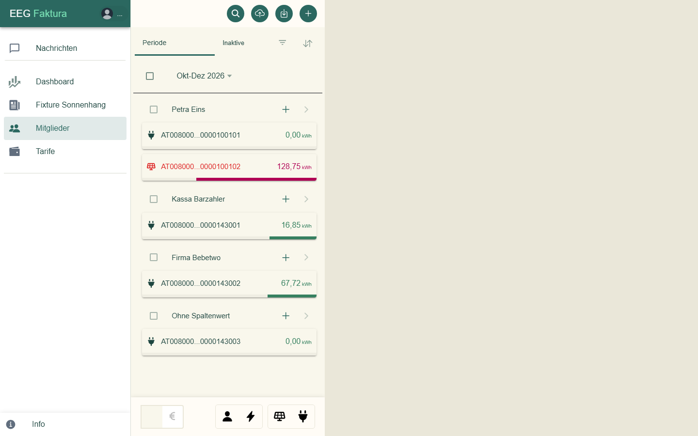
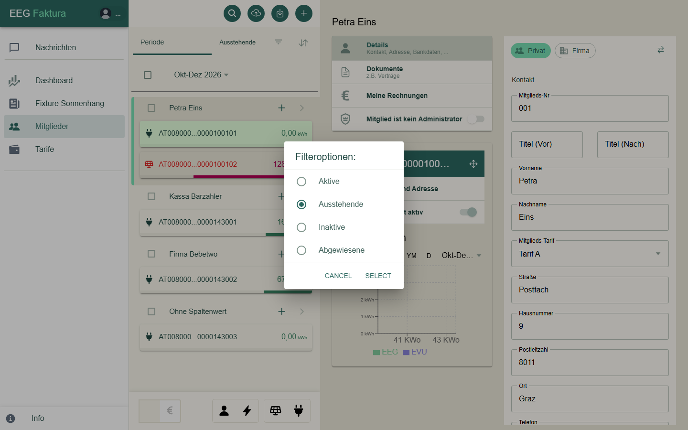
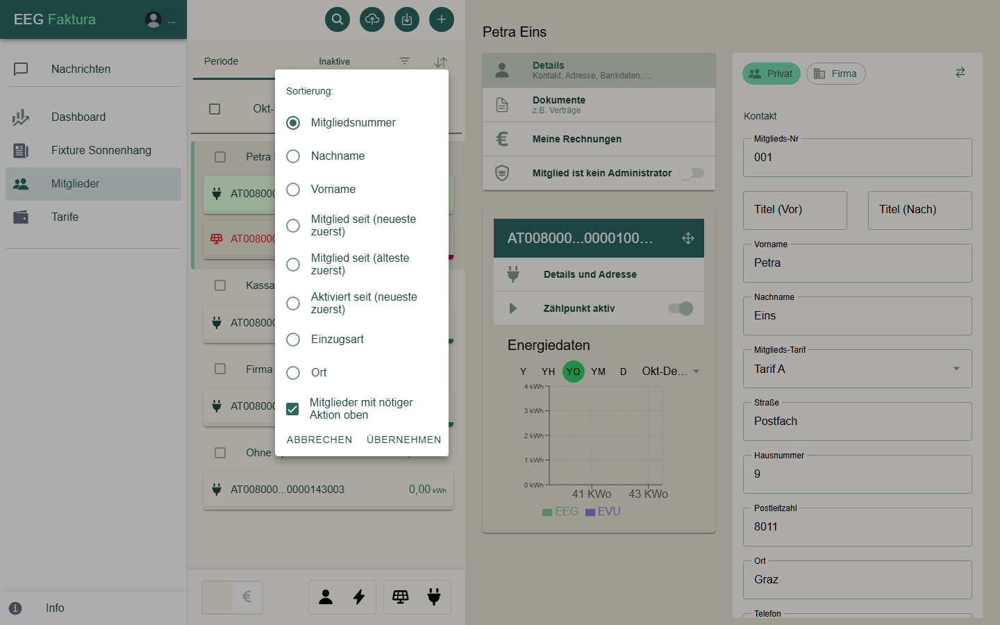
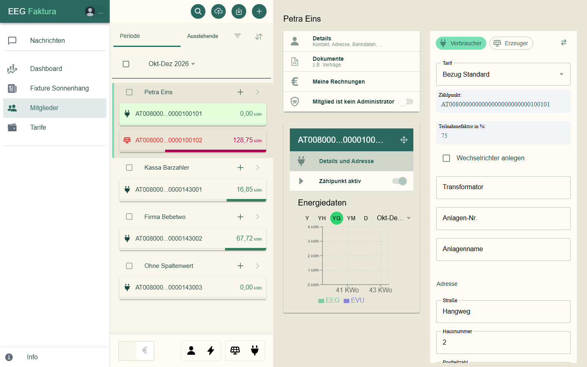
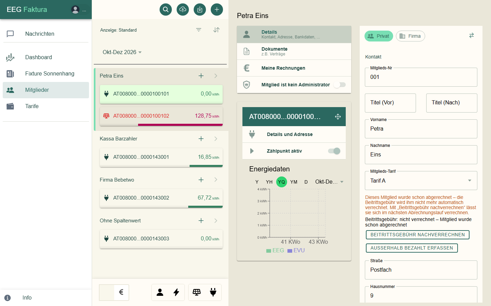
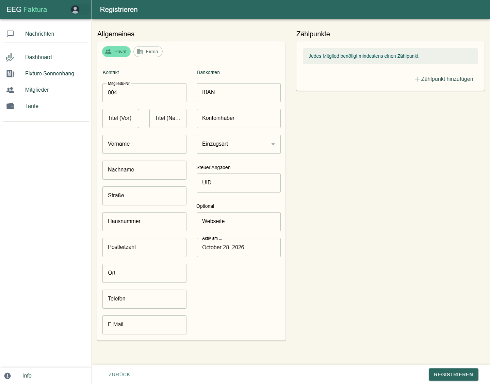
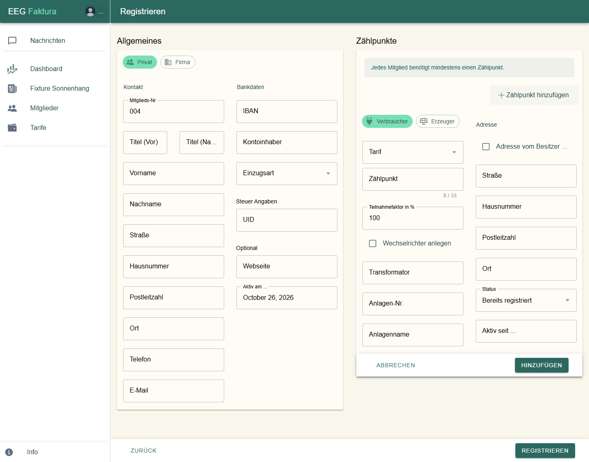
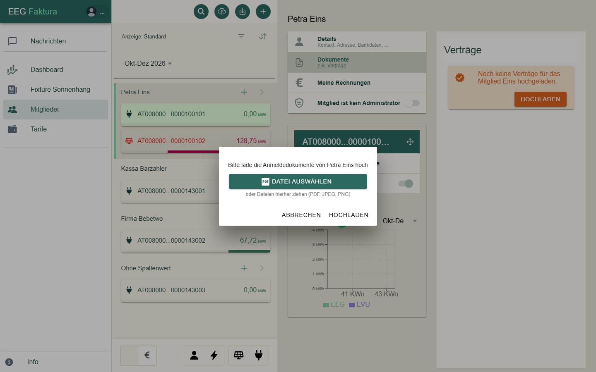

# Mitglieder & Zählpunkte

Unter **Mitglieder** verwaltest du die Mitglieder deiner Gemeinschaft und ihre Zählpunkte.

## Die Mitgliederliste

Jedes Mitglied steht mit seinem Namen in der Liste, darunter eine Karte je **Zählpunkt** mit der Energiemenge im
gewählten Zeitraum. Das Symbol zeigt die Richtung: ein **Stecker** für Verbrauch, ein **Solarmodul** für Erzeugung.
Der Balken unter dem Wert zeigt den Anteil des Zählpunkts.

### Knöpfe oben

| Knopf | Funktion |
|-------|----------|
| Lupe | **Suche**: blendet ein Suchfeld ein, die Liste filtert beim Tippen |
| Wolke mit Pfeil nach oben | **Import**: Stammdaten (Mitglieder und Zählpunkte) aus einer Excel-Datei einlesen; bei Gemeinschaften ohne Online-Anbindung auch Energiedaten |
| Pfeil nach unten | **Export**: Daten für einen Zeitraum herunterladen |
| Plus | **Neues Mitglied** anlegen (siehe unten) |

### Zeitraum, Filter und Sortierung

- **Periode** zeigt alle Mitglieder. Den Zeitraum (z. B. „Okt-Dez 2026“) wählst du darunter.
- Der zweite Reiter filtert die Liste. Über das Filter-Symbol wählst du **Aktive**, **Ausstehende**, **Inaktive**
  oder **Abgewiesene**.

  

- Das Pfeil-Symbol ganz rechts öffnet die **Sortierung**: Standard, Nachname, Vorname, Mitgliedsnummer oder
  Mitglied seit (neueste bzw. älteste zuerst). Mitglieder, bei denen eine Aktion nötig ist, bleiben immer oben.

  

### Farben

| Farbe des Zählpunkts | Bedeutung |
|----------------------|-----------|
| Dunkelgrün | Zählpunkt ist aktiv (oder inaktiv mit früheren Daten) |
| Orange | Anmeldung läuft noch, z. B. wartet eegFaktura auf den Netzbetreiber oder auf die Zustimmung des Mitglieds |
| Rot | vom Netzbetreiber abgewiesen, aufgehoben oder ungültig |

Ein Mitglied, das noch zugelassen werden muss, steht orange mit einem „!“ in der Liste. Steht neben einem Namen
grau „inaktiv“, hat das Mitglied keinen aktiven Zählpunkt mehr.

### Unten in der Liste

- Der Schalter **€** wechselt in den **Abrechnungsmodus**. Er gehört zur Abrechnung und wird im Kapitel
  Abrechnung beschrieben.
- Mit den Symbolen daneben wechselst du zwischen Mitgliedern und Zählpunkten und blendest Verbraucher oder Erzeuger
  ein und aus.

## Ein Mitglied ansehen und ändern

Ein Klick auf ein Mitglied öffnet rechts seine Daten, zunächst mit dem ersten Zählpunkt:

| Eintrag | Inhalt |
|---------|--------|
| **Details** | Kontakt, Adresse, Bankdaten des Mitglieds |
| **Dokumente** | Dokumente zum Mitglied, z. B. Verträge |
| **Meine Rechnungen** | die Rechnungen und Gutschriften des Mitglieds |
| **Mitglied ist (kein) Administrator** | zeigt, ob das Mitglied EEG-Admin ist (nur Anzeige) |

**Details** öffnet das Formular des Mitglieds:

- Oben steht, ob das Mitglied **Privat** oder **Firma** ist. Ändern kannst du das als EEG-Admin über das
  Pfeil-Symbol daneben; eegFaktura warnt vorher (bei Privat → Firma wird der Vorname zum Firmennamen).
- **Kontakt**: Mitglieds-Nr, Titel, Vorname und Nachname (bei Firmen der Firmenname), **Mitglieds-Tarif**,
  Adresse, Telefon, E-Mail, UID.
- **Bankdaten**: IBAN, Kontoinhaber, **Einzugsart** (Kein SEPA, B2B oder CORE); bei Lastschrift zusätzlich
  Bankverbindung, Mandatsreferenz und Mandatsdatum.
- **Optionals**: Mitglied seit.

Änderungen werden gespeichert, sobald du ein Feld verlässt.

### Neues Mitglied zulassen

Ein neues Mitglied — von dir angelegt oder über eine Registrierung hereingekommen — steht zuerst orange mit „!“ in
der Liste und wartet auf die Zulassung. Rechts fragt eegFaktura: „Möchtest du *Nachname* in deine EEG aufnehmen?“

- **Ja, Zulassen** öffnet den Dialog „*Name* zulassen“. Dort kannst du **Anmeldedokumente** hochladen (z. B. den
  unterschriebenen Beitritt) und je Zählpunkt angeben, ob er per **Offline-Registrierung** mit einem
  **Aktivierungs-Code** angemeldet wird. Mit **Zulassen** wird das Mitglied aufgenommen.
- **Nein, Löschen** löscht das Mitglied mit allen Zählpunkten. Das lässt sich nicht rückgängig machen.

Erst mit dem Zulassen meldet eegFaktura die Zählpunkte bei Gemeinschaften mit Online-Anbindung beim Netzbetreiber
an. Bei Gemeinschaften ohne Online-Anbindung werden sie damit aktiv.

## Zählpunkte

Ein Klick auf eine Zählpunkt-Karte zeigt dessen Daten. Über dem Zählpunkt steht seine Nummer; das Pfeilkreuz
daneben **verschiebt** den Zählpunkt zu einem anderen Mitglied (bisherige Rechnungen bleiben beim alten Mitglied).

- **Details und Adresse**: Richtung, Tarif, Zählpunktnummer, Teilnahmefaktor, Wechselrichter, Transformator,
  Anlagen-Nr., Anlagenname und die Adresse des Zählpunkts.
- **Zählpunkt aktiv**: zeigt, ob der Zählpunkt aktiv ist (nur Anzeige).
- **Energiedaten**: ein Diagramm der Energiedaten des Zählpunkts (nur bei aktiven Zählpunkten).

Die **Richtung** (Verbraucher/Erzeuger) eines angemeldeten Zählpunkts ist gesperrt. Ein EEG-Admin kann sie über das
Pfeil-Symbol ändern; eegFaktura warnt vorher, denn die Änderung wird **nicht** an den Netzbetreiber gemeldet.

### Status eines Zählpunkts

Ist ein Zählpunkt nicht aktiv, steht über den Details ein Hinweis zum Stand:

| Hinweis | Bedeutung |
|---------|-----------|
| Antwort des Netzbetreibers noch ausstehend. | Die Anmeldung ist beim Netzbetreiber, er hat noch nicht geantwortet. |
| Zustimmung des Mitglieds noch ausstehend. | Das Mitglied muss die Datenfreigabe noch bestätigen; bei der Online-Anmeldung bekommt es dazu die Mail „Freigabe-Aufforderung“. |
| Abschlussmeldung vom Netzbetreiber noch ausstehend. | Das Mitglied hat zugestimmt, die Abschlussmeldung des Netzbetreibers fehlt noch. |
| Zählpunkt wurde vom Netzbetreiber abgewiesen. | Der Netzbetreiber hat die Anmeldung abgelehnt. |
| Zählpunkt wurde vom Netzbetreiber nicht angenommen. | Die Anmeldung war ungültig, z. B. weil die Zählpunktnummer nicht gefunden wurde. |
| Zählpunkt wurde vom Netzbetreiber aufgehoben. | Der Netzbetreiber hat die Teilnahme beendet. |
| Zählpunkt inaktiv seit … / inaktiv am … | Der Zählpunkt gehört nicht mehr zur Gemeinschaft („am“: das Ende liegt noch in der Zukunft). |
| Zählpunkt wurde archiviert. | Der Zählpunkt ist abgeschlossen und nur noch zur Ansicht da. |
| Zählpunkt hat eine Warnung, bitte die Prozess History prüfen. | Beim Netzbetreiber gab es eine Unstimmigkeit, siehe **Prozesse → Prozess History**. |

Bei Abweisung oder Nichtannahme steht der **Grund** fett darunter, z. B. „Kunde hat Datenfreigabe abgelehnt“. Danach
richtest du dich: Ist der Fehler behoben (z. B. Nummer korrigiert), meldest du den Zählpunkt unter
**Prozesse → Zählpunkt aktivieren** erneut an.

Einen ungültigen Zählpunkt, der nie angemeldet wurde, kannst du hier mit **Löschen** entfernen.

## Neues Mitglied anlegen

1. Klicke in der Mitgliederliste oben auf **Plus**. Es öffnet sich **Registrieren**.

    

2. Wähle **Privat** oder **Firma** und fülle **Allgemeines** aus. Pflicht sind Vorname und Nachname (bzw.
   Firmenname), Straße, Hausnummer, Postleitzahl, Ort, E-Mail und die **Einzugsart**. Die **Mitglieds-Nr** ist
   mit der nächsten freien Nummer vorbelegt.
3. Jedes Mitglied braucht mindestens einen Zählpunkt: Klicke auf **Zählpunkt hinzufügen**.

    

4. Wähle **Verbraucher** oder **Erzeuger**, den **Tarif**, gib die **Zählpunktnummer** (33 Zeichen, beginnt mit
   `AT`) und den **Teilnahmefaktor in %** ein. Mit **Adresse vom Besitzer übernehmen** wird die Adresse des
   Mitglieds eingetragen.
    - Hast du vom Netzbetreiber einen **Aktivierungs-Code** (Offline-Registrierung), hakst du
      **Offline-Registrierung** an und trägst den Code ein.
    - Bei Gemeinschaften ohne Online-Anbindung wählst du zusätzlich den **Status** („Noch nicht registriert“ oder
      „Bereits registriert“) und das Datum **Aktiv seit …**.
5. Klicke auf **Registrieren**. Verlässt du die Seite vor dem Speichern, fragt eegFaktura nach.
6. Das Mitglied steht jetzt als **ausstehend** in der Liste. **Lasse es zu** (siehe
   [Neues Mitglied zulassen](#neues-mitglied-zulassen)) — erst dann werden die Zählpunkte beim Netzbetreiber
   angemeldet bzw. aktiv. Den Fortschritt siehst du am Status des Zählpunkts.

### Zählpunkt zu einem bestehenden Mitglied hinzufügen

Klicke in der Mitgliederliste beim Mitglied auf **+**. Das Formular ist dasselbe wie oben; gespeichert wird mit
**Registrieren**. Ist das Mitglied schon zugelassen, meldet eegFaktura den neuen Zählpunkt bei Gemeinschaften mit
Online-Anbindung gleich beim Netzbetreiber an.
## Stammdaten aus Excel importieren

Viele Mitglieder auf einmal — z. B. beim Umstieg auf eegFaktura — liest du aus einer Excel-Datei ein: oben in der
Mitgliederliste der Knopf mit der Wolke, **Stammdaten**, Blatt „EEG Stammdaten“, **Import**. Eine Vorlage mit allen
Spalten gibt es hier:
[Vorlage Stammdatenimport (Excel)](https://github.com/eegfaktura/eegfaktura-backend/raw/master/tests/260716-vorlage-import-stammdaten.xlsx).

Wichtige Spalten:

| Spalte | Hinweis |
|--------|---------|
| Gemeinschafts-ID | Pflicht, muss zur Gemeinschaft passen |
| Name 1 / Name 2 | Vorname / Nachname |
| Zählpunkt | genau 33 Zeichen |
| Energierichtung | `CONSUMPTION` (Verbraucher, auch leer) oder `GENERATION` (Erzeuger) |
| Zählpunktstatus | `ACTIVE`, `ACTIVATED` oder `REGISTERED` → wird als **aktiv** übernommen; `NEW` → wird neu angemeldet |
| Zugeteilte Menge in Prozent | Teilnahmefaktor; leer oder 0 wird 100 % |
| email | mehrere Adressen mit `;` trennen |
| Einzugsart | `CORE`, `B2B` oder `Kein SEPA` |
| ObjektName | wird als Anlagenname übernommen |

So verhält sich der Import:

- Zählpunkte, die beim Netzbetreiber **schon aktiv** sind, importierst du mit Status aktiv — mit `NEW` würden sie
  erneut angemeldet.
- Ein Mitglied mit gleichem Vor- und Nachnamen wie ein vorhandenes gilt als **dasselbe**: Es bekommt nur die neuen
  Zählpunkte, seine übrigen Daten werden **nicht** geändert.
- Ein Fehler betrifft nur das jeweilige Mitglied; die übrigen Zeilen werden trotzdem importiert. Datumsfelder dürfen
  Excel-Datum oder Text (`TT.MM.JJJJ`) sein.
- Hinweise und Fehler (z. B. doppelte Mitgliedsnummer, Zählpunkt mit falscher Länge) kommen als Nachricht
  **„Excel Stammdaten importiert — Hinweise: …“** unter [Nachrichten](07-nachrichten.md).
- Die Einzugsart gilt nur für Mitglieder, die der Import neu anlegt.

## Gut zu wissen

- **Mehrere E-Mail-Adressen** eines Mitglieds trennst du mit `;` (ohne Leerzeichen); Mails gehen an alle gültigen
  Adressen.
- **Mitglied ohne E-Mail:** Lass das Feld leer — eegFaktura schickt diesem Mitglied dann keine Mails. Trage keine
  Platzhalter-Adresse ein, sonst wird an sie geschickt.
- **Mitglied ohne Konto:** Wähle die Einzugsart **Kein SEPA**; die IBAN darf dann leer bleiben.
- **Anlagenname:** Hat ein Zählpunkt einen Anlagennamen, steht in der Liste und in den Prozessen dieser Name statt der
  Nummer — praktisch bei mehreren Anlagen eines Mitglieds.
- **Aktiv seit:** Bei Gemeinschaften mit Online-Anbindung setzt eegFaktura das Datum aus der Meldung des
  Netzbetreibers. Es begrenzt, ab wann Energiedaten angefordert und abgerechnet werden; ändere es nur, wenn es nicht
  zum Netzbetreiber passt.
- **Ein Mitglied verlässt die Gemeinschaft:** Melde seine Zählpunkte ab
  ([Zählpunkt abmelden](08-prozesse.md#zahlpunkt-abmelden)) statt das Mitglied zu löschen — so bleiben seine Daten und
  Belege erhalten.
- **Ein Zählpunkt wechselt den Besitzer** (z. B. Mieterwechsel): Verschiebe ihn mit dem Pfeilkreuz zum neuen Mitglied
  oder melde ihn beim alten ab und beim neuen an; bisherige Rechnungen bleiben beim alten Mitglied.
- **Teilnahmefaktor:** 1 bis 100 %. Nimmt ein Zählpunkt an mehreren Gemeinschaften teil, darf die Summe 100 % nicht
  übersteigen — senke den Faktor zuerst in der einen Gemeinschaft, bevor du ihn in der anderen erhöhst.

## Dokumente eines Mitglieds

Unter **Dokumente** legst du Unterlagen zum Mitglied ab, z. B. den unterschriebenen Beitritt. **Hochladen** (bzw.
**Hinzufügen**) öffnet das Fenster zum Hochladen; erlaubt sind PDF, PNG und JPEG:

Ein Klick auf ein Dokument öffnet es, das Papierkorb-Symbol löscht es endgültig. Dieselben Anmeldedokumente kannst
du auch beim [Zulassen](#neues-mitglied-zulassen) hochladen.

## Prozesse beim Netzbetreiber

Vorgänge wie Daten nachfordern, einen Zählpunkt abmelden oder den Teilnahmefaktor ändern findest du unter
**Prozesse**; sie sind im Kapitel [Prozesse beim Netzbetreiber](08-prozesse.md) beschrieben.
