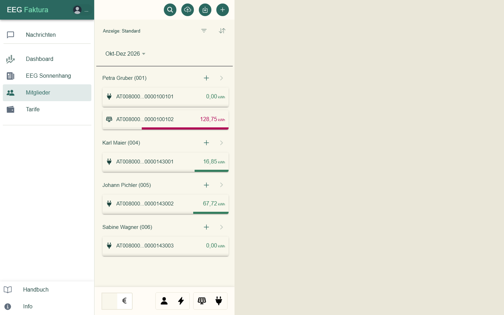
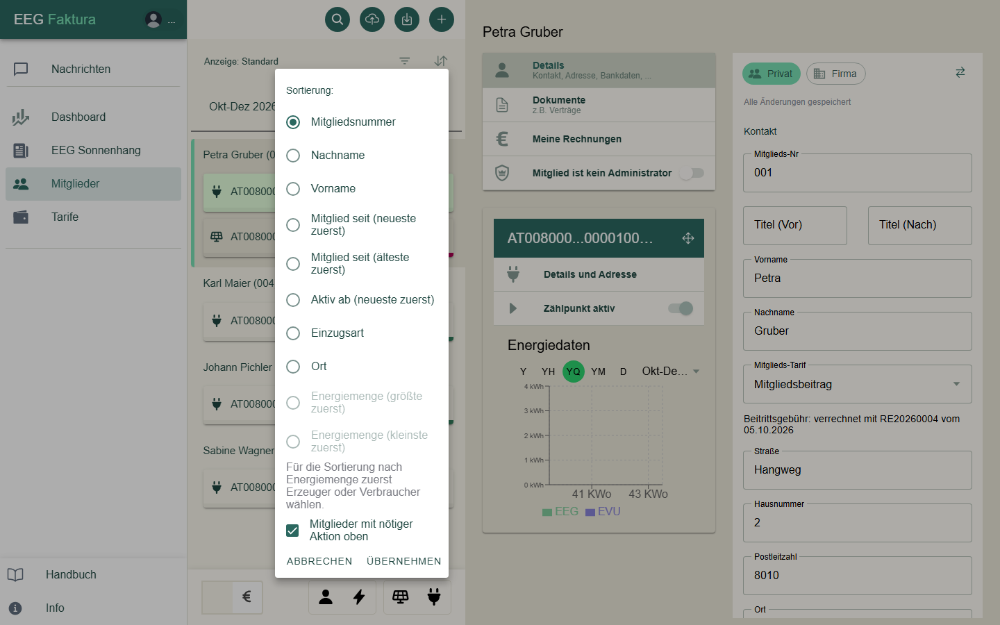
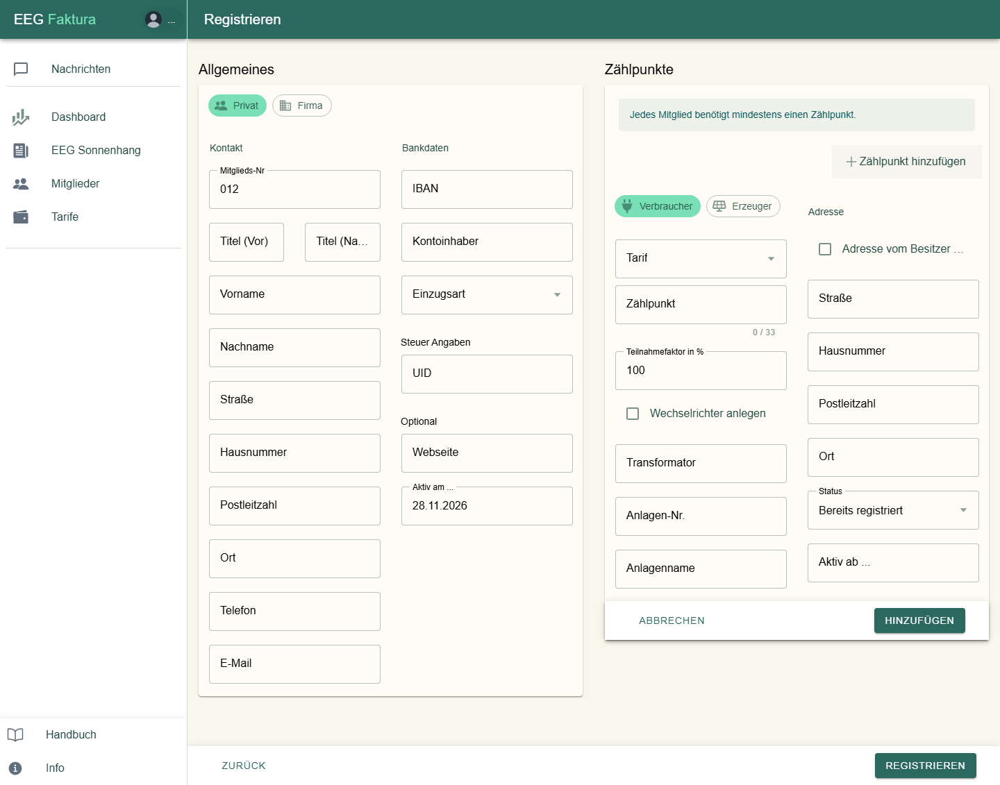

# Mitglieder & Zählpunkte

Unter **Mitglieder** verwaltest du die Mitglieder deiner Gemeinschaft und ihre Zählpunkte.

## Die Mitgliederliste

Jedes Mitglied steht mit seinem Namen und dahinter in Klammern seiner Mitgliedsnummer in der Liste, z. B.
„Max Mustermann (001)“; ein Mitglied ohne Nummer nur mit dem Namen. Darunter steht eine Karte je **Zählpunkt** mit
der Energiemenge im gewählten Zeitraum. Das Symbol zeigt die Richtung: ein **Stecker** für Verbrauch, ein
**Solarmodul** für Erzeugung. Abgewiesene, aufgehobene, ungültige und inaktive Zählpunkte tragen stattdessen ein „!“.
Der Balken unter dem Wert zeigt, welcher Teil des Verbrauchs aus der Gemeinschaft kam bzw. welcher Teil der Erzeugung
in die Gemeinschaft ging. Ein neuer Zählpunkt (orange) hat noch keinen Wert und keinen Balken.

### Knöpfe oben

| Knopf | Funktion |
|-------|----------|
| Lupe | **Suche**: blendet ein Suchfeld ein, die Liste filtert beim Tippen |
| Wolke mit Pfeil nach oben | **Import**: Stammdaten (Mitglieder und Zählpunkte) aus einer Excel-Datei einlesen; bei Gemeinschaften ohne Online-Anbindung auch Energiedaten |
| Pfeil nach unten | **Export**: Energiedaten für einen Zeitraum oder die Stammdaten herunterladen |
| Plus | **Neues Mitglied** anlegen (siehe unten) |

### Suche

Die Lupe oben blendet ein Suchfeld ein; die Liste filtert beim Tippen. Gesucht wird in Nachname, Vorname,
Mitgliedsnummer und E-Mail des Mitglieds sowie in Zählpunktnummer und Anlagenname seiner Zählpunkte.

- **Mehrere Begriffe** trennst du mit Leerzeichen. Gefunden werden die Mitglieder, bei denen **jeder** Begriff
  vorkommt, egal in welcher Reihenfolge: „huber maria“ findet Maria Huber, „huber 0815“ ein Mitglied Huber, bei dem
  „0815“ in der Mitgliedsnummer oder einer Zählpunktnummer vorkommt.
- **Trifft ein Begriff das Mitglied selbst** (Name, Nummer, E-Mail), siehst du alle seine Zählpunkte: „markt“ zeigt
  bei der „Marktgemeinde …“ jeden Zählpunkt.
- **Begriffe, die nur bei Zählpunkten vorkommen** (Anlagenname, Zählpunktnummer), grenzen die Zählpunkte ein:
  „markt pumpwerk“ zeigt bei der Marktgemeinde nur die Pumpwerke, „pv dach“ nur die Anlage „PV Dach“.

### Anzeige, Zeitraum und Sortierung

- Oben steht **Anzeige:** mit der gewählten Ansicht. Ein Klick darauf öffnet die Auswahl **Standard**, **Alle**,
  **Aktive** oder **Inaktive**; die Wahl gilt nach **Übernehmen**. Fährst du mit der Maus über den Eintrag, erklärt
  ein Hinweis die gewählte Ansicht.
    - **Standard** (voreingestellt): die Mitglieder mit Zählpunkten, die im gewählten Zeitraum aktiv sind, dazu
      Zählpunkte mit offenem Problem. Das ist die Ansicht für die Abrechnung. Den Zeitraum (z. B. „Okt-Dez 2026“)
      wählst du darunter.
    - **Alle**, **Aktive** und **Inaktive** zeigen die Mitglieder der Gemeinschaft mit dem Stand heute, unabhängig vom
      Zeitraum, jedes mit genau den Zählpunkten, die passen:
        - **Aktive**: Zählpunkte mit dem Status aktiv.
        - **Inaktive**: alle anderen Zählpunkte, z. B. Anmeldung läuft, abgewiesen, aufgehoben oder ausgetreten. Dazu
          aktive Zählpunkte, bei denen eine Aktion nötig ist (etwa eine laufende Aufhebung), und Mitglieder, die noch
          zugelassen werden müssen. Hier findest du also alles, was einen Blick braucht.
        - **Alle**: jedes Mitglied mit allen Zählpunkten. Ein Mitglied ganz ohne Zählpunkt steht nur dann in der
          Liste, wenn es noch zugelassen werden muss.

  

- Das Pfeil-Symbol ganz rechts öffnet die **Sortierung**: Mitgliedsnummer (voreingestellt), Nachname, Vorname,
  Mitglied seit (neueste bzw. älteste zuerst), Aktiv ab (neueste zuerst), Einzugsart, Ort oder Energiemenge (siehe
  [Nach Energiemenge sortieren](#nach-energiemenge-sortieren)). Mit dem Haken
  **Mitglieder mit nötiger Aktion oben** bleiben Mitglieder, bei denen etwas zu tun ist, vor den anderen; ohne Haken
  gilt die Sortierung für alle gleich. Die Wahl gilt nach **Übernehmen** und bleibt in deinem Browser gespeichert.

  

- Bei jedem Mitglied stehen die Verbraucher vor den Erzeugern.

### Nach Energiemenge sortieren

In der **Sortierung** gibt es **Energiemenge (größte zuerst)** und **Energiemenge (kleinste zuerst)**. Sortiert wird
nach den kWh im gewählten Zeitraum, die auch auf den Zählpunkten stehen: beim Verbraucher die Energie aus der
Gemeinschaft, beim Erzeuger die Einspeisung in die Gemeinschaft.

- Wähle unten in der Liste zuerst **Nur Erzeuger** oder **Nur Verbraucher**. Vorher sind die beiden Einträge grau,
  mit dem Hinweis „Für die Sortierung nach Energiemenge zuerst Erzeuger oder Verbraucher wählen.“ In der Ansicht
  **Nur Mitglieder** gibt es sie nicht.
- Mit **Nur Zählpunkte** steht jeder Zählpunkt für sich, sortiert über alle Mitglieder. So siehst du z. B. die
  größten Erzeuger der Gemeinschaft oben.
- Werden die Mitglieder angezeigt, zählt die Summe ihrer Zählpunkte; die Zählpunkte eines Mitglieds sind ebenfalls
  nach Energiemenge sortiert. Im Abrechnungsmodus bleiben die Zählpunkte immer beim Mitglied, die Reihenfolge richtet
  sich auch dort nach den kWh.
- Ein Zählpunkt ohne Energiedaten im Zeitraum zählt als 0 kWh und steht bei „kleinste zuerst“ oben.
- Der Haken **Mitglieder mit nötiger Aktion oben** gilt auch hier. Gleiche Werte bleiben nach der Mitgliedsnummer
  geordnet.
- Nimmst du die Auswahl Erzeuger oder Verbraucher wieder weg oder wechselst zu **Nur Mitglieder**, sortiert die
  Liste nach der Mitgliedsnummer. Deine Wahl bleibt gespeichert und gilt wieder, sobald die Energiemenge wählbar ist.

### Farben

| Farbe des Zählpunkts | Bedeutung |
|----------------------|-----------|
| Dunkelgrün | Zählpunkt ist aktiv (oder inaktiv mit früheren Daten) |
| Orange | neu angelegt und noch nicht angemeldet, oder eegFaktura wartet auf die Zustimmung des Mitglieds |
| Rot | vom Netzbetreiber abgewiesen, aufgehoben oder ungültig; derzeit auch, solange die erste Antwort oder die Abschlussmeldung des Netzbetreibers noch aussteht |

Rot heißt also nicht immer, dass etwas zu tun ist. Was gerade gilt, sagt der Hinweis beim Zählpunkt (siehe
[Status eines Zählpunkts](#status-eines-zahlpunkts)).

Ein Mitglied, das noch zugelassen werden muss, steht orange mit einem „!“ in der Liste; bei einem importierten
Mitglied sind nur die Zählpunkte orange. Steht neben einem Namen grau „inaktiv“, hat das Mitglied keinen aktiven
Zählpunkt mehr.

### Unten in der Liste

- Der Schalter **€** wechselt in den **Abrechnungsmodus**. Er gehört zur Abrechnung und wird im Kapitel
  [Abrechnung](05-abrechnung.md#abrechnungsmodus) beschrieben.
- Mit den Symbolen daneben wechselst du zwischen Mitgliedern und Zählpunkten und blendest Verbraucher oder Erzeuger
  ein und aus. Fährst du mit der Maus darüber, steht da, was sie tun: „Nur Mitglieder (Zählpunkte einklappen)“,
  „Nur Zählpunkte“, „Nur Erzeuger“, „Nur Verbraucher“.

## Ein Mitglied ansehen und ändern

Ein Klick auf ein Mitglied öffnet rechts seine Daten, zunächst mit dem ersten Zählpunkt:

| Eintrag | Inhalt |
|---------|--------|
| **Details** | Kontakt, Adresse, Bankdaten des Mitglieds |
| **Dokumente** | Dokumente zum Mitglied, z. B. Verträge |
| **Meine Rechnungen** | die Rechnungen und Gutschriften des Mitglieds |
| **Mitglied ist (kein) Administrator** | zeigt, ob das Mitglied EEG-Admin ist (nur Anzeige) |

**Details** öffnet das Formular des Mitglieds:

- Oben steht, ob das Mitglied **Privat** oder **Firma** ist. Ändern kannst du das als EEG-Admin über das
  Pfeil-Symbol daneben; eegFaktura warnt vorher (bei Privat → Firma wird der Vorname zum Firmennamen).
- **Kontakt**: Mitglieds-Nr, Titel, Vorname und Nachname (bei Firmen der Firmenname), **Mitglieds-Tarif**,
  Adresse, Telefon, E-Mail, UID.
- **Bankdaten**: IBAN, Kontoinhaber, **Einzugsart** (Kein SEPA, B2B oder CORE); bei Lastschrift zusätzlich
  **Bank (optional)**, Mandatsreferenz und Mandatsdatum. Den Namen der Bank musst du nicht eintragen; er steht nur auf
  der Rechnung und im Stammdaten-Export.
- **Optionals**: Mitglied seit.

Änderungen werden gespeichert, sobald du ein Feld verlässt. Über dem Formular steht, ob alles gespeichert ist
(„Alle Änderungen gespeichert“). Ein ungültiges Feld wird nicht gespeichert; eegFaktura markiert es und fragt nach,
bevor du das Mitglied verlässt. Ist die E-Mail-Adresse ungültig, steht neben dem Namen „E-Mail ungültig“.

### Beitrittsgebühr eines Mitglieds

Hat ein Tarif deiner Gemeinschaft eine [Beitrittsgebühr](04-tarife.md#beitrittsgebuhr), steht unter dem
**Mitglieds-Tarif** die Zeile **Beitrittsgebühr:** mit dem Stand für dieses Mitglied:

| Anzeige | Bedeutung |
|---------|-----------|
| verrechnet mit *Belegnummer* vom *Datum* | Die Gebühr steht auf dieser endgültigen Rechnung. |
| außerhalb bezahlt am *Datum* (*Notiz*) | Ihr habt eine Zahlung außerhalb von eegFaktura erfasst; die Gebühr wird nicht verrechnet. |
| zur Verrechnung im nächsten Abrechnungslauf vorgemerkt | Die Gebühr kommt mit der nächsten endgültigen Abrechnung. |
| offen – wird mit der ersten Energieabrechnung verrechnet | Das Mitglied wurde noch nie mit Energie abgerechnet; die Gebühr kommt automatisch mit seiner ersten Abrechnung. |
| nicht verrechnet – Mitglied wurde schon abgerechnet | Das Mitglied wurde schon vor der Gebühr abgerechnet; automatisch bekommt es sie nicht mehr. |
| kein Tarif mit Beitrittsgebühr | Der Mitglieds-Tarif dieses Mitglieds hat keine Beitrittsgebühr. |

Darunter stehen, je nach Stand, diese Knöpfe:

- **Beitrittsgebühr nachverrechnen** merkt die Gebühr für den nächsten endgültigen Abrechnungslauf vor, auch wenn das
  Mitglied schon abgerechnet wurde. eegFaktura nennt vorher Tarif, Betrag und Umsatzsteuer; es gilt der Tarifstand beim
  Abrechnen. Bestätigt wird mit **Nachverrechnen**. Den Knopf gibt es nur beim Stand „nicht verrechnet – Mitglied wurde
  schon abgerechnet“, also wenn das Mitglied schon mit Energie abgerechnet wurde, noch keine Gebühr verrechnet und
  keine Zahlung erfasst ist. Beim Stand „offen“ braucht es ihn nicht: Die Gebühr kommt dann ohnehin mit der ersten
  endgültigen Energieabrechnung.
- **Vormerkung zurücknehmen** hebt das Nachverrechnen wieder auf, solange es noch nicht abgerechnet ist.
- **Außerhalb bezahlt erfassen**: Hat das Mitglied die Gebühr z. B. bar beim Beitritt bezahlt, trägst du das **Datum
  der Zahlung** ein (Pflicht) und optional eine kurze Notiz. Einen Betrag gibt es nicht. Danach wird ihm die Gebühr
  nicht mehr verrechnet, auch nicht mit der ersten Abrechnung.
- **Zahlung korrigieren** und **Zahlung entfernen** ändern bzw. löschen die erfasste Zahlung; ohne sie gilt wieder der
  Stand ohne Zahlung (offen, oder „nicht verrechnet“, wenn das Mitglied schon abgerechnet wurde).

Vormerken und „außerhalb bezahlt“ schließen sich aus. Ist die Gebühr einmal verrechnet, lässt sich nichts mehr ändern.

Wählst du für ein Mitglied, das schon abgerechnet wurde, einen Tarif mit Beitrittsgebühr, weist eegFaktura beim Tarif
darauf hin: „Dieses Mitglied wurde schon abgerechnet – die Beitrittsgebühr wird ihm nicht mehr automatisch
verrechnet. …“ Zuweisen kannst du den Tarif trotzdem; mit **Beitrittsgebühr nachverrechnen** kommt die Gebühr dann
in den nächsten Abrechnungslauf.

Ist die Abrechnung gerade nicht erreichbar, fehlen die Zeile und die Knöpfe.

### Neues Mitglied zulassen

Ein neues Mitglied — von dir angelegt oder über eine Registrierung hereingekommen — steht zuerst orange mit „!“ in
der Liste und wartet auf die Zulassung. Rechts fragt eegFaktura: „Möchtest du *Nachname* in deine EEG aufnehmen?“

- **Ja, Zulassen** öffnet den Dialog „*Name* zulassen“. Dort kannst du **Anmeldedokumente** hochladen (z. B. den
  unterschriebenen Beitritt) und die Zählpunkte auswählen, die angemeldet werden sollen. Mit **Zulassen** wird das
  Mitglied aufgenommen.
- **Nein, Löschen** löscht das Mitglied mit allen Zählpunkten. Das lässt sich nicht rückgängig machen.

Was das Zulassen bewirkt, hängt von der Gemeinschaft ab:

- **Mit Online-Anbindung:** eegFaktura meldet die angehakten Zählpunkte beim Netzbetreiber an; das Mitglied bestätigt
  danach die Datenfreigabe. Vor dem Zulassen wird nichts angemeldet. Einen nicht angehakten Zählpunkt meldest du
  später unter **Prozesse → Zählpunkt aktivieren** an.
- **Ohne Online-Anbindung:** Alle Zählpunkte des Mitglieds werden mit dem Zulassen aktiv.

## Zählpunkte

Ein Klick auf eine Zählpunkt-Karte zeigt dessen Daten. Über dem Zählpunkt steht seine Nummer; das Pfeilkreuz
daneben **verschiebt** den Zählpunkt zu einem anderen Mitglied (bisherige Rechnungen bleiben beim alten Mitglied).

- **Details und Adresse**: Richtung, Tarif, Zählpunktnummer, Teilnahmefaktor, Wechselrichter, Transformator,
  Anlagen-Nr., Anlagenname, die Adresse des Zählpunkts und das Datum **Aktiv ab …**; je nach Gemeinschaft auch
  Verteilungsfaktor und Netzbetreiber.
- **Zählpunkt aktiv**: zeigt, ob der Zählpunkt aktiv ist (nur Anzeige).
- **Energiedaten**: ein Diagramm der Energiedaten des Zählpunkts (bei aktiven und früher aktiven Zählpunkten).

Die **Richtung** (Verbraucher/Erzeuger) eines angemeldeten Zählpunkts ist gesperrt. Ein EEG-Admin kann sie über das
Pfeil-Symbol ändern; eegFaktura warnt vorher, denn die Änderung wird **nicht** an den Netzbetreiber gemeldet.
Der bisherige Tarif bleibt dabei gespeichert, auch wenn das Feld ihn nicht mehr anzeigt: Wähle danach einen Tarif
der neuen Richtung.

### Status eines Zählpunkts

Ist ein Zählpunkt nicht aktiv, steht über den Details ein Hinweis zum Stand:

| Hinweis | Bedeutung |
|---------|-----------|
| Antwort des Netzbetreibers noch ausstehend. | Die Anmeldung ist beim Netzbetreiber, er hat noch nicht geantwortet. |
| Zustimmung des Mitglieds noch ausstehend. | Das Mitglied muss die Datenfreigabe noch bestätigen; es bekommt dazu die Mail „Freigabe-Aufforderung“. Dauert es länger, erinnere das Mitglied — nach Ablauf der Frist (30 Arbeitstage) lehnt der Netzbetreiber ab. |
| Abschlussmeldung vom Netzbetreiber noch ausstehend. | Das Mitglied hat zugestimmt, die Abschlussmeldung des Netzbetreibers fehlt noch. Ohne Smart Meter kann das dauern, bis der Netzbetreiber ihn eingebaut hat; du musst dafür nichts tun. |
| Zählpunkt wurde vom Netzbetreiber abgewiesen. | Der Netzbetreiber hat die Anmeldung abgelehnt. |
| Zählpunkt wurde vom Netzbetreiber nicht angenommen. | Die Anmeldung war ungültig, z. B. weil die Zählpunktnummer nicht gefunden wurde. |
| Zählpunkt wurde vom Netzbetreiber aufgehoben. | Der Netzbetreiber hat die Teilnahme beendet. |
| Zählpunkt inaktiv seit … / inaktiv am … | Der Zählpunkt gehört nicht mehr zur Gemeinschaft („am“: das Ende liegt noch in der Zukunft). |
| Zählpunkt wurde archiviert. | Der Zählpunkt ist abgeschlossen und nur noch zur Ansicht da. |
| Zählpunkt hat eine Warnung, bitte die Prozess History prüfen. | Beim Netzbetreiber gab es eine Unstimmigkeit, siehe **Prozesse → Prozess History**. |

Bei Abweisung oder Nichtannahme steht der **Grund** fett dahinter, z. B. „Kunde hat Datenfreigabe abgelehnt“. Danach
richtest du dich: Ist der Fehler behoben (z. B. Nummer korrigiert), meldest du den Zählpunkt unter
**Prozesse → Zählpunkt aktivieren** erneut an.

Steht kein Grund da, sieh in der **Prozess History** nach. Bei „Noch kein fernauslesbarer Zähler eingebaut“ oder
„Summe der gemeldeten Aufteilungsschlüssel übersteigt 100%“ läuft die Anmeldung beim Netzbetreiber weiter: **nicht
löschen und nicht neu anmelden** (siehe [Häufige Ablehnungsgründe](08-prozesse.md#haufige-ablehnungsgrunde)).

Einen nicht angenommenen Zählpunkt, der noch nie aktiv war, kannst du hier mit **Löschen** entfernen — außer in den
beiden Fällen oben.

## Neues Mitglied anlegen

Lege zuerst die [Tarife](04-tarife.md) an — beim Zählpunkt wählst du einen davon aus.

1. Klicke in der Mitgliederliste oben auf **Plus**. Es öffnet sich **Registrieren**.

    

2. Wähle **Privat** oder **Firma** und fülle **Allgemeines** aus. Pflicht sind Vorname und Nachname (bzw.
   Firmenname), Straße, Hausnummer, Postleitzahl, Ort, E-Mail und die **Einzugsart**; bei **CORE** und **B2B** auch
   IBAN, Kontoinhaber, Mandatsreferenz (mit der Mitglieds-Nr vorbelegt) und Mandatsdatum. Die **Mitglieds-Nr** ist
   mit der nächsten freien Nummer vorbelegt.
    - Unter **Optional** steht das Datum **Aktiv am …**, vorbelegt mit heute. eegFaktura speichert es als „Mitglied
      seit“ und meldet die Zählpunkte beim Zulassen ab diesem Tag beim Netzbetreiber an, frühestens ab morgen.
3. Jedes Mitglied braucht mindestens einen Zählpunkt: Klicke auf **Zählpunkt hinzufügen**.

    

4. Wähle **Verbraucher** oder **Erzeuger** und den **Tarif**. Gib die **Zählpunktnummer** ein: 33 Zeichen, `AT`,
   dann sechs Ziffern des Netzbetreibers, dann 25 Ziffern oder Großbuchstaben. Leerzeichen und Striche entfernt
   eegFaktura beim Einfügen. Der **Teilnahmefaktor in %** ist mit 100 vorbelegt. Die Adresse des Zählpunkts ist
   Pflicht; mit **Adresse vom Besitzer übernehmen** wird die Adresse des Mitglieds eingetragen.
    - Bei Gemeinschaften mit Online-Anbindung lässt du das Datum **Aktiv ab …** leer: Es kommt mit der Meldung des
      Netzbetreibers.
    - Bei Gemeinschaften ohne Online-Anbindung wählst du zusätzlich den **Status** („Noch nicht registriert“ oder
      „Bereits registriert“) und trägst **Aktiv ab …** ein.
5. Klicke auf **Hinzufügen** — erst damit steht der Zählpunkt in der Liste. Weitere Zählpunkte fügst du genauso
   hinzu.
6. Klicke auf **Registrieren**. Verlässt du die Seite vor dem Speichern, fragt eegFaktura nach.
   **Achtung:** Ohne **Hinzufügen** wird das Mitglied ohne Zählpunkt angelegt. Du findest es dann nur unter
   **Anzeige: Alle** oder **Inaktive**.
7. Das Mitglied steht jetzt orange mit „!“ in der Liste und wartet auf die Zulassung. **Lasse es zu** (siehe
   [Neues Mitglied zulassen](#neues-mitglied-zulassen)) — erst dann werden die Zählpunkte beim Netzbetreiber
   angemeldet bzw. aktiv. Den Fortschritt siehst du am Status des Zählpunkts.

### Zählpunkt vor dem Registrieren ändern oder entfernen

Einen schon eingetragenen Zählpunkt kannst du vor dem **Registrieren** noch korrigieren: Klicke auf seine Karte, ändere
die Angaben und klicke auf **Übernehmen**. **Entfernen** nimmt ihn wieder aus der Liste. Jede Zählpunktnummer steht
nur einmal in der Liste: Trägst du eine Nummer ein, die schon dasteht, ersetzt der neue Eintrag den alten.

### Zählpunkt zu einem bestehenden Mitglied hinzufügen

Klicke in der Mitgliederliste beim Mitglied auf **+**. Bei einem Mitglied, das orange mit „!“ auf die Zulassung
wartet, gibt es das **+** noch nicht. Das Formular ist dasselbe wie oben; gespeichert wird mit **Registrieren**. Ist das Mitglied schon zugelassen, meldet eegFaktura den neuen Zählpunkt bei Gemeinschaften mit
Online-Anbindung gleich beim Netzbetreiber an.
## Stammdaten aus Excel importieren

Viele Mitglieder auf einmal — z. B. beim Umstieg auf eegFaktura — liest du aus einer Excel-Datei ein: oben in der
Mitgliederliste der Knopf mit der Wolke, **Stammdaten**, **Sheet-Name** (voreingestellt „EEG Stammdaten“; heißt das
Blatt in deiner Datei anders, trägst du hier seinen Namen ein), die Datei mit dem Stern wählen oder in das Fenster
ziehen, **Import**. Es geht eine Datei je Import. Eine Vorlage mit allen Spalten gibt es hier; Zeile 5 erklärt die
wichtigsten Spalten:
[Vorlage Stammdatenimport (Excel)](https://github.com/eegfaktura/eegfaktura-backend/raw/master/tests/261124-vorlage-import-stammdaten.xlsx).
Ältere Vorlagen funktionieren weiter: eegFaktura erkennt die Spalten an ihrer Überschrift, nicht an der Position.

Wichtige Spalten:

| Spalte | Hinweis |
|--------|---------|
| Gemeinschafts-ID | Pflicht, muss zur Gemeinschaft passen |
| Name 1 / Name 2 | Vorname / Nachname (bei Firmen: Firmenname / Nachname der Kontaktperson). Groß-/Kleinschreibung zählt beim Wiedererkennen. Ist „Name 1“ leer, muss „Name 2“ „Nachname Vorname“ enthalten |
| BusinessRole | `business` für eine Firma, sonst privat |
| Mitglied seit | Excel-Datum oder `TT.MM.JJJJ`; leer = Spalte „Dokument unterschrieben“ (ältere Vorlagen), sonst heute |
| Zählpunkt | genau 33 Zeichen |
| Energierichtung | `CONSUMPTION` (Verbraucher, auch leer) oder `GENERATION` (Erzeuger) |
| Zählpunktstatus | Pflicht. `ACTIVE`, `ACTIVATED` oder `REGISTERED` → wird als **aktiv** übernommen; `NEW` → wird neu angemeldet; andere Werte → Zeile wird nicht importiert |
| registriert seit | ab wann der Zählpunkt aktiv ist; **leer = 1. Jänner des laufenden Jahres**. Ältere Energiedaten werden davor weder angefordert noch abgerechnet — beim Umstieg das tatsächliche Datum eintragen |
| Zugeteilte Menge in Prozent | Teilnahmefaktor (1–100); leer oder 0 wird 100 % |
| email | mehrere Adressen mit `;` trennen; ist eine Adresse ungültig, wird das Mitglied ohne E-Mail angelegt (mit Hinweis) |
| Einzugsart | `CORE`, `B2B` oder `Kein SEPA`. Leer: kein Einzug; hat das Mitglied eine IBAN, kommt ein Hinweis |
| MandatRef | Mandatsreferenz für die Lastschrift. Leer: Die Abrechnung nimmt die Mitgliedsnummer. Die Bank nimmt sie nur ohne Leerzeichen und Umlaute an (höchstens 35 Zeichen) – sonst die Mandatsreferenz ausfüllen |
| MandatDat | Datum, an dem das Mitglied das Mandat unterschrieben hat (Excel-Datum oder `TT.MM.JJJJ`); bei `CORE` und `B2B` immer ausfüllen |
| ObjektName | wird als Anlagenname übernommen |
| Mitgliedstarif | Name eines aktiven Mitgliedstarifs eurer Gemeinschaft, so geschrieben wie im Stammdaten-Export (Groß-/Kleinschreibung egal). Leer: kein Tarif. Steht das Mitglied in mehreren Zeilen, zählt die erste ausgefüllte |
| Zp. Tarifname | Name eines aktiven Zählpunkttarifs, passend zur Energierichtung (Verbrauch bzw. Erzeugung). Leer: kein Tarif |

So verhält sich der Import:

- Zählpunkte, die beim Netzbetreiber **schon aktiv** sind, importierst du mit Status aktiv — mit `NEW` würden sie
  erneut angemeldet.
- Ein Mitglied mit gleichem Vor- und Nachnamen wie ein vorhandenes gilt als **dasselbe**: Es bekommt die Zählpunkte
  aus der Datei, seine übrigen Daten werden **nicht** geändert. Hat es einen dieser Zählpunkte schon, wird für dieses
  Mitglied nichts importiert (Fehler unter Nachrichten) — nimm dann nur die neuen Zählpunkte in die Datei.
- Zählpunkte mit `NEW` bei einem schon zugelassenen Mitglied legt der Import nur an. Melde sie danach unter
  **Prozesse → Zählpunkt aktivieren** an.
- Ein Fehler betrifft nur das jeweilige Mitglied; die übrigen Zeilen werden trotzdem importiert. Datumsfelder dürfen
  Excel-Datum oder Text (`TT.MM.JJJJ`) sein.
- Hinweise und Fehler (z. B. doppelte Mitgliedsnummer, Zählpunkt mit falscher Länge) kommen als Nachricht
  **„Excel Stammdaten importiert — Hinweise: …“** unter [Nachrichten](07-nachrichten.md). Die Hinweise stehen
  derzeit großteils auf Englisch. Die häufigsten:
    - „Rows skipped: 'Gemeinschafts-ID' …“: Die Gemeinschafts-ID fehlt oder passt nicht zu deiner Gemeinschaft.
    - „Len not equal 33“: Die Zählpunktnummer hat nicht 33 Zeichen.
    - „Participant has wrong status“: Der Zählpunktstatus ist leer oder kein erlaubter Wert.
    - „unknown 'Energierichtung'“: Erlaubt sind `CONSUMPTION` und `GENERATION`.
    - „no active tariff named …“: Einen aktiven Tarif mit diesem Namen gibt es nicht.
    - „MitgliedsNr … is already assigned …“ oder „… is used by several members“: Die Mitgliedsnummer ist schon
      vergeben oder steht in der Datei bei mehreren Mitgliedern.
    - „… have no direct debit type“: Mitglieder mit IBAN, aber ohne Einzugsart; sie werden nicht eingezogen.
- Einzugsart, Mandatsreferenz, Mandatsdatum und Mitgliedstarif gelten nur für Mitglieder, die der Import neu
  anlegt. Der Zählpunkttarif gilt für jeden neu angelegten Zählpunkt, auch bei einem schon vorhandenen Mitglied.
- Einen unbekannten Tarifnamen oder einen Tarif der falschen Art meldet der Import; das Mitglied bzw. der Zählpunkt
  wird dann ohne Tarif angelegt.
- Bekommt ein neues Mitglied einen Tarif mit [Beitrittsgebühr](04-tarife.md#beitrittsgebuhr), weist die Nachricht
  darauf hin: Die Gebühr wird mit der ersten Energieabrechnung verrechnet, auch wenn das Mitglied sie schon früher
  bezahlt hat (z. B. vor dem Umstieg). Dann beim Mitglied **Außerhalb bezahlt erfassen**, siehe
  [Beitrittsgebühr eines Mitglieds](#beitrittsgebuhr-eines-mitglieds).

### Import zuerst mit wenigen Mitgliedern testen

Bevor du alle Mitglieder einliest, probiere den Import mit **zwei oder drei Mitgliedern** aus. So siehst du, ob die
Spalten passen, ohne dass sich Fehler in Hunderten Mitgliedern wiederfinden.

> **Wichtig:** Ein Mitglied, dessen Zählpunkte in der Spalte **Zählpunktstatus** als aktiv eingetragen sind
> (`ACTIVE`, `ACTIVATED` oder `REGISTERED`), kannst du nach dem Import **nicht mehr löschen**. Deshalb läuft der Test
> mit dem Status `NEW`: Solche Mitglieder lassen sich wieder löschen.

**1. Testdatei anlegen.** Kopiere deine Importdatei und lass darin nur zwei oder drei Mitglieder stehen, am besten
verschiedene Fälle: einen Verbraucher, einen Erzeuger, ein Mitglied mit mehreren Zählpunkten, ein Mitglied mit
Einzugsart **Kein SEPA**. Nimm nur Mitglieder, die **noch nicht** in eegFaktura stehen. Ein Mitglied mit gleichem
Vor- und Nachnamen gilt als dasselbe, und dessen neue Zählpunkte könntest du nicht mehr mit dem Mitglied löschen.
Setze in der Testdatei die Spalte **Zählpunktstatus** in **allen** Zeilen auf `NEW`, auch bei mehreren Zeilen
desselben Mitglieds.

**2. Importieren.** Lies die Testdatei wie oben beschrieben ein. Der Import selbst schickt **nichts** an den
Netzbetreiber.

**3. Prüfen.**

- Unter [Nachrichten](07-nachrichten.md) nach der Nachricht **„Excel Stammdaten importiert — Hinweise: …“** sehen.
  Jeder Hinweis nennt ein Mitglied oder einen Zählpunkt, den du in der großen Datei auch korrigieren solltest. Kommt
  keine solche Nachricht, gab es nichts zu beanstanden.
- In der Mitgliederliste jedes Testmitglied öffnen: Name, Adresse, E-Mail, Bankverbindung und Einzugsart, die
  Zählpunkte mit Energierichtung, Teilnahmefaktor und Anlagenname.

**4. Testmitglieder wieder löschen.** Bei den Testmitgliedern sind die Zählpunkte orange, der Name selbst ist es
bei importierten Mitgliedern nicht. Öffne jedes. Rechts steht
die Frage „Möchtest du *Nachname* in deine EEG aufnehmen?“ (siehe [Neues Mitglied zulassen](#neues-mitglied-zulassen)).
Klicke auf **Nein, Löschen** und bestätige die Rückfrage mit **Löschen**. Lösche **alle** Testmitglieder. Ein
übrig gebliebenes Testmitglied würde der große Import nicht mehr richtigstellen (siehe unten).

!!! danger "Nicht auf „Ja, Zulassen“ klicken"
    Bei Gemeinschaften mit Online-Anbindung meldet eegFaktura die Zählpunkte damit beim Netzbetreiber an. Ohne
    Online-Anbindung werden sie aktiv. In beiden Fällen lässt sich das Mitglied danach nicht mehr löschen.

**5. Korrigieren und wiederholen.** Passe die große Datei an. Wiederhole den Test mit den Schritten 2 bis 4, bis
keine Hinweise mehr kommen, und lösche die Testmitglieder jedes Mal wieder.

**6. Alle Mitglieder importieren.** Trage in der großen Datei bei Zählpunkten, die beim Netzbetreiber schon aktiv
sind, den Status aktiv und unter „registriert seit“ das tatsächliche Datum ein. Importiere dann die vollständige
Datei.

Gut zu wissen:

- **Aktiven Status mitprüfen:** Den Status aktiv und das Datum „registriert seit“ prüft der Test mit `NEW` nicht.
  Willst du auch das sehen, importiere vor Schritt 6 zuerst **einige echte Mitglieder** mit ihrem richtigen Status
  und prüfe sie. Diese Mitglieder bleiben in eegFaktura. **Nimm sie danach aus der großen Datei heraus**, sonst
  meldet der große Import für jedes von ihnen einen Fehler.
- **Ein erneuter Import ändert keine vorhandenen Mitglieder.** Einen Fehler an einem schon importierten Mitglied
  korrigierst du direkt beim Mitglied in eegFaktura.
- **Ein Testmitglied wurde nicht gelöscht:** Steht es auch in der großen Datei, meldet der Import für dieses Mitglied
  einen Fehler (unter Nachrichten) und lässt es mit dem Teststatus stehen. Lösche es mit **Nein, Löschen** und
  importiere eine Datei nur mit diesem Mitglied noch einmal.
- Ist beim großen Import etwas schiefgegangen, wende dich an den [Support](einrichtung-hilfe.md#hilfe-und-support).

## Gut zu wissen

- **Mehrere E-Mail-Adressen** eines Mitglieds trennst du mit `;` (ohne Leerzeichen); Mails gehen an alle gültigen
  Adressen.
- **Mitglied ohne E-Mail:** Beim Anlegen und Ändern verlangt eegFaktura eine E-Mail-Adresse. Ohne Adresse kommt ein
  Mitglied nur über den [Stammdaten-Import](#stammdaten-aus-excel-importieren) in die Liste (Spalte leer); es bekommt
  dann keine Mails. Das Feld E-Mail selbst kannst du danach nur mit einer gültigen Adresse speichern. Trage keine
  erfundene Adresse ein — an sie wird geschickt.
- **Mitglied ohne Konto:** Wähle die Einzugsart **Kein SEPA**; die IBAN darf dann leer bleiben.
- **Anlagenname:** Hat ein Zählpunkt einen Anlagennamen, steht in der Liste dieser Name statt der Nummer, in den
  Prozessen „Verbraucher - Name - Nummer“ bzw. „Erzeuger - Name - Nummer“ — praktisch bei mehreren Anlagen eines
  Mitglieds.
- **Aktiv ab:** Bei Online-Anmeldungen setzt eegFaktura das Datum aus der Meldung des Netzbetreibers, beim Import
  aus der Spalte „registriert seit“. Es begrenzt, ab wann Energiedaten angefordert und abgerechnet werden; ändere es nur, wenn es nicht
  zum Netzbetreiber passt.
- **Ein Mitglied verlässt die Gemeinschaft:** Melde seine Zählpunkte ab
  ([Zählpunkt abmelden](08-prozesse.md#zahlpunkt-abmelden)) statt das Mitglied zu löschen — so bleiben seine Daten und
  Belege erhalten. Bei importierten Zählpunkten fehlt eegFaktura manchmal die Kennung der Datenfreigabe (Consent-ID);
  dann zuerst die [Teilnehmerliste anfordern](08-prozesse.md#teilnehmerliste-anfordern) — eegFaktura trägt die
  Kennung beim Eintreffen der Liste selbst ein, danach die Abmeldung noch einmal anfordern.
- **Zählpunkt schon vergeben:** Ist ein Zählpunkt schon einem anderen Mitglied deiner Gemeinschaft zugeordnet, lässt
  er sich nicht noch einmal anlegen. Verschiebe ihn beim anderen Mitglied mit dem Pfeilkreuz oder melde ihn dort ab.
  Hat das Mitglied den Zählpunkt schon (z. B. inaktiv nach einer Abmeldung), meldest du ihn unter
  **Prozesse → Zählpunkt aktivieren** wieder an. War der Zählpunkt bei diesem Mitglied schon einmal angelegt und
  wurde verschoben oder archiviert, lässt er sich dort nicht neu anlegen — wende dich an den
  [Support](einrichtung-hilfe.md#hilfe-und-support).
- **Ein Zählpunkt wechselt den Besitzer** (z. B. Mieterwechsel): Verschiebe ihn mit dem Pfeilkreuz zum neuen Mitglied
  oder melde ihn beim alten ab und beim neuen an; bisherige Rechnungen bleiben beim alten Mitglied.
- **Teilnahmefaktor:** 1 bis 100 %. Nimmt ein Zählpunkt an mehreren Gemeinschaften teil, darf die Summe 100 % nicht
  übersteigen — senke den Faktor zuerst in der einen Gemeinschaft, bevor du ihn in der anderen erhöhst.

## Dokumente eines Mitglieds

Unter **Dokumente** legst du Unterlagen zum Mitglied ab, z. B. den unterschriebenen Beitritt. Sie stehen dort unter
**Verträge**. **Hochladen** (bzw. **Hinzufügen**) öffnet das Fenster zum Hochladen; erlaubt sind PDF, PNG und JPEG:

- Mit **Datei auswählen** fügst du eine Datei hinzu; du kannst auch mehrere Dateien auf einmal in das Fenster ziehen.
  Andere Dateiarten nimmt eegFaktura nicht und nennt sie in einem Hinweis. Mit dem Papierkorb nimmst du eine Datei
  wieder aus der Liste; **Hochladen** lädt alle hoch. Zeigt die Dateiauswahl eine `.jpg`-Datei nicht an, ziehe sie
  in das Fenster.
- Ziehst du Dateien direkt auf den Bereich **Verträge** eines Mitglieds, öffnet sich das Fenster gleich mit diesen
  Dateien. Hochgeladen wird erst mit **Hochladen**.

Ein Klick auf ein Dokument öffnet es, das Papierkorb-Symbol löscht es endgültig. Dieselben Anmeldedokumente kannst
du auch beim [Zulassen](#neues-mitglied-zulassen) hochladen.

## Prozesse beim Netzbetreiber

Vorgänge wie Daten nachfordern, einen Zählpunkt abmelden oder den Teilnahmefaktor ändern findest du unter
**Prozesse**; sie sind im Kapitel [Prozesse beim Netzbetreiber](08-prozesse.md) beschrieben.
