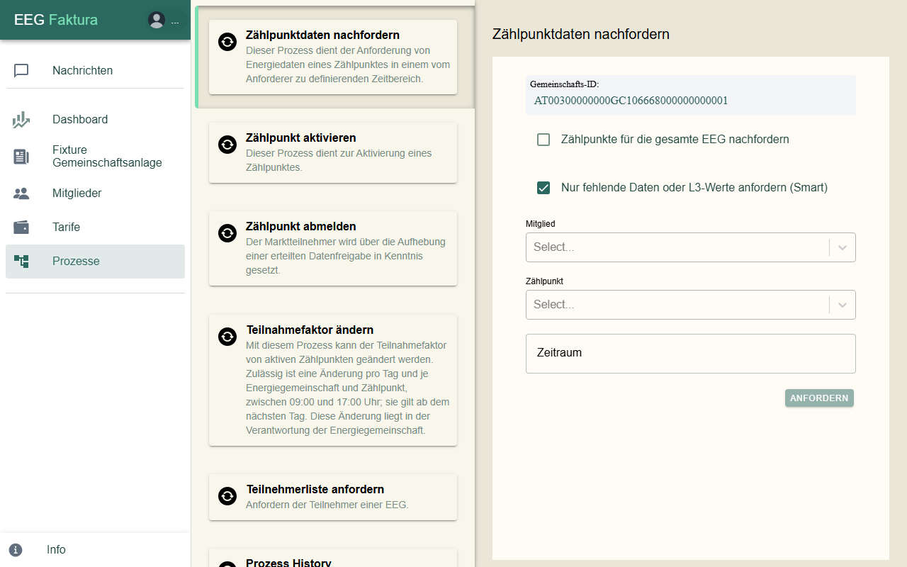

# Mitglieder & Zählpunkte

Unter **Mitglieder** verwaltest du die Mitglieder deiner Gemeinschaft und ihre Zählpunkte.

## Die Mitgliederliste

Jedes Mitglied steht mit seinem Namen in der Liste, darunter eine Karte je **Zählpunkt** mit der Energiemenge im
gewählten Zeitraum. Das Symbol zeigt die Richtung: ein **Stecker** für Verbrauch, ein **Solarmodul** für Erzeugung.
Der Balken unter dem Wert zeigt den Anteil des Zählpunkts.

### Knöpfe oben

| Knopf | Funktion |
|-------|----------|
| Lupe | **Suche**: blendet ein Suchfeld ein, die Liste filtert beim Tippen |
| Wolke mit Pfeil nach oben | **Import**: Stammdaten (Mitglieder und Zählpunkte) aus einer Excel-Datei einlesen; bei Gemeinschaften ohne Online-Anbindung auch Energiedaten |
| Pfeil nach unten | **Export**: Daten für einen Zeitraum herunterladen |
| Plus | **Neues Mitglied** anlegen (siehe unten) |

### Zeitraum, Filter und Sortierung

- **Periode** zeigt alle Mitglieder. Den Zeitraum (z. B. „Okt-Dez 2026“) wählst du darunter.
- Der zweite Reiter filtert die Liste. Über das Filter-Symbol wählst du **Aktive**, **Ausstehende**, **Inaktive**
  oder **Abgewiesene**.

  

- Das Pfeil-Symbol ganz rechts öffnet die **Sortierung**: Standard, Nachname, Vorname, Mitgliedsnummer oder
  Mitglied seit (neueste bzw. älteste zuerst). Mitglieder, bei denen eine Aktion nötig ist, bleiben immer oben.

  

### Farben

| Farbe des Zählpunkts | Bedeutung |
|----------------------|-----------|
| Dunkelgrün | Zählpunkt ist aktiv (oder inaktiv mit früheren Daten) |
| Orange | Anmeldung läuft noch, z. B. wartet eegFaktura auf den Netzbetreiber oder auf die Zustimmung des Mitglieds |
| Rot | vom Netzbetreiber abgewiesen, aufgehoben oder ungültig |

Ein Mitglied, das noch zugelassen werden muss, steht orange mit einem „!“ in der Liste. Steht neben einem Namen
grau „inaktiv“, hat das Mitglied keinen aktiven Zählpunkt mehr.

### Unten in der Liste

- Der Schalter **€** wechselt in den **Abrechnungsmodus**. Er gehört zur Abrechnung und wird im Kapitel
  Abrechnung beschrieben.
- Mit den Symbolen daneben wechselst du zwischen Mitgliedern und Zählpunkten und blendest Verbraucher oder Erzeuger
  ein und aus.

## Ein Mitglied ansehen und ändern

Ein Klick auf ein Mitglied öffnet rechts seine Daten, zunächst mit dem ersten Zählpunkt:

| Eintrag | Inhalt |
|---------|--------|
| **Details** | Kontakt, Adresse, Bankdaten des Mitglieds |
| **Dokumente** | Dokumente zum Mitglied, z. B. Verträge |
| **Meine Rechnungen** | die Rechnungen und Gutschriften des Mitglieds |
| **Mitglied ist (kein) Administrator** | zeigt, ob das Mitglied EEG-Admin ist (nur Anzeige) |

**Details** öffnet das Formular des Mitglieds:

- Oben wählst du **Privat** oder **Firma**.
- **Kontakt**: Mitglieds-Nr, Titel, Vorname und Nachname (bei Firmen der Firmenname), **Mitglieds-Tarif**,
  Adresse, Telefon, E-Mail, UID.
- **Bankdaten**: IBAN, Kontoinhaber, **Einzugsart** (Kein SEPA, B2B oder CORE); bei Lastschrift zusätzlich
  Bankverbindung, Mandatsreferenz und Mandatsdatum.
- **Optionals**: Mitglied seit.

Änderungen werden gespeichert, sobald du ein Feld verlässt.

### Neues Mitglied zulassen

Wartet ein neues Mitglied auf deine Zulassung (orange mit „!“ in der Liste), fragt eegFaktura:
„Möchtest du *Name* in deine EEG aufnehmen?“

- **Ja, Zulassen** öffnet einen Dialog mit den Zählpunkten des Mitglieds; mit **Zulassen** wird es aufgenommen.
- **Nein, Löschen** löscht das Mitglied mit allen Zählpunkten. Das lässt sich nicht rückgängig machen.

## Zählpunkte

Ein Klick auf eine Zählpunkt-Karte zeigt dessen Daten. Über dem Zählpunkt steht seine Nummer; das Pfeilkreuz
daneben **verschiebt** den Zählpunkt zu einem anderen Mitglied (bisherige Rechnungen bleiben beim alten Mitglied).

- **Details und Adresse**: Richtung, Tarif, Zählpunktnummer, Teilnahmefaktor, Wechselrichter, Transformator,
  Anlagen-Nr., Anlagenname und die Adresse des Zählpunkts.
- **Zählpunkt aktiv**: zeigt, ob der Zählpunkt aktiv ist (nur Anzeige).
- **Energiedaten**: ein Diagramm der Energiedaten des Zählpunkts (nur bei aktiven Zählpunkten).

### Status eines Zählpunkts

Ist ein Zählpunkt nicht aktiv, steht über den Details ein Hinweis zum Stand:

| Hinweis | Bedeutung |
|---------|-----------|
| Antwort des Netzbetreibers noch ausstehend. | Die Anmeldung ist beim Netzbetreiber, er hat noch nicht geantwortet. |
| Zustimmung des Mitglieds noch ausstehend. | Das Mitglied muss die Datenfreigabe noch bestätigen (es bekommt dazu die Mail „Freigabe-Aufforderung“). |
| Abschlussmeldung vom Netzbetreiber noch ausstehend. | Das Mitglied hat zugestimmt, die Abschlussmeldung des Netzbetreibers fehlt noch. |
| Zählpunkt wurde vom Netzbetreiber abgewiesen. | Der Netzbetreiber hat die Anmeldung abgelehnt. |
| Zählpunkt inaktiv seit … | Der Zählpunkt gehört nicht mehr zur Gemeinschaft. |
| Zählpunkt hat eine Warnung, bitte die Prozess History prüfen. | Beim Netzbetreiber gab es eine Unstimmigkeit, siehe **Prozesse → Prozess History**. |

Einen ungültigen Zählpunkt, der nie angemeldet wurde, kannst du hier mit **Löschen** entfernen.

## Neues Mitglied anlegen

1. Klicke in der Mitgliederliste oben auf **Plus**. Es öffnet sich **Registrieren**.

    

2. Wähle **Privat** oder **Firma** und fülle **Allgemeines** aus. Pflicht sind Vorname und Nachname (bzw.
   Firmenname), Straße, Hausnummer, Postleitzahl, Ort, E-Mail und die **Einzugsart**. Die **Mitglieds-Nr** ist
   mit der nächsten freien Nummer vorbelegt.
3. Jedes Mitglied braucht mindestens einen Zählpunkt: Klicke auf **Zählpunkt hinzufügen**.

    

4. Wähle **Verbraucher** oder **Erzeuger**, den **Tarif**, gib die **Zählpunktnummer** (33 Zeichen, beginnt mit
   `AT`) und den **Teilnahmefaktor in %** ein. Mit **Adresse vom Besitzer übernehmen** wird die Adresse des
   Mitglieds eingetragen.
5. Klicke auf **Registrieren**.

Bei Gemeinschaften mit Online-Anbindung meldet eegFaktura den Zählpunkt danach automatisch beim Netzbetreiber an;
den Fortschritt siehst du am Status des Zählpunkts. Verlässt du die Seite vor dem Speichern, fragt eegFaktura nach.

### Zählpunkt zu einem bestehenden Mitglied hinzufügen

Klicke in der Mitgliederliste beim Mitglied auf **+**. Das Formular ist dasselbe wie oben; gespeichert wird mit
**Registrieren**.

## Prozesse beim Netzbetreiber

Für Gemeinschaften mit Online-Anbindung findest du unter **Prozesse** die Vorgänge, die du beim Netzbetreiber
auslösen kannst:

| Prozess | Wofür |
|---------|-------|
| **Zählpunktdaten nachfordern** | Energiedaten für einen Zeitraum erneut anfordern, für einzelne Zählpunkte oder die ganze Gemeinschaft; mit „Smart“ nur fehlende Daten |
| **Zählpunkt aktivieren** | einen Zählpunkt aktivieren, z. B. mit dem Aktivierungs-Code einer Offline-Registrierung |
| **Zählpunkt abmelden** | die Datenfreigabe eines Zählpunkts beim Netzbetreiber aufheben |
| **Teilnahmefaktor ändern** | den Teilnahmefaktor aktiver Zählpunkte ändern (eine Änderung pro Tag und Zählpunkt, 09:00–17:00 Uhr, gilt ab dem nächsten Tag) |
| **Teilnehmerliste anfordern** | die Liste der Zählpunkte der Gemeinschaft beim Netzbetreiber anfordern |
| **Prozess History** | alle bisherigen Prozesse und Rückmeldungen nachlesen |

Die Antworten des Netzbetreibers kommen unter **Nachrichten** an.
