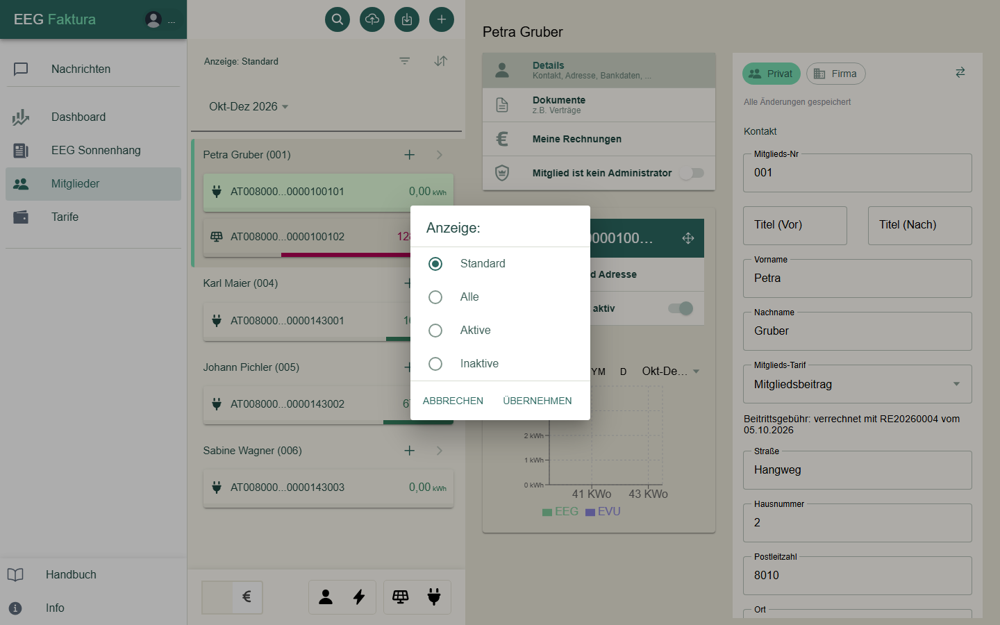
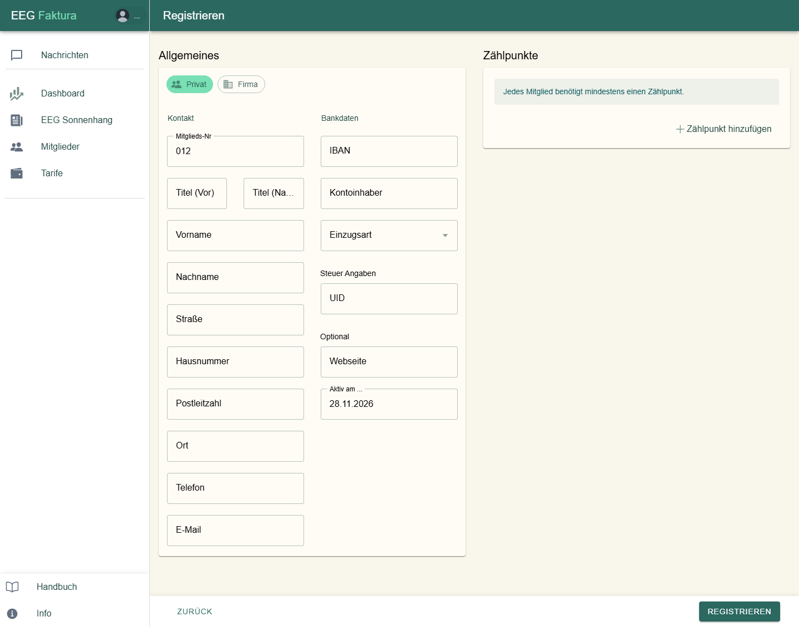
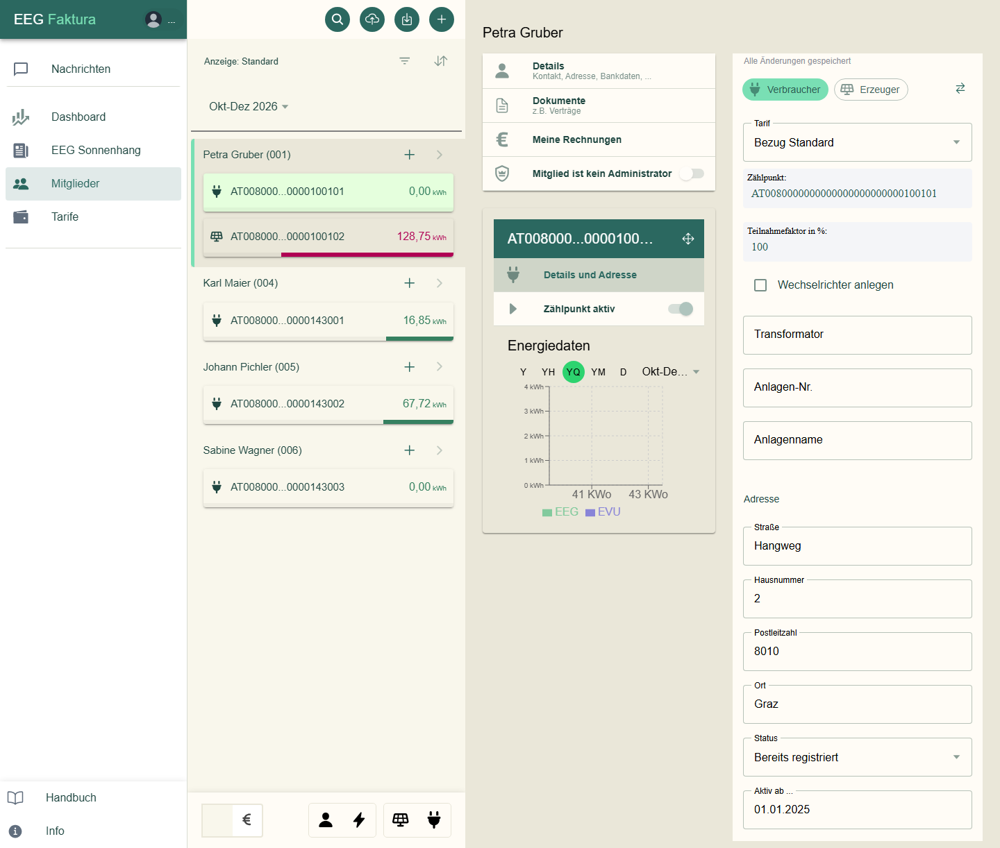
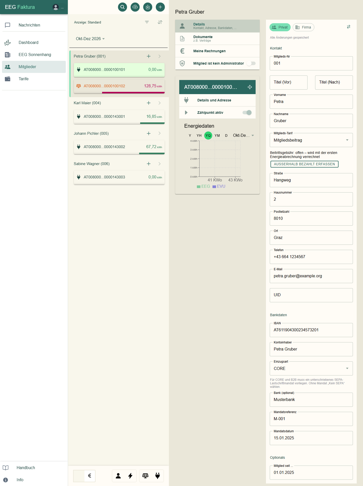
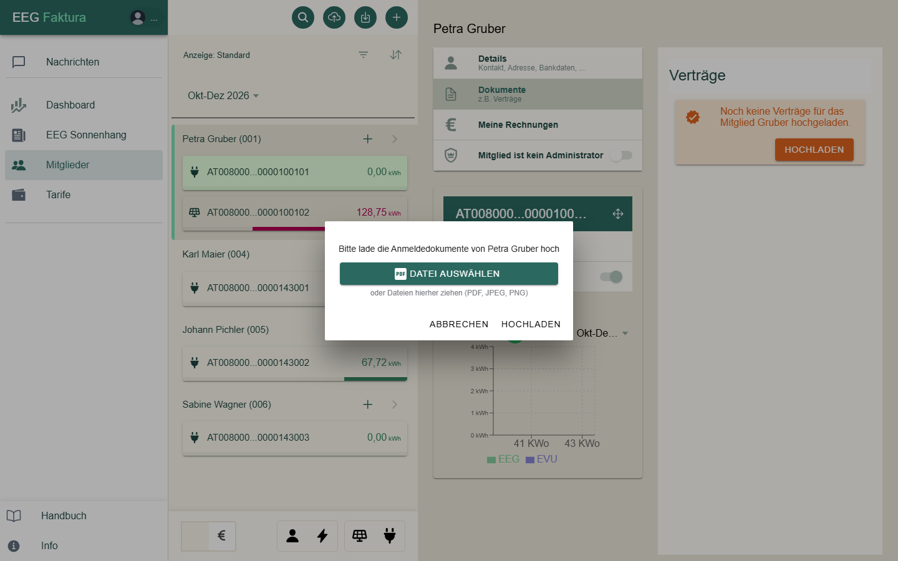

# Mitglieder & Zählpunkte

Unter **Mitglieder** verwaltest du die Mitglieder deiner Gemeinschaft und ihre Zählpunkte.

## Die Mitgliederliste

Jedes Mitglied steht mit seinem Namen und dahinter in Klammern seiner Mitgliedsnummer in der Liste, z. B.
„Max Mustermann (001)“; ein Mitglied ohne Nummer nur mit dem Namen. Darunter steht eine Karte je **Zählpunkt** mit
der Energiemenge im gewählten Zeitraum. Das Symbol zeigt die Richtung: ein **Stecker** für Verbrauch, ein
**Solarmodul** für Erzeugung. Abgewiesene, aufgehobene, ungültige und inaktive Zählpunkte tragen stattdessen ein „!“.
Der Balken unter dem Wert zeigt, welcher Teil des Verbrauchs aus der Gemeinschaft kam bzw. welcher Teil der Erzeugung
in die Gemeinschaft ging. Ein neuer Zählpunkt (orange) hat noch keinen Wert und keinen Balken.

### Knöpfe oben

| Knopf | Funktion |
|-------|----------|
| Lupe | **Suche**: blendet ein Suchfeld ein, die Liste filtert beim Tippen |
| Wolke mit Pfeil nach oben | **Import**: Stammdaten (Mitglieder und Zählpunkte) aus einer Excel-Datei einlesen; bei Gemeinschaften ohne Online-Anbindung auch Energiedaten |
| Pfeil nach unten | **Export**: Energiedaten für einen Zeitraum oder die Stammdaten herunterladen |
| Plus | **Neues Mitglied** anlegen (siehe unten) |

### Suche

Die Lupe oben blendet ein Suchfeld ein; die Liste filtert beim Tippen. Gesucht wird in Nachname, Vorname,
Mitgliedsnummer und E-Mail des Mitglieds sowie in Zählpunktnummer und Anlagenname seiner Zählpunkte.

- **Mehrere Begriffe** trennst du mit Leerzeichen. Gefunden werden die Mitglieder, bei denen **jeder** Begriff
  vorkommt, egal in welcher Reihenfolge: „huber maria“ findet Maria Huber, „huber 0815“ ein Mitglied Huber, bei dem
  „0815“ in der Mitgliedsnummer oder einer Zählpunktnummer vorkommt.
- **Trifft ein Begriff das Mitglied selbst** (Name, Nummer, E-Mail), siehst du alle seine Zählpunkte: „markt“ zeigt
  bei der „Marktgemeinde …“ jeden Zählpunkt.
- **Begriffe, die nur bei Zählpunkten vorkommen** (Anlagenname, Zählpunktnummer), grenzen die Zählpunkte ein:
  „markt pumpwerk“ zeigt bei der Marktgemeinde nur die Pumpwerke, „pv dach“ nur die Anlage „PV Dach“.

### Anzeige, Zeitraum und Sortierung

- Oben steht **Anzeige:** mit der gewählten Ansicht. Ein Klick darauf öffnet die Auswahl **Standard**, **Alle**,
  **Aktive** oder **Inaktive**; die Wahl gilt nach **Übernehmen**. Fährst du mit der Maus über den Eintrag, erklärt
  ein Hinweis die gewählte Ansicht.
    - **Standard** (voreingestellt): die Mitglieder mit Zählpunkten, die im gewählten Zeitraum aktiv sind, dazu
      Zählpunkte mit offenem Problem. Das ist die Ansicht für die Abrechnung. Den Zeitraum (z. B. „Okt-Dez 2026“)
      wählst du darunter.
    - **Alle**, **Aktive** und **Inaktive** zeigen die Mitglieder der Gemeinschaft mit dem Stand heute, unabhängig vom
      Zeitraum, jedes mit genau den Zählpunkten, die passen:
        - **Aktive**: Zählpunkte mit dem Status aktiv.
        - **Inaktive**: alle anderen Zählpunkte, z. B. Anmeldung läuft, abgewiesen, aufgehoben oder ausgetreten. Dazu
          aktive Zählpunkte, bei denen eine Aktion nötig ist (etwa eine laufende Aufhebung), und Mitglieder, die noch
          zugelassen werden müssen. Hier findest du also alles, was einen Blick braucht.
        - **Alle**: jedes Mitglied mit allen Zählpunkten. Ein Mitglied ganz ohne Zählpunkt steht nur dann in der
          Liste, wenn es noch zugelassen werden muss.

  

- Das Pfeil-Symbol ganz rechts öffnet die **Sortierung**: Mitgliedsnummer (voreingestellt), Nachname, Vorname,
  Mitglied seit (neueste bzw. älteste zuerst), Aktiv ab (neueste zuerst), Einzugsart, Ort oder Energiemenge. Mit dem
  Haken **Mitglieder mit nötiger Aktion oben** bleiben Mitglieder, bei denen etwas zu tun ist, vor den anderen; ohne
  Haken gilt die Sortierung für alle gleich. Die Wahl gilt nach **Übernehmen** und bleibt in deinem Browser
  gespeichert.

  

- Die **Energiemenge** (größte oder kleinste zuerst, kWh im gewählten Zeitraum) ist wählbar, sobald unten in der Liste
  **Nur Erzeuger** oder **Nur Verbraucher** gewählt ist. Mit **Nur Zählpunkte** steht jeder Zählpunkt für sich — so
  siehst du z. B. die größten Erzeuger der Gemeinschaft oben. Sonst sortiert die Liste nach der Mitgliedsnummer;
  deine Wahl gilt wieder, sobald die Energiemenge wählbar ist.
- Bei jedem Mitglied stehen die Verbraucher vor den Erzeugern.

### Farben

| Farbe des Zählpunkts | Bedeutung |
|----------------------|-----------|
| Dunkelgrün | Zählpunkt ist aktiv (oder inaktiv mit früheren Daten) |
| Orange | neu angelegt und noch nicht angemeldet, oder eegFaktura wartet auf die Zustimmung des Mitglieds |
| Rot | vom Netzbetreiber abgewiesen, aufgehoben oder ungültig; derzeit auch, solange die erste Antwort oder die Abschlussmeldung des Netzbetreibers noch aussteht |

Rot heißt also nicht immer, dass etwas zu tun ist. Was gerade gilt, sagt der Hinweis beim Zählpunkt (siehe
[Status eines Zählpunkts](#status-eines-zahlpunkts)).

Ein Mitglied, das noch zugelassen werden muss, steht orange mit einem „!“ in der Liste; bei einem importierten
Mitglied sind nur die Zählpunkte orange. Steht neben einem Namen grau „inaktiv“, hat das Mitglied keinen aktiven
Zählpunkt mehr.

### Unten in der Liste

- Der Schalter **€** wechselt in den **Abrechnungsmodus**. Er gehört zur Abrechnung und wird im Kapitel
  [Abrechnung](05-abrechnung.md#abrechnungsmodus) beschrieben.
- Mit den Symbolen daneben wechselst du zwischen Mitgliedern und Zählpunkten und blendest Verbraucher oder Erzeuger
  ein und aus (**Nur Mitglieder**, **Nur Zählpunkte**, **Nur Erzeuger**, **Nur Verbraucher**).

## Neues Mitglied anlegen

Lege zuerst die [Tarife](04-tarife.md) an — beim Zählpunkt wählst du einen davon aus.

1. Klicke in der Mitgliederliste oben auf **Plus**. Es öffnet sich **Registrieren**.

    

2. Wähle **Privat** oder **Firma** und fülle **Allgemeines** aus. Pflicht sind Vorname und Nachname (bzw.
   Firmenname), Straße, Hausnummer, Postleitzahl, Ort, E-Mail und die **Einzugsart**; bei **CORE** und **B2B** auch
   IBAN, Kontoinhaber, Mandatsreferenz (mit der Mitglieds-Nr vorbelegt) und Mandatsdatum. Die **Mitglieds-Nr** ist
   mit der nächsten freien Nummer vorbelegt.
   Unter **Optional** steht das Datum **Aktiv am …** (siehe [unten](#aktiv-am)).
3. Jedes Mitglied braucht mindestens einen Zählpunkt: Klicke auf **Zählpunkt hinzufügen**.

    

4. Wähle **Verbraucher** oder **Erzeuger** und den **Tarif**. Gib die **Zählpunktnummer** ein: 33 Zeichen, `AT`,
   dann sechs Ziffern des Netzbetreibers, dann 25 Ziffern oder Großbuchstaben. Leerzeichen und Striche entfernt
   eegFaktura beim Einfügen. Der **Teilnahmefaktor in %** ist mit 100 vorbelegt. Die Adresse des Zählpunkts ist
   Pflicht; mit **Adresse vom Besitzer übernehmen** wird die Adresse des Mitglieds eingetragen. Gehört die Nummer schon
   einem anderen Mitglied der Gemeinschaft, siehe
   [Zählpunkt verschieben oder Besitzer wechselt](#zahlpunkt-verschieben-oder-besitzer-wechselt).
    - Bei Gemeinschaften mit Online-Anbindung lässt du das Datum **Aktiv ab …** leer: Es kommt mit der Meldung des
      Netzbetreibers.
    - Bei Gemeinschaften ohne Online-Anbindung wählst du zusätzlich den **Status** („Noch nicht registriert“ oder
      „Bereits registriert“) und trägst **Aktiv ab …** ein.
5. Klicke auf **Hinzufügen** — erst damit steht der Zählpunkt in der Liste. Weitere Zählpunkte fügst du genauso
   hinzu.
6. Klicke auf **Registrieren**. Verlässt du die Seite vor dem Speichern, fragt eegFaktura nach.
   **Achtung:** Ohne **Hinzufügen** wird das Mitglied ohne Zählpunkt angelegt. Du findest es dann nur unter
   **Anzeige: Alle** oder **Inaktive**.
7. Das Mitglied steht jetzt orange mit „!“ in der Liste und wartet auf die Zulassung. **Lasse es zu** (siehe
   [Neues Mitglied zulassen](#neues-mitglied-zulassen)) — erst dann werden die Zählpunkte beim Netzbetreiber
   angemeldet bzw. aktiv. Den Fortschritt siehst du am Status des Zählpunkts.

### Aktiv am …: ab wann das Mitglied teilnimmt {#aktiv-am}

Das Datum **Aktiv am …** ist mit heute vorbelegt. eegFaktura speichert es als „Mitglied seit“ und meldet die
Zählpunkte beim Zulassen ab diesem Tag beim Netzbetreiber an, frühestens ab morgen. Du kannst auch einen späteren Tag
wählen, z. B. den Ersten des nächsten Abrechnungszeitraums. Nach den Regeln der Marktkommunikation darf er höchstens
**30 Arbeitstage nach dem Zulassen** liegen; liegt er weiter weg, lehnt der Netzbetreiber die Anmeldung ab. Lass das
Mitglied dann erst später zu. eegFaktura prüft das nicht.

**Tipp:** Mitgliedsbeitrag und Zählpunktgebühr kommen je Abrechnung in voller Höhe, nicht anteilig nach Tagen, sobald
für den Zeitraum Energiedaten da sind (siehe [Vorschau erstellen](05-abrechnung.md#vorschau-erstellen)). Wird ein
Mitglied wenige Tage vor dem Ende eines Abrechnungszeitraums aktiv, zahlt es sie für diesen Zeitraum ganz. Mit
**Aktiv am …** auf dem Ersten des nächsten Zeitraums vermeidest du das (höchstens 30 Arbeitstage nach dem Zulassen,
siehe oben).

### Zählpunkt vor dem Registrieren ändern oder entfernen

Einen schon eingetragenen Zählpunkt kannst du vor dem **Registrieren** noch korrigieren: Klicke auf seine Karte, ändere
die Angaben und klicke auf **Übernehmen**. **Entfernen** nimmt ihn wieder aus der Liste. Jede Zählpunktnummer steht
nur einmal in der Liste: Trägst du eine Nummer ein, die schon dasteht, ersetzt der neue Eintrag den alten.

## Stammdaten aus Excel importieren

Viele Mitglieder auf einmal — z. B. beim Umstieg auf eegFaktura — liest du aus einer Excel-Datei ein: oben in der
Mitgliederliste der Knopf mit der Wolke, **Stammdaten**. Spalten, Vorlage und ein Testablauf mit wenigen Mitgliedern
stehen auf der Seite [Stammdaten aus Excel importieren](stammdaten-import.md).

## Neues Mitglied zulassen

Ein neues Mitglied — von dir angelegt oder über eine Registrierung hereingekommen — steht zuerst orange mit „!“ in
der Liste und wartet auf die Zulassung. Rechts fragt eegFaktura: „Möchtest du *Nachname* in deine EEG aufnehmen?“

- **Ja, Zulassen** öffnet den Dialog „*Name* zulassen“. Dort kannst du **Anmeldedokumente** hochladen (z. B. den
  unterschriebenen Beitritt) und die Zählpunkte auswählen, die angemeldet werden sollen. Mit **Zulassen** wird das
  Mitglied aufgenommen.
- **Nein, Löschen** löscht das Mitglied mit allen Zählpunkten. Das lässt sich nicht rückgängig machen.

Was das Zulassen bewirkt, hängt von der Gemeinschaft ab:

- **Mit Online-Anbindung:** eegFaktura meldet die angehakten Zählpunkte beim Netzbetreiber an; das Mitglied bestätigt
  danach die Datenfreigabe. Vor dem Zulassen wird nichts angemeldet. Einen nicht angehakten Zählpunkt meldest du
  später unter **Prozesse → Zählpunkt aktivieren** an.
- **Ohne Online-Anbindung:** Alle Zählpunkte des Mitglieds werden mit dem Zulassen aktiv.

## Ein Mitglied ansehen und ändern

Ein Klick auf ein Mitglied öffnet rechts seine Daten, zunächst mit dem ersten Zählpunkt:

| Eintrag | Inhalt |
|---------|--------|
| **Details** | Kontakt, Adresse, Bankdaten des Mitglieds |
| **Dokumente** | Dokumente zum Mitglied, z. B. Verträge |
| **Meine Rechnungen** | die Rechnungen und Gutschriften des Mitglieds |
| **Mitglied ist (kein) Administrator** | zeigt, ob das Mitglied EEG-Admin ist (nur Anzeige) |

**Details** öffnet das Formular des Mitglieds:

- Oben steht, ob das Mitglied **Privat** oder **Firma** ist. Ändern kannst du das als EEG-Admin über das
  Pfeil-Symbol daneben; eegFaktura warnt vorher (bei Privat → Firma wird der Vorname zum Firmennamen).
- **Kontakt**: Mitglieds-Nr, Titel, Vorname und Nachname (bei Firmen der Firmenname), **Mitglieds-Tarif**,
  Adresse, Telefon, E-Mail, UID. Mehrere E-Mail-Adressen trennst du mit `;` (ohne Leerzeichen); Mails gehen an alle
  gültigen Adressen.
- **Bankdaten**: IBAN, Kontoinhaber, **Einzugsart** (Kein SEPA, B2B oder CORE); bei Lastschrift zusätzlich
  **Bank (optional)**, Mandatsreferenz und Mandatsdatum. Den Namen der Bank musst du nicht eintragen; er steht nur auf
  der Rechnung und im Stammdaten-Export. Für ein Mitglied ohne Konto wählst du **Kein SEPA**; die IBAN darf dann leer
  bleiben. Einzugsart, Mandatsreferenz und Mandatsdatum vieler Mitglieder setzt der Support in einem Schritt (siehe
  [Dafür schreibst du ein Ticket](einrichtung-hilfe.md#dafur-schreibst-du-ein-ticket)).
- **Optionals**: Mitglied seit.

Änderungen werden gespeichert, sobald du ein Feld verlässt. Über dem Formular steht, ob alles gespeichert ist
(„Alle Änderungen gespeichert“). Ein ungültiges Feld wird nicht gespeichert; eegFaktura markiert es und fragt nach,
bevor du das Mitglied verlässt. Ist die E-Mail-Adresse ungültig, steht neben dem Namen „E-Mail ungültig“.

**Mitglied ohne E-Mail:** Beim Anlegen und Ändern verlangt eegFaktura eine E-Mail-Adresse. Ohne Adresse kommt ein
Mitglied nur über den [Stammdaten-Import](stammdaten-import.md) in die Liste (Spalte leer); es bekommt dann keine
Mails. Das Feld E-Mail selbst kannst du danach nur mit einer gültigen Adresse speichern. Trage keine erfundene Adresse
ein — an sie wird geschickt.

### Beitrittsgebühr eines Mitglieds

Hat ein Tarif deiner Gemeinschaft eine [Beitrittsgebühr](04-tarife.md#beitrittsgebuhr), steht unter dem
**Mitglieds-Tarif** die Zeile **Beitrittsgebühr:** mit dem Stand für dieses Mitglied:

| Anzeige | Bedeutung |
|---------|-----------|
| verrechnet mit *Belegnummer* vom *Datum* | Die Gebühr steht auf dieser endgültigen Rechnung. |
| außerhalb bezahlt am *Datum* (*Notiz*) | Ihr habt eine Zahlung außerhalb von eegFaktura erfasst; die Gebühr wird nicht verrechnet. |
| zur Verrechnung im nächsten Abrechnungslauf vorgemerkt | Die Gebühr kommt mit der nächsten endgültigen Abrechnung. |
| offen – wird mit der ersten Energieabrechnung verrechnet | Das Mitglied wurde noch nie mit Energie abgerechnet; die Gebühr kommt automatisch mit seiner ersten Abrechnung. |
| nicht verrechnet – Mitglied wurde schon abgerechnet | Das Mitglied wurde schon vor der Gebühr abgerechnet; automatisch bekommt es sie nicht mehr. |
| kein Tarif mit Beitrittsgebühr | Der Mitglieds-Tarif dieses Mitglieds hat keine Beitrittsgebühr. |

Darunter stehen, je nach Stand, diese Knöpfe:

- **Beitrittsgebühr nachverrechnen** (nur beim Stand „nicht verrechnet – Mitglied wurde schon abgerechnet“) merkt die
  Gebühr für den nächsten endgültigen Abrechnungslauf vor. eegFaktura nennt vorher Tarif, Betrag und Umsatzsteuer;
  bestätigt wird mit **Nachverrechnen**. **Vormerkung zurücknehmen** hebt das wieder auf, solange noch nicht
  abgerechnet ist.
- **Außerhalb bezahlt erfassen**: Hat das Mitglied die Gebühr z. B. bar beim Beitritt bezahlt, trägst du das **Datum
  der Zahlung** ein (Pflicht) und optional eine kurze Notiz. Einen Betrag gibt es nicht. Danach wird ihm die Gebühr
  nicht mehr verrechnet, auch nicht mit der ersten Abrechnung.
- **Zahlung korrigieren** und **Zahlung entfernen** ändern bzw. löschen die erfasste Zahlung; ohne sie gilt wieder der
  Stand ohne Zahlung (offen, oder „nicht verrechnet“, wenn das Mitglied schon abgerechnet wurde).

Vormerken und „außerhalb bezahlt“ schließen sich aus. Ist die Gebühr einmal verrechnet, lässt sich nichts mehr ändern.
Ist die Abrechnung gerade nicht erreichbar, fehlen die Zeile und die Knöpfe.

Weist du einem schon abgerechneten Mitglied einen Tarif mit Beitrittsgebühr zu, warnt eegFaktura: Die Gebühr wird ihm
nicht mehr automatisch verrechnet. Mit **Beitrittsgebühr nachverrechnen** kommt sie in den nächsten Abrechnungslauf.

Wann und wie eegFaktura die Gebühr verrechnet, steht bei den [Tarifen](04-tarife.md#beitrittsgebuhr).

## Zählpunkte

Ein Klick auf eine Zählpunkt-Karte zeigt dessen Daten. Über dem Zählpunkt steht seine Nummer; mit dem Pfeilkreuz
daneben verschiebst du ihn zu einem anderen Mitglied (siehe
[Zählpunkt verschieben oder Besitzer wechselt](#zahlpunkt-verschieben-oder-besitzer-wechselt)).

- **Details und Adresse**: Richtung, Tarif, Zählpunktnummer, Teilnahmefaktor (ändern: siehe
  [Teilnahmefaktor ändern](08-prozesse.md#teilnahmefaktor-andern)), Wechselrichter, Transformator, Anlagen-Nr.,
  Anlagenname, die Adresse des Zählpunkts und das Datum **Aktiv ab …**; je nach Gemeinschaft auch Verteilungsfaktor
  und Netzbetreiber.
- **Zählpunkt aktiv**: zeigt, ob der Zählpunkt aktiv ist (nur Anzeige).
- **Energiedaten**: ein Diagramm der Energiedaten des Zählpunkts (bei aktiven und früher aktiven Zählpunkten).

Die **Richtung** (Verbraucher/Erzeuger) eines angemeldeten Zählpunkts ist gesperrt. Ein EEG-Admin kann sie über das
Pfeil-Symbol ändern; eegFaktura warnt vorher, denn die Änderung wird **nicht** an den Netzbetreiber gemeldet.
Der bisherige Tarif bleibt dabei gespeichert, auch wenn das Feld ihn nicht mehr anzeigt: Wähle danach einen Tarif
der neuen Richtung.

**Anlagenname:** Hat ein Zählpunkt einen Anlagennamen, steht in der Liste dieser Name statt der Nummer, in den
Prozessen „Verbraucher - Name - Nummer“ bzw. „Erzeuger - Name - Nummer“ — praktisch bei mehreren Anlagen eines
Mitglieds.

**Aktiv ab:** Bei Online-Anmeldungen setzt eegFaktura das Datum aus der Meldung des Netzbetreibers, beim Import aus
der Spalte „registriert seit“. Es begrenzt, ab wann Energiedaten angefordert und abgerechnet werden; ändere es nur,
wenn es nicht zum Netzbetreiber passt.

### Status eines Zählpunkts

Ist ein Zählpunkt nicht aktiv, steht über den Details ein Hinweis zum Stand:

| Hinweis | Bedeutung |
|---------|-----------|
| Antwort des Netzbetreibers noch ausstehend. | Die Anmeldung ist beim Netzbetreiber, er hat noch nicht geantwortet. |
| Zustimmung des Mitglieds noch ausstehend. | Das Mitglied muss die Datenfreigabe noch bestätigen; es bekommt dazu die Mail „Freigabe-Aufforderung“. Dauert es länger, erinnere das Mitglied — nach Ablauf der Frist (30 Arbeitstage) lehnt der Netzbetreiber ab. |
| Abschlussmeldung vom Netzbetreiber noch ausstehend. | Das Mitglied hat zugestimmt, die Abschlussmeldung des Netzbetreibers fehlt noch. Ohne Smart Meter kann das dauern, bis der Netzbetreiber ihn eingebaut hat; du musst dafür nichts tun. |
| Zählpunkt wurde vom Netzbetreiber abgewiesen. | Der Netzbetreiber hat die Anmeldung abgelehnt. |
| Zählpunkt wurde vom Netzbetreiber nicht angenommen. | Die Anmeldung war ungültig, z. B. weil die Zählpunktnummer nicht gefunden wurde. |
| Zählpunkt wurde vom Netzbetreiber aufgehoben. | Der Netzbetreiber hat die Teilnahme beendet. |
| Zählpunkt inaktiv seit … / inaktiv am … | Der Zählpunkt gehört nicht mehr zur Gemeinschaft („am“: das Ende liegt noch in der Zukunft). |
| Zählpunkt wurde archiviert. | Der Zählpunkt ist abgeschlossen und nur noch zur Ansicht da. |
| Zählpunkt hat eine Warnung, bitte die Prozess History prüfen. | Beim Netzbetreiber gab es eine Unstimmigkeit, siehe **Prozesse → Prozess History**. |

Bei Abweisung oder Nichtannahme steht der **Grund** fett dahinter, z. B. „Kunde hat Datenfreigabe abgelehnt“. Danach
richtest du dich: Ist der Fehler behoben (z. B. Nummer korrigiert), meldest du den Zählpunkt unter
**Prozesse → Zählpunkt aktivieren** erneut an.

Steht kein Grund da, sieh in der **Prozess History** nach. Bei „Noch kein fernauslesbarer Zähler eingebaut“ oder
„Summe der gemeldeten Aufteilungsschlüssel übersteigt 100%“ läuft die Anmeldung beim Netzbetreiber weiter: **nicht
löschen und nicht neu anmelden** (siehe [Häufige Ablehnungsgründe](08-prozesse.md#haufige-ablehnungsgrunde)).

Einen nicht angenommenen Zählpunkt, der noch nie aktiv war, kannst du hier mit **Löschen** entfernen — außer in den
beiden Fällen oben.

### Zählpunkt zu einem bestehenden Mitglied hinzufügen

Klicke in der Mitgliederliste beim Mitglied auf **+**. Bei einem Mitglied, das orange mit „!“ auf die Zulassung
wartet, gibt es das **+** noch nicht. Das Formular ist dasselbe wie beim
[Anlegen eines Mitglieds](#neues-mitglied-anlegen); gespeichert wird mit **Registrieren**. Ist das Mitglied schon
zugelassen, meldet eegFaktura den neuen Zählpunkt bei Gemeinschaften mit Online-Anbindung gleich beim Netzbetreiber an.

## Dokumente eines Mitglieds

Unter **Dokumente** legst du Unterlagen zum Mitglied ab, z. B. den unterschriebenen Beitritt. Sie stehen dort unter
**Verträge**. **Hochladen** (bzw. **Hinzufügen**) öffnet das Fenster zum Hochladen; erlaubt sind PDF, PNG und JPEG:

- Mit **Datei auswählen** fügst du eine Datei hinzu; du kannst auch mehrere Dateien auf einmal in das Fenster ziehen.
  Andere Dateiarten nimmt eegFaktura nicht und nennt sie in einem Hinweis. Mit dem Papierkorb nimmst du eine Datei
  wieder aus der Liste; **Hochladen** lädt alle hoch. Zeigt die Dateiauswahl eine `.jpg`-Datei nicht an, ziehe sie
  in das Fenster.
- Ziehst du Dateien direkt auf den Bereich **Verträge** eines Mitglieds, öffnet sich das Fenster gleich mit diesen
  Dateien. Hochgeladen wird erst mit **Hochladen**.

Ein Klick auf ein Dokument öffnet es, das Papierkorb-Symbol löscht es endgültig. Dieselben Anmeldedokumente kannst
du auch beim [Zulassen](#neues-mitglied-zulassen) hochladen.

## Ein Mitglied tritt aus

Melde seine Zählpunkte ab ([Zählpunkt abmelden](08-prozesse.md#zahlpunkt-abmelden)) statt das Mitglied zu löschen —
so bleiben seine Daten und Belege erhalten. Meldet eegFaktura dabei, dass die Kennung der Datenfreigabe fehlt, steht
unter [Zählpunkt abmelden](08-prozesse.md#zahlpunkt-abmelden), was zu tun ist.

## Zählpunkt verschieben oder Besitzer wechselt

Das Pfeilkreuz über dem Zählpunkt, neben seiner Nummer, **verschiebt** ihn zu einem anderen Mitglied. Bisherige
Rechnungen bleiben beim alten Mitglied.

- **Ein Zählpunkt wechselt den Besitzer** (z. B. Mieterwechsel): Verschiebe ihn mit dem Pfeilkreuz zum neuen Mitglied
  oder melde ihn beim alten ab und beim neuen an.
- **Zählpunkt schon vergeben:** Ist ein Zählpunkt schon einem anderen Mitglied deiner Gemeinschaft zugeordnet, lässt
  er sich nicht noch einmal anlegen. Verschiebe ihn beim anderen Mitglied mit dem Pfeilkreuz oder melde ihn dort ab.
  Hat das Mitglied den Zählpunkt schon (z. B. inaktiv nach einer Abmeldung), meldest du ihn unter
  **Prozesse → Zählpunkt aktivieren** wieder an. War der Zählpunkt bei diesem Mitglied schon einmal angelegt und
  wurde verschoben oder archiviert, lässt er sich dort nicht neu anlegen — wende dich an den
  [Support](einrichtung-hilfe.md#hilfe-und-support).
