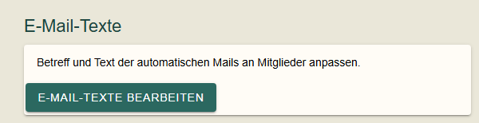
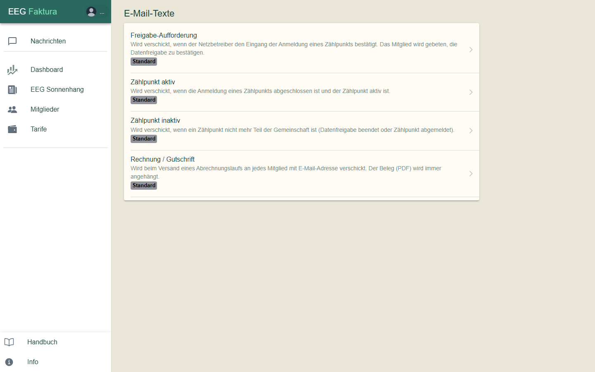
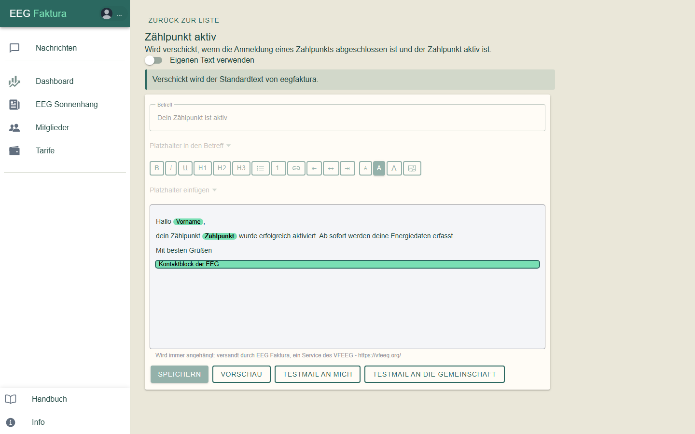
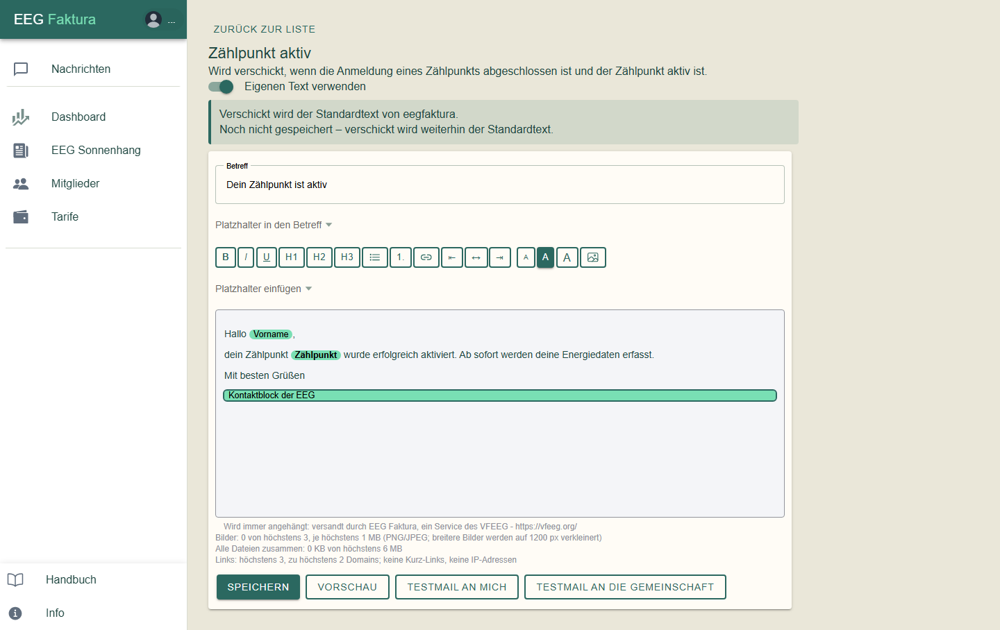
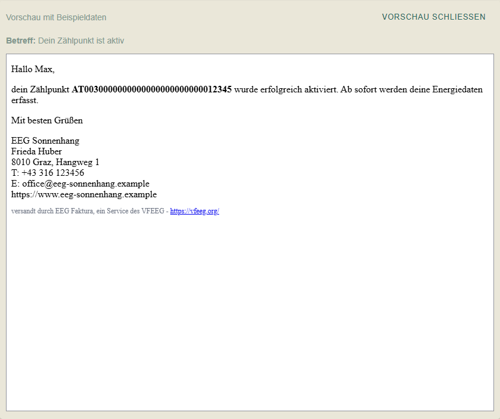
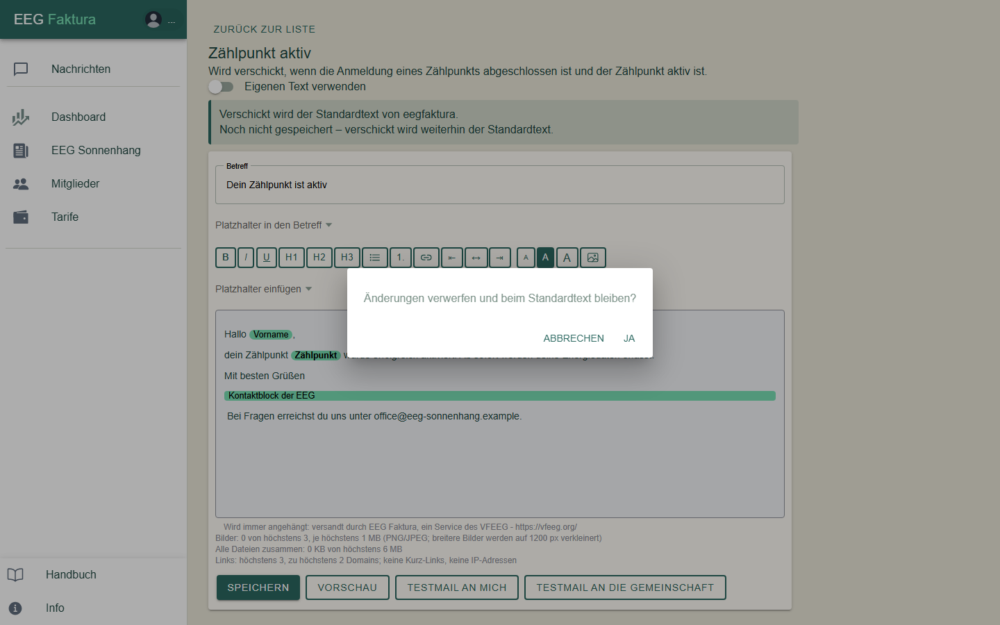

# E-Mail-Texte

eegFaktura schickt deinen Mitgliedern automatisch E-Mails, zum Beispiel wenn ein Zählpunkt aktiv wird oder eine
Rechnung fertig ist. Für jede dieser Mails gibt es einen **Standardtext von eegFaktura**. Du kannst ihn
übernehmen, wie er ist, oder einen **eigenen Text** mit Bildern gestalten.

Unter jeder Mail steht eine feste Zeile, die du nicht ändern kannst: „versandt durch EEG Faktura, ein Service des
VFEEG - https://vfeeg.org/“. Im Editor siehst du sie grau unter dem Text („Wird immer angehängt: …“).

Die E-Mail-Texte können nur **EEG-Admins** bearbeiten.

## Wo finde ich die E-Mail-Texte?

Auf der **EEG-Seite** (Menüpunkt mit dem Namen deiner Gemeinschaft) in der Karte **E-Mail-Texte**:

Klicke auf **E-Mail-Texte bearbeiten**. Es öffnet sich die Liste der Mails:

| Mail | Wann sie verschickt wird |
|------|--------------------------|
| **Freigabe-Aufforderung** | wenn der Netzbetreiber den Eingang der Anmeldung eines Zählpunkts bestätigt; das Mitglied wird gebeten, die Datenfreigabe zu bestätigen |
| **Zählpunkt aktiv** | wenn die Anmeldung eines Zählpunkts abgeschlossen und der Zählpunkt aktiv ist |
| **Zählpunkt inaktiv** | wenn ein Zählpunkt nicht mehr Teil der Gemeinschaft ist (Datenfreigabe beendet oder Zählpunkt abgemeldet) |
| **Rechnung / Gutschrift** | beim Versand eines Abrechnungslaufs an jedes Mitglied mit E-Mail-Adresse; der Beleg (PDF) ist immer angehängt |

Bei jeder Mail siehst du, was gerade verschickt wird:

- **Standard**: der Standardtext von eegFaktura,
- **Eigener Text**: eure gespeicherte Fassung, mit dem Hinweis „Angepasst (am … von …)“.

## Der Standardtext

Ein Klick auf eine Mail öffnet sie. Solange der Schalter **Eigenen Text verwenden** aus ist, verschickt eegFaktura
den Standardtext. Der Kasten darunter sagt das ausdrücklich, Betreff und Text sind zum Lesen da und gesperrt:

Die grün hinterlegten Felder sind **Platzhalter**. Sie werden beim Versand für jedes Mitglied ersetzt, z. B.
„Vorname“ durch den Vornamen des Mitglieds oder „Zählpunkt“ durch die Zählpunktnummer. Der **Kontaktblock der
EEG** ist ein **Baustein**: Er wird durch EEG Bezeichnung, Kontaktperson, Adresse, Telefon, E-Mail und Webseite der
Gemeinschaft ersetzt (leere Angaben fallen weg).

Die Rechnungs-Mail hat eigene Platzhalter: **Empfängername**, **Belegart**, **Abrechnungszeitraum**, **Name der
EEG**, **E-Mail der EEG**, **Fußzeile der Belege** und den Baustein **Kontaktdaten der EEG** (Adresse, Telefon,
E-Mail und Web aus den Angaben des Belegs). Ihr Standardtext endet mit dem Namen der EEG und der Fußzeile der Belege;
den Baustein mit den Kontaktdaten fügst du bei Bedarf selbst ein.

**Vorschau** und **Testmail** funktionieren auch mit dem Standardtext.

## Eigenen Text verwenden

1. Schalte **Eigenen Text verwenden** ein. Der Editor startet mit einer Kopie des Standardtexts.

    

    Solange du nicht gespeichert hast, steht im Kasten „Noch nicht gespeichert – verschickt wird weiterhin der
    Standardtext.“

2. Ändere **Betreff** und Text:
    - **Platzhalter einfügen** setzt einen Platzhalter an die Stelle des Cursors; Einträge mit „(Baustein)“ fügen
      einen ganzen Absatz ein. **Platzhalter in den Betreff** macht dasselbe für den Betreff.
    - Für Links gelten Regeln gegen Spam, siehe [Links](#links).
3. Klicke auf **Speichern**. Ab jetzt verschickt eegFaktura eure Fassung; der Kasten wird grün:
   „Verschickt wird eure eigene Fassung (gespeichert am … von …).“

### Bilder

Mit eingeschaltetem eigenem Text kannst du Bilder (PNG oder JPEG) in den Text einfügen: mit **Bild einfügen**, durch
Einfügen aus der Zwischenablage oder indem du die Bilddatei in den Text ziehst. Breitere Bilder werden auf 1200 px
verkleinert. Fotos (JPEG) verlieren vor dem Hochladen ihre versteckten Angaben, z. B. den Aufnahmeort.
Ein neues Bild ist zunächst **Klein** (200 px breit). Klickst du ein Bild an, stellst du unter **Bildgröße**
**Klein**, **Mittel** oder **Groß** ein.

Unter dem Text stehen die Grenzen der jeweiligen Mail:

| | Freigabe-Aufforderung, Zählpunkt aktiv, Zählpunkt inaktiv | Rechnung / Gutschrift |
|---|---|---|
| Bilder | höchstens 3, je höchstens 1 MB | höchstens 3 |
| alle Bilder zusammen | — (3 × 1 MB) | höchstens 500 KB |
| PDF-Anhang | keiner | keiner — der Beleg ist immer angehängt |

Neu hochgeladene Bilder sind **Entwürfe**: Sie werden erst mit dem Speichern verwendet.

### Links

Damit eure Mails nicht im Spam landen, prüft eegFaktura die Links beim Speichern, bei der Vorschau und bei der
Testmail: höchstens **3 Links** auf höchstens **2 Domains**, nur `https://` oder `mailto:`, keine Kurz-Links.

Der Standardtext der **Freigabe-Aufforderung** enthält bereits einen Link. Startest du von seiner Kopie, zählt er mit.

Verstößt ein Text gegen eine Regel, speichert eegFaktura ihn nicht und nennt den Grund. Ausnahme: Fügst du Text mit
einem `http://`-Link ein, bleibt nur der Text stehen, der Link fällt ohne Meldung weg. Prüfe eingefügte Links
deshalb in der Vorschau.

??? note "Alle Link-Regeln"
    - höchstens **3 Links** je Mail; E-Mail-Links (`mailto:` — ein Klick öffnet eine neue Mail) zählen mit,
    - höchstens **2 Domains**. Es zählt die Hauptdomain, z. B. `netz.at`: `portal.netz.at` und `www.netz.at` zählen
      als eine. E-Mail-Links zählen hier nicht,
    - die feste Zeile unten zählt bei beidem nicht mit,
    - Links beginnen mit `https://` oder `mailto:`,
    - keine Kurz-Links (z. B. bit.ly) und keine Adressen, die nur aus Zahlen bestehen (IP-Adressen),
    - steht im Linktext eine Adresse, muss es dieselbe sein wie das Ziel des Links,
    - kein Platzhalter in einem Link.

    Selten nötig: Eine Domain mit Umlaut schreibst du in der Form mit `xn--` (z. B. `xn--mnchen-3ya.at` statt
    `münchen.at`).

## Vorschau und Testmail

- **Vorschau** zeigt die Mail mit Beispieldaten, so wie ein Mitglied sie bekommt:

    

- **Testmail an mich** schickt die Mail mit Beispieldaten an deine eigene E-Mail-Adresse.
- **Testmail an die Gemeinschaft** schickt sie an die E-Mail-Adresse der Gemeinschaft (EEG-Seite → Kontakt).
  Ist dort keine Adresse hinterlegt, ist der Knopf gesperrt.

Testmails tragen „[Test]“ vor dem Betreff. Sie verwenden den Text, der gerade im Editor steht, auch wenn er noch
nicht gespeichert ist. So kannst du Änderungen prüfen, bevor du sie speicherst.

## Zurück zum Standardtext

Schalte **Eigenen Text verwenden** wieder aus. eegFaktura fragt nach:

| Situation | Rückfrage | Mit **Ja** … |
|-----------|-----------|--------------|
| eine gespeicherte eigene Fassung | „Eigene Fassung löschen und wieder den Standardtext verschicken? Bilder und PDF-Anhang werden mit gelöscht.“ | wird eure Fassung gelöscht, ab sofort geht der Standardtext hinaus |
| nur ungespeicherte Änderungen | „Änderungen verwerfen und beim Standardtext bleiben?“ | werden die Änderungen verworfen |
| keine Änderungen | keine Rückfrage | — |

Mit **Abbrechen** bleibt alles, wie es war.

## Gut zu wissen

--8<-- "pilot.md"

- **Kopie an die Gemeinschaft:** Die Mails „Freigabe-Aufforderung“, „Zählpunkt aktiv“ und „Zählpunkt inaktiv“ gehen
  mit der E-Mail-Adresse der Gemeinschaft (EEG-Seite → Kontakt) in Kopie hinaus. Auch die Mail „Rechnung /
  Gutschrift“ geht in Kopie an die Gemeinschaft, an die Adresse zum Zeitpunkt der Abrechnung.
- **Wenn eure Fassung nicht verwendet werden kann:** Lässt sich ein gespeicherter eigener Text beim Versand nicht
  verwenden, verschickt eegFaktura den Standardtext — die Mail kommt also trotzdem an. Bei den Mitglieder-Mails
  meldet eegFaktura das unter **Nachrichten**; prüfe dann deinen Text in der Vorschau. Bei der Rechnungs-Mail steht
  nach dem Versand unter dem Knopf **SENDEN** des Abrechnungslaufs ein oranger Hinweis: „Beim Versand konnte euer
  eigener Mailtext nicht verwendet werden, die Mails gingen mit dem Standardtext hinaus. …“ Er bleibt, wenn du den
  Lauf später wieder öffnest. Prüfe dann den Text „Rechnung / Gutschrift“. Eine eigene Rechnungs-Mail prüfst du am
  besten schon vor dem Versand mit **Vorschau** und **Testmail**.
- **Der Standardtext wurde überarbeitet:** Ändert eegFaktura einen Standardtext, während ihr einen eigenen Text
  verwendet, siehst du „Der Standardtext wurde inzwischen überarbeitet.“ Mit **Neuen Standard ansehen** vergleichst
  du. **Neuen Standard übernehmen** lädt die neue Fassung in den Editor. Verschickt wird sie erst, wenn du auf
  **Speichern** klickst; bis dahin gilt eure bisherige Fassung.
- **Kontaktdaten aktuell halten:** Der Kontaktblock der Mitglieder-Mails kommt aus den Stammdaten der EEG-Seite.
  Ändern sich Adresse oder Telefonnummer, passt du sie dort an, nicht im Text.
