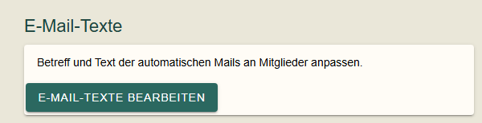
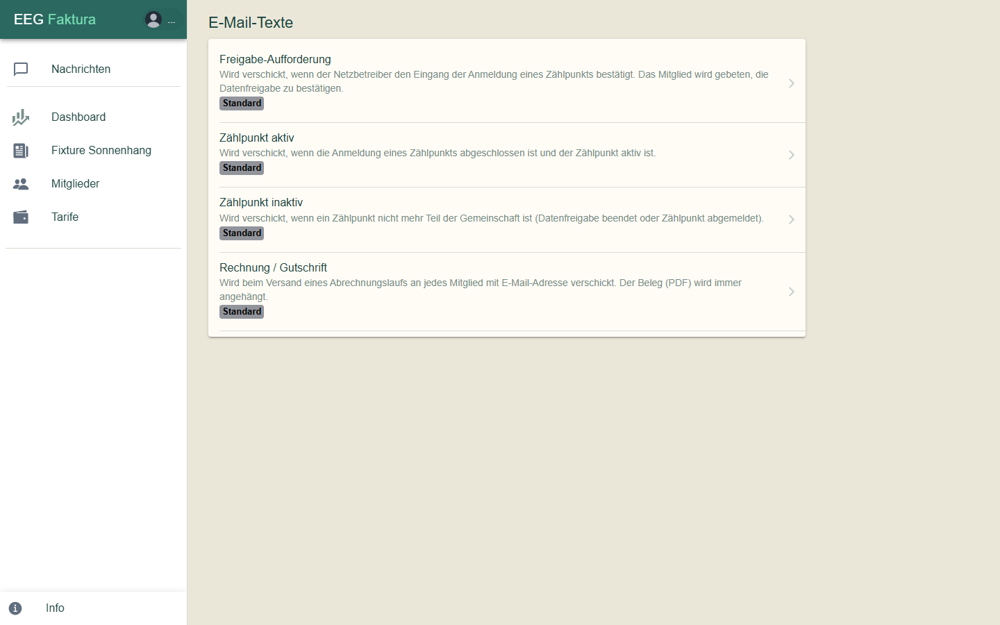
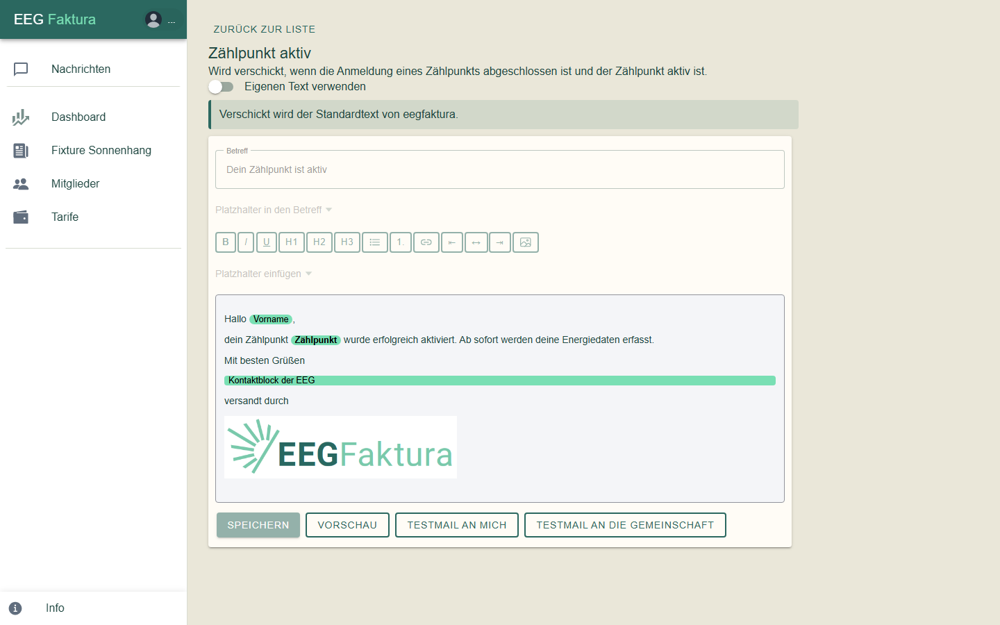
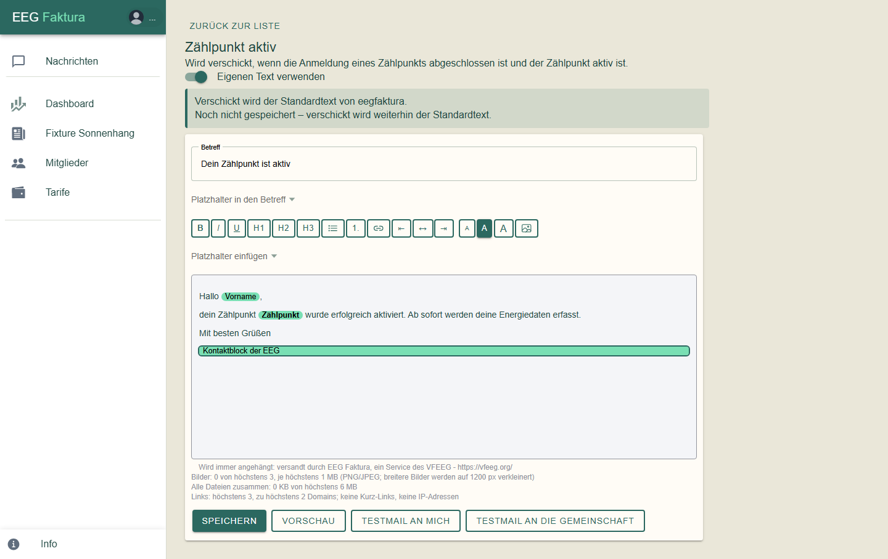
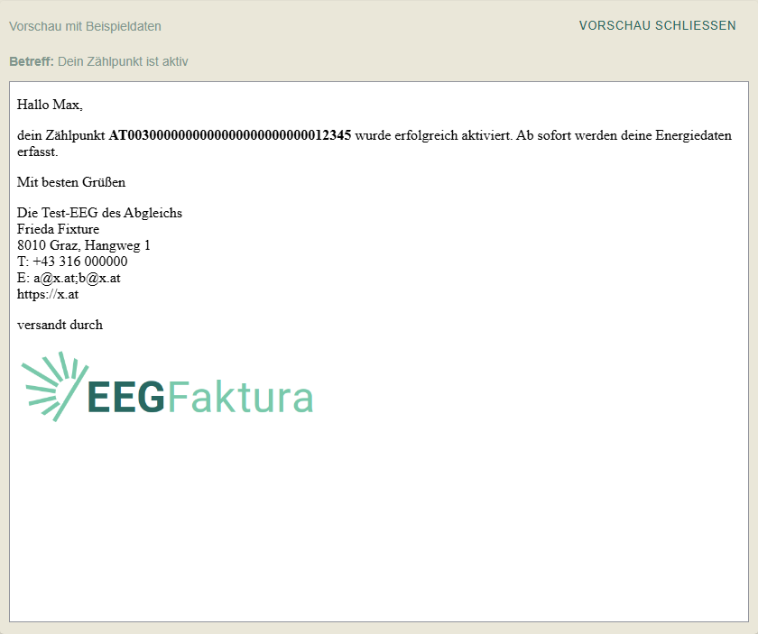
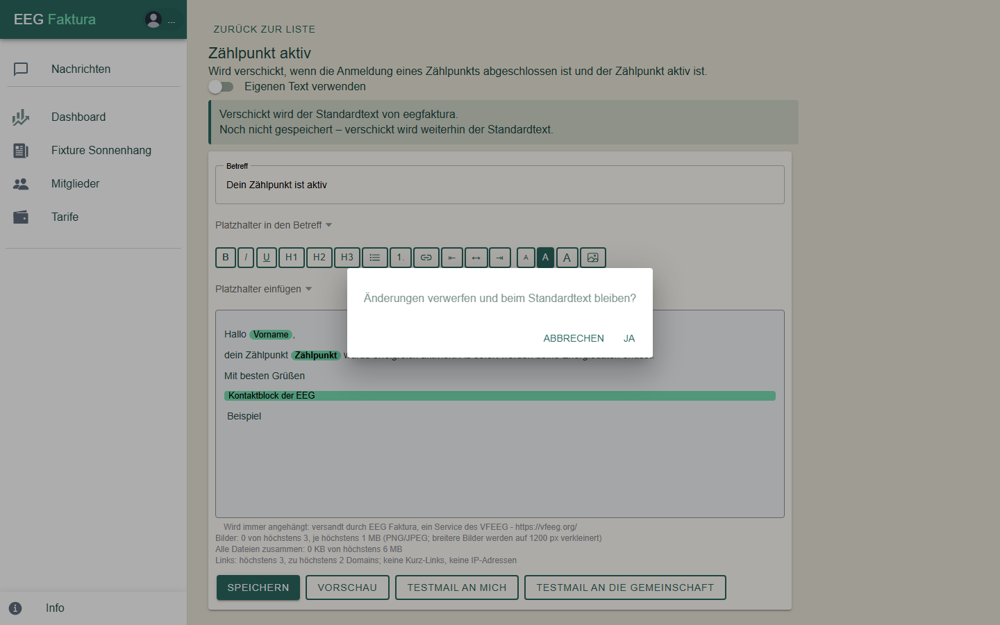

# E-Mail-Texte

eegFaktura schickt deinen Mitgliedern automatisch E-Mails, zum Beispiel wenn ein Zählpunkt aktiv wird oder eine
Rechnung fertig ist. Für jede dieser Mails gibt es einen **Standardtext von eegFaktura**. Du kannst ihn
übernehmen, wie er ist, oder einen **eigenen Text** mit Bildern und einem PDF-Anhang gestalten.

Die E-Mail-Texte können nur **EEG-Admins** bearbeiten.

## Wo finde ich die E-Mail-Texte?

Auf der **EEG-Seite** (Menüpunkt mit dem Namen deiner Gemeinschaft) in der Karte **E-Mail-Texte**:

Klicke auf **E-Mail-Texte bearbeiten**. Es öffnet sich die Liste der Mails:

| Mail | Wann sie verschickt wird |
|------|--------------------------|
| **Freigabe-Aufforderung** | wenn der Netzbetreiber den Eingang der Anmeldung eines Zählpunkts bestätigt; das Mitglied wird gebeten, die Datenfreigabe zu bestätigen |
| **Zählpunkt aktiv** | wenn die Anmeldung eines Zählpunkts abgeschlossen und der Zählpunkt aktiv ist |
| **Zählpunkt inaktiv** | wenn ein Zählpunkt nicht mehr Teil der Gemeinschaft ist (Datenfreigabe beendet oder Zählpunkt abgemeldet) |
| **Rechnung / Gutschrift** | beim Versand eines Abrechnungslaufs an jedes Mitglied mit E-Mail-Adresse; der Beleg (PDF) ist immer angehängt |

Bei jeder Mail siehst du, was gerade verschickt wird:

- **Standard**: der Standardtext von eegFaktura,
- **Eigener Text**: eure gespeicherte Fassung, mit dem Hinweis „Angepasst (am … von …)“.

## Der Standardtext

Ein Klick auf eine Mail öffnet sie. Solange der Schalter **Eigenen Text verwenden** aus ist, verschickt eegFaktura
den Standardtext. Der Kasten darunter sagt das ausdrücklich, Betreff und Text sind zum Lesen da und gesperrt:

Die grün hinterlegten Felder sind **Platzhalter**. Sie werden beim Versand für jedes Mitglied ersetzt, z. B.
„Vorname“ durch den Vornamen des Mitglieds oder „Zählpunkt“ durch die Zählpunktnummer. Der **Kontaktblock der
EEG** ist ein **Baustein**: Er wird durch EEG Bezeichnung, Kontaktperson, Adresse, Telefon, E-Mail und Webseite der
Gemeinschaft ersetzt (leere Angaben fallen weg). Die Rechnungs-Mail hat stattdessen den Baustein **Kontaktdaten der
EEG**; er kommt aus den Angaben des Belegs, und dort gibt es zusätzlich den Platzhalter **Empfängername**.

**Vorschau** und **Testmail** funktionieren auch mit dem Standardtext.

## Eigenen Text verwenden

1. Schalte **Eigenen Text verwenden** ein. Der Editor startet mit einer Kopie des Standardtexts.

    

    Solange du nicht gespeichert hast, steht im Kasten „Noch nicht gespeichert – verschickt wird weiterhin der
    Standardtext.“

2. Ändere **Betreff** und Text:
    - Die Knöpfe über dem Text formatieren ihn: **Fett**, **Kursiv**, **Unterstrichen**, **Überschrift 1–3**,
      **Aufzählung**, **Nummerierte Liste**, **Link**, **Linksbündig**, **Zentriert**, **Rechtsbündig** und
      **Bild einfügen**.
    - **Platzhalter einfügen** setzt einen Platzhalter an die Stelle des Cursors; Einträge mit „(Baustein)“ fügen
      einen ganzen Absatz ein. **Platzhalter in den Betreff** macht dasselbe für den Betreff.
    - Links müssen mit `https://` oder `mailto:` beginnen.
3. Klicke auf **Speichern**. Ab jetzt verschickt eegFaktura eure Fassung; der Kasten wird grün:
   „Verschickt wird eure eigene Fassung (gespeichert am … von …).“

### Bilder und PDF-Anhang

Mit eingeschaltetem eigenem Text kannst du Bilder (PNG oder JPEG) in den Text einfügen und bei den Mitglieder-Mails
ein PDF anhängen (z. B. eine Anleitung). Breitere Bilder werden auf 1200 px verkleinert. Unter dem Text stehen die
Grenzen der jeweiligen Mail:

| | Freigabe-Aufforderung, Zählpunkt aktiv, Zählpunkt inaktiv | Rechnung / Gutschrift |
|---|---|---|
| Bilder | höchstens 10, je höchstens 1 MB | höchstens 3 |
| PDF-Anhang (**PDF anhängen**) | höchstens 1, höchstens 3 MB | keiner — der Beleg ist immer angehängt |
| alle Dateien zusammen | höchstens 6 MB | höchstens 500 KB |

Neu hochgeladene Dateien sind **Entwürfe**: Sie werden erst mit dem Speichern verwendet.

## Vorschau und Testmail

- **Vorschau** zeigt die Mail mit Beispieldaten, so wie ein Mitglied sie bekommt:

    

- **Testmail an mich** schickt die Mail mit Beispieldaten an deine eigene E-Mail-Adresse.
- **Testmail an die Gemeinschaft** schickt sie an die E-Mail-Adresse der Gemeinschaft (EEG-Seite → Kontakt).
  Ist dort keine Adresse hinterlegt, ist der Knopf gesperrt.

Testmails tragen „[Test]“ vor dem Betreff. Sie verwenden den Text, der gerade im Editor steht, auch wenn er noch
nicht gespeichert ist. So kannst du Änderungen prüfen, bevor du sie speicherst.

## Zurück zum Standardtext

Schalte **Eigenen Text verwenden** wieder aus. eegFaktura fragt nach:

| Situation | Rückfrage | Mit **Ja** … |
|-----------|-----------|--------------|
| eine gespeicherte eigene Fassung | „Eigene Fassung löschen und wieder den Standardtext verschicken? Bilder und PDF-Anhang werden mit gelöscht.“ | wird eure Fassung gelöscht, ab sofort geht der Standardtext hinaus |
| nur ungespeicherte Änderungen | „Änderungen verwerfen und beim Standardtext bleiben?“ | werden die Änderungen verworfen |
| keine Änderungen | keine Rückfrage | — |

Mit **Abbrechen** bleibt alles, wie es war.

## Gut zu wissen

- **Kopie an die Gemeinschaft:** Die Mails „Freigabe-Aufforderung“, „Zählpunkt aktiv“ und „Zählpunkt inaktiv“ gehen
  mit der E-Mail-Adresse der Gemeinschaft (EEG-Seite → Kontakt) in Kopie hinaus.
- **Wenn eure Fassung nicht verwendet werden kann:** Lässt sich ein gespeicherter eigener Text beim Versand nicht
  verwenden, verschickt eegFaktura den Standardtext — die Mail kommt also trotzdem an. Bei den Mitglieder-Mails
  meldet eegFaktura das unter **Nachrichten**, bei der Rechnungs-Mail mit einem Hinweis im Versandprotokoll des
  Abrechnungslaufs. Prüfe dann deinen Text in der Vorschau.
- **Der Standardtext wurde überarbeitet:** Ändert eegFaktura einen Standardtext, während ihr einen eigenen Text
  verwendet, siehst du „Der Standardtext wurde inzwischen überarbeitet.“ Mit **Neuen Standard ansehen** vergleichst
  du, mit **Neuen Standard übernehmen** startest du von der neuen Fassung. Eure Fassung bleibt bis dahin gültig.
- **Zwei Personen gleichzeitig:** Hat jemand anderer die Mail inzwischen gespeichert, meldet eegFaktura „Diese Mail
  wurde inzwischen geändert …“. Mit **Neu laden** holst du den aktuellen Stand.
- **Ungespeichert zurück:** **Zurück zur Liste** fragt nach, wenn noch Änderungen offen sind.
- **Kontaktdaten aktuell halten:** Der Kontaktblock der Mitglieder-Mails kommt aus den Stammdaten der EEG-Seite.
  Ändern sich Adresse oder Telefonnummer, passt du sie dort an, nicht im Text.
