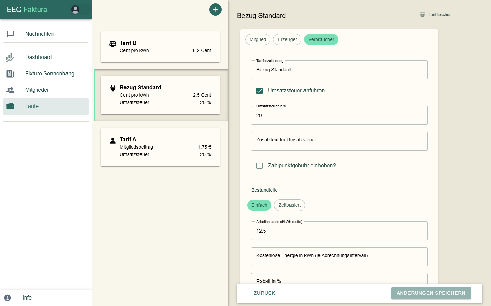
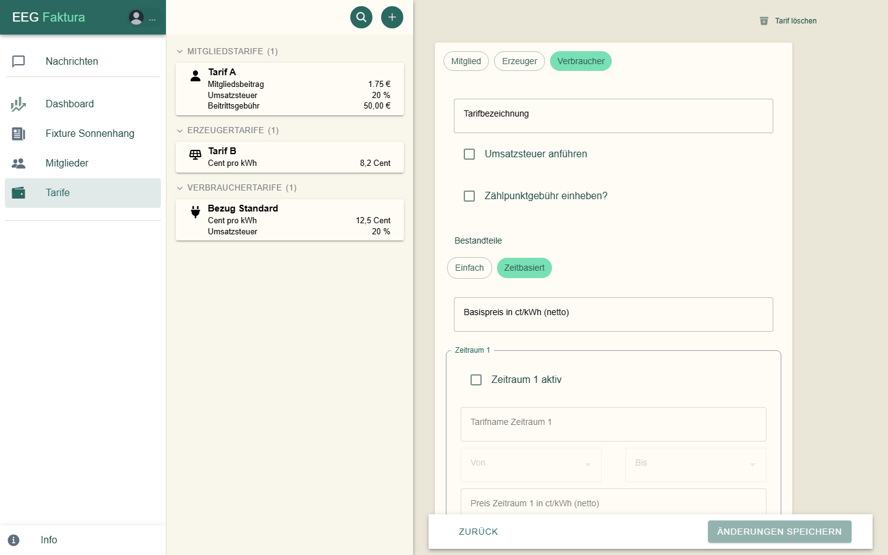
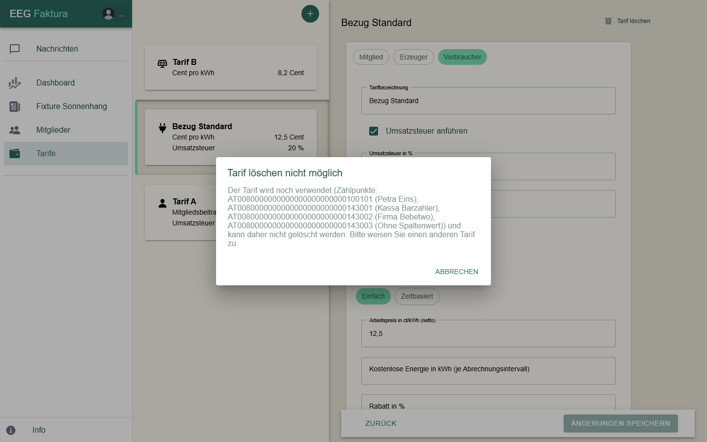

# Tarife

Tarife legen fest, was deine Gemeinschaft verrechnet: den Mitgliedsbeitrag, den Preis für bezogenen Strom und die
Vergütung für eingespeisten Strom. Tarife anlegen und ändern können nur EEG-Admins.

## Die Tarifliste

Unter **Tarife** stehen links alle aktiven Tarife als Karten, rechts die Daten des gewählten Tarifs:

Das Symbol zeigt die Art:

| Symbol | Art | Wofür |
|--------|-----|-------|
| Person | **Mitglied** | den Mitgliedsbeitrag je Abrechnungszeitraum |
| Solarmodul | **Erzeuger** | die Vergütung für eingespeisten Strom (Gutschrift) |
| Stecker | **Verbraucher** | den Preis für bezogenen Strom (Rechnung) |

Auf der Karte stehen die wichtigsten Werte, z. B. Mitgliedsbeitrag, Cent pro kWh, Inklusive kWh, Zählpunktgebühr und
Umsatzsteuer.

## Einen Tarif anlegen

1. Klicke oben in der Tarifliste auf **+**.
2. Wähle die Art: **Mitglied**, **Erzeuger** oder **Verbraucher**. Die Art lässt sich später nicht mehr ändern.
3. Gib die **Tarifbezeichnung** ein. Erlaubt sind Buchstaben ohne Umlaute, Ziffern, Leerzeichen, `-` und `_`; jeder
   Name darf nur einmal vorkommen.
4. Fülle die Bestandteile aus (siehe unten) und klicke auf **Änderungen speichern**.

### Umsatzsteuer

Hake **Umsatzsteuer anführen** an, wenn auf dem Beleg Umsatzsteuer ausgewiesen werden soll. Dann trägst du
**Umsatzsteuer in %** und optional einen **Zusatztext für Umsatzsteuer** ein. Welche Steuer gilt, klärst du bitte
mit deiner Steuerberatung.

Ohne den Haken stehen die Positionen dieses Tarifs auf dem Beleg mit **0 %** in der USt-Spalte, und für sie gibt es
keine eigene USt-Summenzeile. Ein Feld, das du leerst, zählt als 0.

### Bestandteile je Art

| Art | Felder |
|-----|--------|
| **Mitglied** | **Mitgliedsbeitrag in €** (je Abrechnungsintervall, netto), **Rabatt in %** (ganze Zahl) |
| **Erzeuger** | **Arbeitspreis in ct/kWh** (netto); optional **Zählpunktgebühr einheben?** mit Gebühr in € und eigener USt. |
| **Verbraucher** | **Arbeitspreis in ct/kWh** (netto), **Kostenlose Energie in kWh** (Freikontingent je Abrechnungsintervall und **je Zählpunkt**), **Rabatt in %**; optional **Zählpunktgebühr einheben?** |

### Zeitbasierte Tarife

Bei **Erzeuger** und **Verbraucher** kannst du statt **Einfach** auch **Zeitbasiert** wählen. Dann gilt ein
**Basispreis** und bis zu zwei Zeiträume mit eigenem Preis, z. B. ein günstigerer Mittagstarif:

- Je Zeitraum: **Zeitraum aktiv** anhaken, **Tarifname**, **Von** und **Bis** (im 15-Minuten-Raster) und den
  **Preis**.
- Mindestens ein Zeitraum muss aktiv sein. Die beiden Zeiträume dürfen sich nicht überschneiden; ein Zeitraum darf
  über Mitternacht gehen (z. B. 22:00 bis 06:00).
- Das Freikontingent gibt es nur bei **Einfach**.

## Einen Tarif ändern

Wähle den Tarif, ändere die Werte und klicke auf **Änderungen speichern**.

> **Wichtig:** Eine Abrechnung rechnet immer mit dem Tarif, wie er **beim Erstellen** der Abrechnung gilt — für den
> ganzen Abrechnungszeitraum. Bereits **abgerechnete** Läufe ändern sich nicht. Eine **Vorschau**, die vor der
> Änderung erstellt wurde, musst du mit **Vorschau Akt.** neu rechnen lassen.

## Tarife zuweisen

- **Mitgliedsbeitrag:** beim Mitglied unter **Details → Mitglieds-Tarif** (nur Tarife der Art „Mitglied“, oder
  „Kein Tarif“).
- **Strom:** beim Zählpunkt unter **Details und Adresse → Tarif** (Verbrauchertarife für Verbraucher, Erzeugertarife
  für Erzeuger).

Zählpunkte ohne Tarif werden nicht abgerechnet. Die [Prüfung vor der Abrechnung](05-abrechnung.md#vorschau-erstellen)
weist darauf hin.

## Einen Tarif löschen

Wähle den Tarif und klicke oben rechts auf **Tarif löschen**. Wird er noch verwendet — auch von inaktiven Mitgliedern —,
zeigt eegFaktura, welche Mitglieder und Zählpunkte ihn haben; weise ihnen zuerst einen anderen Tarif zu:

Ein gelöschter Tarif verschwindet aus der Liste; bestehende Belege bleiben unverändert.
