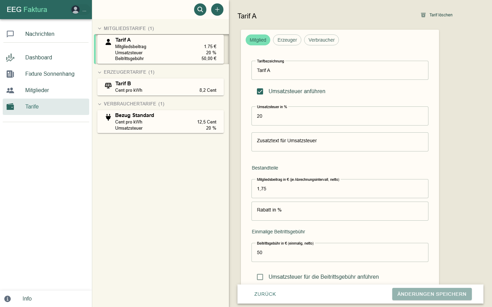

# Tarife

Tarife legen fest, was deine Gemeinschaft verrechnet: den Mitgliedsbeitrag, den Preis für bezogenen Strom und die
Vergütung für eingespeisten Strom. Tarife anlegen und ändern können nur EEG-Admins.

## Die Tarifliste

Unter **Tarife** stehen links alle aktiven Tarife als Karten, rechts die Daten des gewählten Tarifs:

Die Karten sind nach Art gruppiert: **Mitgliedstarife**, **Erzeugertarife** und **Verbrauchertarife**, jeweils nach
Namen sortiert (Zahlen in natürlicher Reihenfolge, „Beitritt 2 ZP“ vor „Beitritt 10 ZP“). Die Zahl hinter der
Überschrift nennt die Tarife der Gruppe (bei einer Suche die Treffer); ein Klick auf die Überschrift klappt die Gruppe zu oder auf. Beim Öffnen der
Seite sind alle Gruppen offen. Der gewählte Tarif bleibt immer sichtbar.

Die **Lupe** neben dem **+** blendet ein Suchfeld ein („Tarif suchen“): Es sucht im Tarifnamen, ohne auf Groß- und
Kleinschreibung oder Akzente zu achten, und öffnet die Gruppen mit Treffern. Ein zweiter Klick auf die Lupe schließt
die Suche.

Das Symbol zeigt die Art:

| Symbol | Art | Wofür |
|--------|-----|-------|
| Person | **Mitglied** | den Mitgliedsbeitrag je Abrechnungszeitraum |
| Solarmodul | **Erzeuger** | die Vergütung für eingespeisten Strom (Gutschrift) |
| Stecker | **Verbraucher** | den Preis für bezogenen Strom (Rechnung) |

Auf der Karte stehen die wichtigsten Werte, z. B. Mitgliedsbeitrag, Beitrittsgebühr, Cent pro kWh, Inklusive kWh,
Zählpunktgebühr und Umsatzsteuer.

## Einen Tarif anlegen

1. Klicke oben in der Tarifliste auf **+**.
2. Wähle die Art: **Mitglied**, **Erzeuger** oder **Verbraucher**. Die Art lässt sich später nicht mehr ändern.
3. Gib die **Tarifbezeichnung** ein. Erlaubt sind Buchstaben ohne Umlaute, Ziffern, Leerzeichen, `-` und `_`; jeder
   Name darf nur einmal vorkommen.
4. Fülle die Bestandteile aus (siehe unten) und klicke auf **Änderungen speichern**. Ein Zahlenfeld, das du leerst,
   zählt als 0.

### Umsatzsteuer

Hake **Umsatzsteuer anführen** an, wenn auf dem Beleg Umsatzsteuer ausgewiesen werden soll. Dann trägst du
**Umsatzsteuer in %** und optional einen **Zusatztext für Umsatzsteuer** ein. Welche Steuer gilt, klärst du bitte
mit deiner Steuerberatung.

Ohne den Haken stehen die Positionen dieses Tarifs auf dem Beleg mit **0 %** in der USt-Spalte, und für sie gibt es
keine eigene USt-Summenzeile.

### Bestandteile je Art

| Art | Felder |
|-----|--------|
| **Mitglied** | **Mitgliedsbeitrag in €** (je Abrechnungsintervall, netto), **Rabatt in %** (ganze Zahl); optional die [Beitrittsgebühr](#beitrittsgebuhr) |
| **Erzeuger** | **Arbeitspreis in ct/kWh** (netto); optional **Zählpunktgebühr einheben?** mit Gebühr in € und eigener USt. |
| **Verbraucher** | **Arbeitspreis in ct/kWh** (netto), **Kostenlose Energie in kWh** (Freikontingent je Abrechnungsintervall und **je Zählpunkt**), **Rabatt in %**; optional **Zählpunktgebühr einheben?** |

### Zeitbasierte Tarife

Bei **Erzeuger** und **Verbraucher** kannst du statt **Einfach** auch **Zeitbasiert** wählen. Dann gilt ein
**Basispreis** und bis zu zwei Zeiträume mit eigenem Preis, z. B. ein günstigerer Mittagstarif:

- Je Zeitraum: **Zeitraum aktiv** anhaken, **Tarifname**, **Von** und **Bis** (im 15-Minuten-Raster) und den
  **Preis**.
- Mindestens ein Zeitraum muss aktiv sein. Die beiden Zeiträume dürfen sich nicht überschneiden; ein Zeitraum darf
  über Mitternacht gehen (z. B. 22:00 bis 06:00).
- Das Freikontingent gibt es nur bei **Einfach**.

### Beitrittsgebühr

Ein Tarif der Art **Mitglied** kann zusätzlich zum laufenden Mitgliedsbeitrag eine **einmalige Beitrittsgebühr**
haben (Abschnitt **Einmalige Beitrittsgebühr**):

- **Beitrittsgebühr in € (einmalig, netto)**, auch mit Cent (z. B. 49,90). Leer oder 0 heißt: keine Beitrittsgebühr.
- **Umsatzsteuer für die Beitrittsgebühr anführen** und **Umsatzsteuer der Beitrittsgebühr in %** (ganze Zahl über
  0) — eine eigene Einstellung, unabhängig vom Mitgliedsbeitrag. Welche Steuer gilt, klärst du bitte mit deiner
  Steuerberatung.

Soll nur die Beitrittsgebühr verrechnet werden, setzt du den Mitgliedsbeitrag auf 0.

So verrechnet eegFaktura die Gebühr:

- **Einmal je Mitglied**, im ersten endgültigen Abrechnungslauf, in dem das Mitglied **Energie** abgerechnet bekommt —
  egal ob Bezug oder Einspeisung. Ein Lauf nur mit Mitgliedsbeitrag oder Zählpunktgebühr (z. B. weil der Zählpunkt
  noch nicht aktiv ist) löst sie nicht aus.
- Sie steht als eigene Position „Beitrittsgebühr“ immer auf einer **Rechnung**, nie auf einer Gutschrift. Ein reiner
  Erzeuger bekommt dafür eine eigene Rechnung.
- Es gilt der Tarifstand **beim Abrechnen**. Nach einem Tarifwechsel wird keine zweite Gebühr fällig.
- Mitglieder, die in eegFaktura **schon mit Energie abgerechnet** wurden, bekommen die Gebühr nicht automatisch. Willst
  du sie trotzdem verrechnen, nutzt du beim Mitglied **Beitrittsgebühr nachverrechnen**; hat ein Mitglied außerhalb
  von eegFaktura bezahlt, erfasst du das dort (siehe
  [Beitrittsgebühr eines Mitglieds](02-mitglieder-zaehlpunkte.md#beitrittsgebuhr-eines-mitglieds)).
- Eine **Vorschau** zeigt die Gebühr, verrechnet ist sie erst mit **Abrechnung durchführen**.

Beim Speichern einer Gebühr über 0 fragt eegFaktura nach, wenn

- aktive Mitglieder mit diesem Tarif noch nie in eegFaktura mit Energie abgerechnet wurden: „N aktive Mitglieder mit
  diesem Tarif wurden in eegfaktura noch nie mit Energie abgerechnet und bekommen die Beitrittsgebühr mit ihrer
  nächsten Abrechnung.“ Mitglieder, die früher außerhalb von eegFaktura abgerechnet wurden, zählen hier mit — erfasse
  bei ihnen „außerhalb bezahlt“, wenn sie die Gebühr nicht bekommen sollen;
- der USt-Satz der Gebühr in deinen Tarifen sonst nicht vorkommt. Eine Rechnung kann höchstens zwei verschiedene
  USt-Sätze über 0 % enthalten; mit einem dritten bricht die Abrechnung ab.

Speichern kannst du in beiden Fällen.

## Einen Tarif ändern

Wähle den Tarif, ändere die Werte und klicke auf **Änderungen speichern**.

> **Wichtig:** Eine Abrechnung rechnet immer mit dem Tarif, wie er **beim Erstellen** der Abrechnung gilt — für den
> ganzen Abrechnungszeitraum. Bereits **abgerechnete** Läufe ändern sich nicht. Eine **Vorschau**, die vor der
> Änderung erstellt wurde, musst du mit **Vorschau Akt.** neu rechnen lassen.

## Tarife zuweisen

- **Mitgliedsbeitrag:** beim Mitglied unter **Details → Mitglieds-Tarif** (nur Tarife der Art „Mitglied“, oder
  „Kein Tarif“).
- **Strom:** beim Zählpunkt unter **Details und Adresse → Tarif** (Verbrauchertarife für Verbraucher, Erzeugertarife
  für Erzeuger).

Die Auswahl ist wie die Tarifliste nach Namen sortiert.

Zählpunkte ohne Tarif werden nicht abgerechnet. Die [Prüfung vor der Abrechnung](05-abrechnung.md#vorschau-erstellen)
weist darauf hin.

## Einen Tarif löschen

Wähle den Tarif und klicke oben rechts auf **Tarif löschen**. Wird er noch verwendet — auch von inaktiven Mitgliedern —,
zeigt eegFaktura, welche Mitglieder und Zählpunkte ihn haben; weise ihnen zuerst einen anderen Tarif zu:

Ein gelöschter Tarif verschwindet aus der Liste; bestehende Belege bleiben unverändert.
