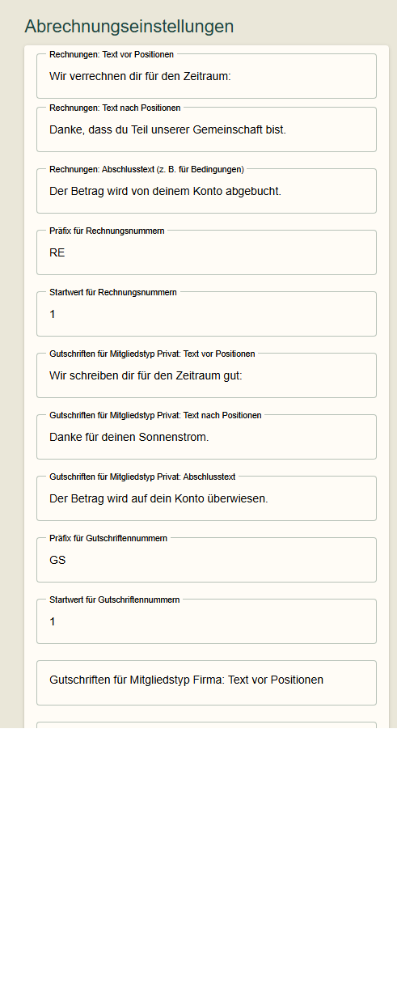
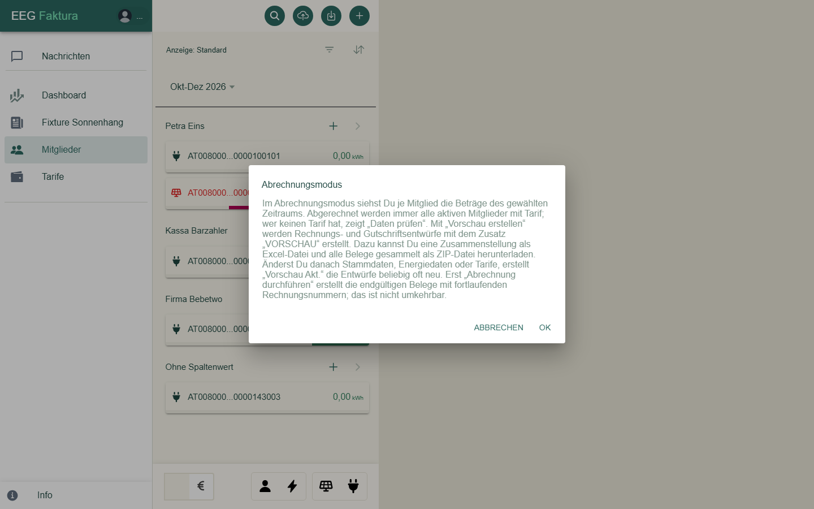
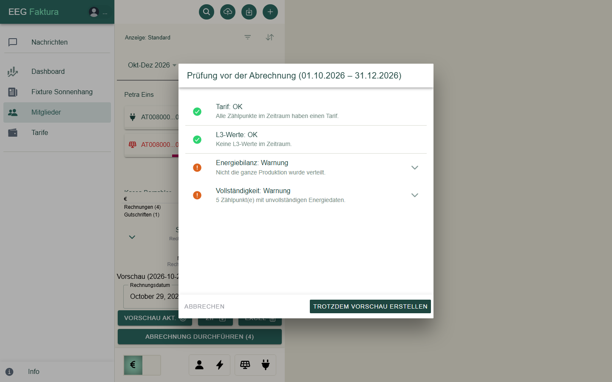
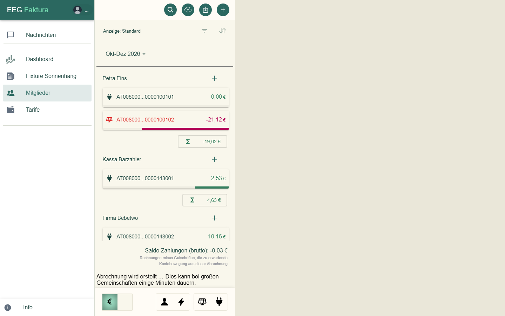
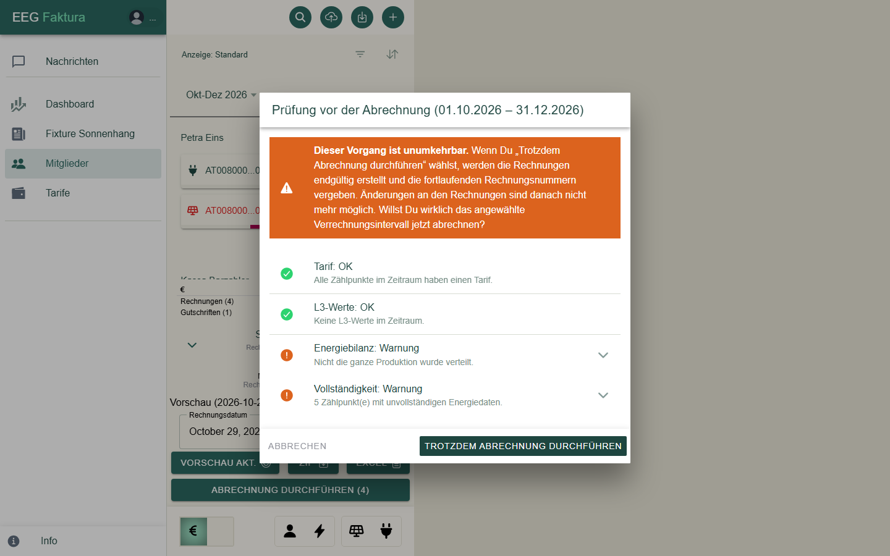
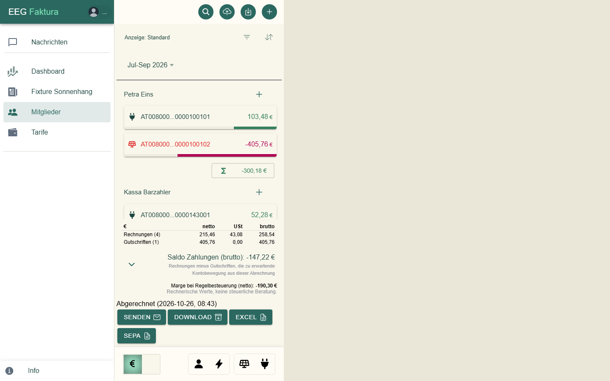
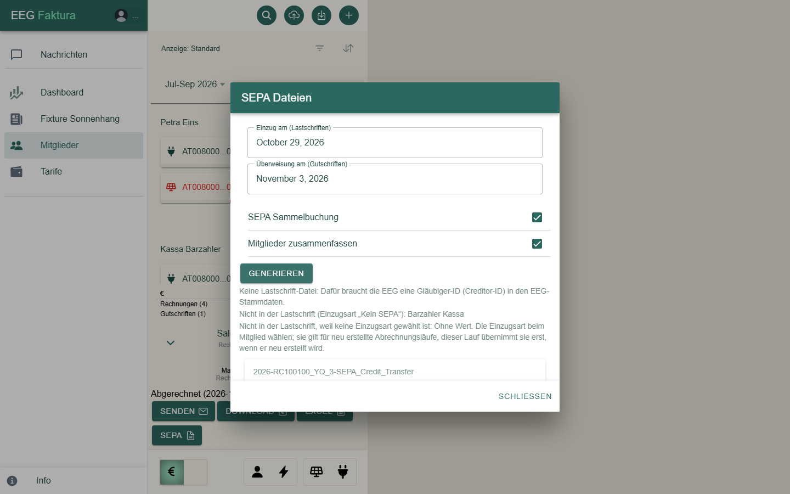
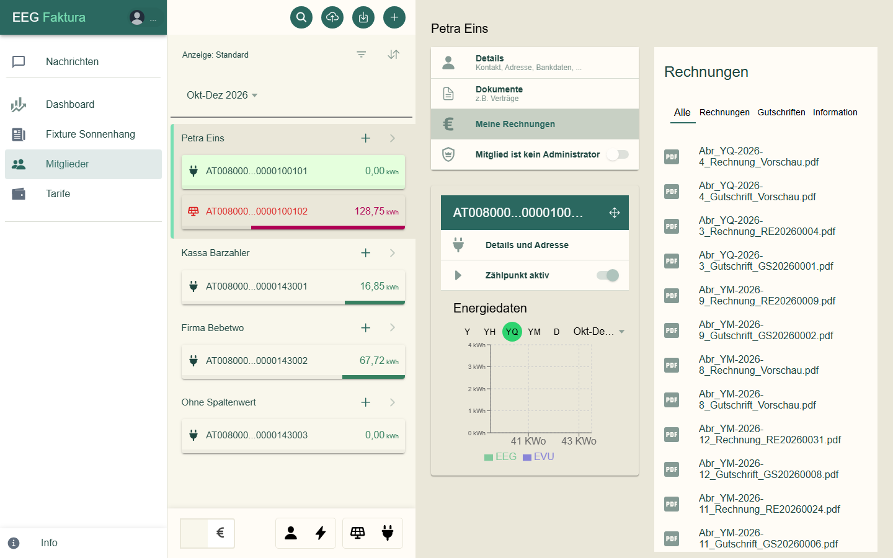

# Abrechnung

Am Ende jedes Abrechnungszeitraums erstellt eegFaktura für deine Mitglieder **Rechnungen** (Strombezug,
Mitgliedsbeitrag) und **Gutschriften** (Einspeisung). Abrechnen können nur EEG-Admins.

Der Ablauf in Kurzform:

1. [Abrechnungseinstellungen](#abrechnungseinstellungen) einmalig anlegen.
2. In der Mitgliederliste den **Abrechnungsmodus** einschalten und den Zeitraum wählen.
3. Eine **Vorschau** erstellen und prüfen — so oft du willst.
4. **Abrechnung durchführen** — endgültig, mit fortlaufenden Nummern.
5. Belege **senden**, als ZIP oder Excel herunterladen, **SEPA**-Dateien erzeugen.

## Abrechnungseinstellungen

Auf der **EEG-Seite** in der Karte **Abrechnungseinstellungen** (beim ersten Mal **Abrechnungseinstellungen
hinzufügen**):

| Feld | Wofür |
|------|-------|
| **Rechnungen: Text vor / nach Positionen, Abschlusstext** | Texte auf jeder Rechnung, z. B. Zahlungsbedingungen |
| **Präfix / Startwert für Rechnungsnummern** | Die Nummer setzt sich aus Präfix, Jahr des Belegdatums und laufender Nummer zusammen, z. B. `RE20260004`; die laufende Nummer beginnt je Jahr beim Startwert |
| **Gutschriften für Mitgliedstyp Privat: Texte** | Texte auf Gutschriften an Privatpersonen |
| **Präfix / Startwert für Gutschriftennummern** | wie bei den Rechnungen, z. B. `GS20260001` |
| **Gutschriften für Mitgliedstyp Firma: Texte** | Texte auf Gutschriften an Firmen (mit UID: Reverse Charge) |
| **Text für Fußzeile** | steht unten auf jedem Beleg |
| **Dokumentennummer: Anzahl Stellen** | Länge der laufenden Nummer (1–6, mit führenden Nullen) |
| **Bild für Logo** | das Logo oben auf den Belegen |

Änderungen werden gespeichert, sobald du ein Feld verlässt.

In allen Texten der Abrechnungseinstellungen (und in den Tariftexten) erzeugt `##` einen Zeilenumbruch.

### Was auf einem Beleg steht

Die Positionen sind je Zählpunkt gruppiert („Zählpunkt AT… – Anlagenname“, ggf. mit Rabatt):

- die **Energiemenge** mit Arbeitspreis (bei zeitbasierten Tarifen je Zeitraum),
- bei Verbrauchern mit Freikontingent eine Zeile „Menge (…) = Verbrauch (…) abzgl. freie kWh (…)“,
- die **Zählpunktgebühr**, wenn der Tarif eine hat,
- auf Rechnungen der **Mitgliedsbeitrag** des Mitglieds-Tarifs,
- im ersten endgültigen Lauf mit Energie (oder nach **Beitrittsgebühr nachverrechnen**) einmal die **Beitrittsgebühr**,
  immer auf einer Rechnung (ein reiner Erzeuger bekommt dafür eine eigene Rechnung neben der Gutschrift),
  siehe [Tarife](04-tarife.md#beitrittsgebuhr),
- Umsatzsteuer und Summen, darunter die Texte aus den Abrechnungseinstellungen und die Fußzeile.

Der Anlagenname des Zählpunkts erscheint auf dem Beleg — praktisch, wenn ein Mitglied mehrere Anlagen hat.

## Abrechnungsmodus

1. Öffne **Mitglieder** und wähle oben den **Zeitraum** (z. B. „Jul-Sep 2026“). Jeder Zeitraum hat seinen eigenen
   Abrechnungslauf. Die Anzeige **Standard** zeigt die Mitglieder dieses Zeitraums.
2. Schalte unten links den Schalter **€** ein. eegFaktura erklärt den Ablauf; bestätige mit **OK**.

Abgerechnet wird immer die **ganze Gemeinschaft**: alle aktiven Mitglieder mit Tarif (am Mitglied oder an einem
angemeldeten Zählpunkt). Auswählen musst du niemanden. Zählpunkte ohne Tarif nennt die
[Prüfung vor der Abrechnung](#vorschau-erstellen) unter **Tarif**.

Der Schalter **€** lässt sich einschalten, sobald die Energiedaten des Zeitraums geladen sind und darin mindestens ein
abrechenbares Mitglied vorkommt. Fährst du mit der Maus darüber, steht da „Abrechnungsmodus aktivieren“ bzw.
„Abrechnungsmodus beenden“ — oder, solange er gesperrt ist, der Grund, z. B. „Bitte zuerst einen Zeitraum wählen.“
oder „Im Zeitraum gibt es keine abrechenbaren Mitglieder (aktiv, mit Tarif).“

Im Abrechnungsmodus zeigen die Zählpunkt-Karten Beträge in € statt kWh.

## Vorschau erstellen

Wähle das **Rechnungsdatum** und klicke auf **Vorschau erstellen**. Vorher prüft eegFaktura die Daten des Zeitraums:

| Prüfung | Was sie zeigt |
|---------|---------------|
| **Tarif** | Zählpunkte ohne Tarif (für sie entsteht keine Position) |
| **L3-Werte** | Zählpunkte mit vorläufigen Werten des Netzbetreibers |
| **Energiebilanz** | ob Produktion, Verbrauch und Verteilung zusammenpassen |
| **Vollständigkeit** | Zählpunkte mit fehlenden Viertelstunden |

Die Prüfung umfasst alle aktiven Zählpunkte der Gemeinschaft. Die Pfeile klappen
die Details auf. Warnungen halten dich nicht auf (**Trotzdem Vorschau erstellen**), sie zeigen
aber, wo die Abrechnung noch unvollständig ist. Fehlende Daten forderst du unter
[Prozesse → Zählpunktdaten nachfordern](08-prozesse.md#zahlpunktdaten-nachfordern) an.

Sind die Energiedaten des Zeitraums noch nicht geladen oder gibt es darin kein abrechenbares Mitglied, startet
eegFaktura nach der Prüfung keinen Lauf und nennt unter „Abrechnung nicht möglich“ den Grund. Ein Zeitraum ganz ohne
Energiedaten wird also nicht abgerechnet.

Die Vorschau erstellt Belege mit dem Zusatz „Vorschau“ und ohne Nummern:

- Die Tabelle zeigt Rechnungen und Gutschriften netto, USt und brutto; **Saldo Zahlungen (brutto)** ist die zu
  erwartende Kontobewegung.
- **Marge bei Regelbesteuerung (netto)** ist ein rechnerischer Wert zur Orientierung, kein Buchungsbetrag und keine
  steuerliche Beratung.
- Den **Mitgliedsbeitrag** bekommt ein Mitglied nur, wenn es im Zeitraum mindestens einen Zählpunkt mit Energiedaten
  hat.
- Ist eine [Beitrittsgebühr](04-tarife.md#beitrittsgebuhr) fällig, steht sie in den Beträgen des Mitglieds in einer
  eigenen Zeile „Beitrittsgebühr:“ und ist in seiner Summe enthalten.
- **ZIP** lädt alle Vorschau-Belege als PDF herunter (Dateinamen mit der Mitgliedsnummer am Ende, z. B.
  `Abr_YM-2026-9_Rechnung_Vorschau_042.pdf`), **EXCEL** eine Aufstellung aller Positionen.
- **Vorschau Akt.** rechnet die Vorschau neu, z. B. nachdem du einen Tarif geändert oder Daten nachgefordert hast.

## Abrechnung durchführen

Passt die Vorschau, klicke auf **Abrechnung durchführen**. Die endgültigen Belege werden dabei **neu berechnet** — mit
den Tarifen, Stammdaten und Energiedaten im Moment des Klicks. Hat sich seit
der Vorschau etwas geändert, erstelle sie mit **Vorschau Akt.** direkt davor neu. eegFaktura prüft noch einmal und
warnt ausdrücklich:

> **Die Abrechnung ist endgültig.** Die Belege bekommen fortlaufende Nummern und lassen sich danach nicht mehr ändern
> oder löschen. Ein Belegdatum in der Zukunft ist nicht erlaubt.

Endgültige Läufe einer Gemeinschaft laufen nacheinander: Startest du einen, während ein anderer noch läuft (z. B.
für einen zweiten Zeitraum), bricht er ab mit „Ein endgültiger Abrechnungslauf dieser Gemeinschaft läuft gerade –
bitte nach dessen Ende erneut starten“.

Belege mit dem Betrag 0 werden nicht erstellt. Erzeuger ohne UID bekommen eine **Gutschrift**, Erzeuger mit UID eine
**Gutschrift im Reverse-Charge-Verfahren** (mit den Texten „Gutschriften für Mitgliedstyp Firma“).

## Nach der Abrechnung

| Knopf | Was er tut |
|-------|------------|
| **SENDEN** | schickt jedem Mitglied mit E-Mail-Adresse seinen Beleg als PDF, mit der Gemeinschaft in Kopie. Text und Betreff kommen aus den [E-Mail-Texten](03-email-texte.md) („Rechnung / Gutschrift“) |
| **DOWNLOAD** | alle Belege als ZIP (Dateinamen siehe unten) |
| **EXCEL** | Aufstellung aller Belege und Positionen, z. B. für die Buchhaltung |
| **SEPA** | Dateien für die Bank (siehe unten) |

> **Vor dem Senden:** **SENDEN** geht pro Lauf nur **einmal**. Einzelne Mails, die nicht zugestellt werden können
> (fehlende oder ungültige Adresse), zeigt eegFaktura nicht an, und der Versand lässt sich nicht wiederholen. Prüfe die
> E-Mail-Adressen deshalb vorher und gib Mitgliedern ohne Mail ihren Beleg aus dem **DOWNLOAD** (ZIP).

**Dateinamen im ZIP:** Rechnungen und Gutschriften heißen wie der Beleg, mit der Belegnummer, z. B.
`Abr_YM-2026-9_Rechnung_RG202600123.pdf`. Kommt ein Name zweimal vor, bekommt der zweite „ (2)“.

### SEPA-Dateien

**SEPA** öffnet den Dialog **SEPA Dateien**:

1. Wähle **Einzug am** (für die Lastschriften, voreingestellt heute) und **Überweisung am** (für die Gutschriften,
   voreingestellt fünf Tage später, nicht am Wochenende). Liegt die Überweisung vor dem Einzug, warnt eegFaktura.
   Passe das Einzugsdatum an das an, was eure Rechnungstexte versprechen.
2. Mit **SEPA Sammelbuchung** bucht die Bank die Datei als eine Sammelbuchung.
3. **Mitglieder zusammenfassen** **verrechnet** Rechnungen und Gutschriften je Konto (IBAN, Einzugsart, Mandat):
   Ist die Summe positiv, wird sie eingezogen, ist sie negativ, überwiesen, bei 0 gibt es keine Buchung. Beispiel:
   Rechnung 50 €, Gutschrift 20 € → Einzug 30 €. Ohne den Haken wird jeder Beleg einzeln gebucht. Beides ist
   voreingestellt.
4. Klicke auf **Generieren** und lade die Dateien mit **Herunterladen** herunter. Sie werden im Browser erstellt und
   nicht auf dem Server gespeichert.

Die Hinweise darunter nennen, was nicht in den Dateien ist, z. B.:

- keine Lastschrift-Datei, weil die Gemeinschaft keine **Creditor-ID** hat (EEG-Seite → Bankdaten),
- Mitglieder mit Einzugsart „Kein SEPA“ oder ohne Einzugsart,
- Mitglieder ohne IBAN — diese bitte händisch abwickeln.

### SEPA — Begriffe

- **Einzugsart CORE** (Basislastschrift): für alle Mitglieder; das Mitglied kann eine Lastschrift innerhalb von acht
  Wochen zurückbuchen lassen.
- **Einzugsart B2B** (Firmenlastschrift): nur für Firmen; das Mandat muss der Bank des Mitglieds vorliegen, eine
  Rückbuchung ist nur sehr kurz möglich.
- **Kein SEPA:** das Mitglied zahlt selbst (z. B. per Überweisung); es kommt nicht in die Lastschrift-Datei.
- **Mandatsreferenz** und **Mandatsdatum** (Datum der Unterschrift) stehen beim Mitglied unter Bankdaten; als
  Mandatsreferenz wird oft die Mitgliedsnummer verwendet.

Details zu Lastschriften klärt eure Bank.

## Belege eines Mitglieds

Beim Mitglied unter **Meine Rechnungen** stehen seine Belege, mit den Reitern Alle, Rechnungen, Gutschriften und
Information. Ein Klick öffnet das PDF:

Belege mit „Vorschau“ im Namen stammen aus einer Vorschau und sind nicht gültig.
