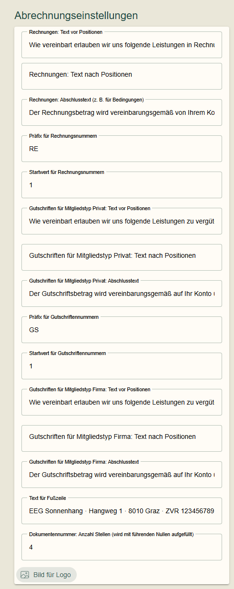
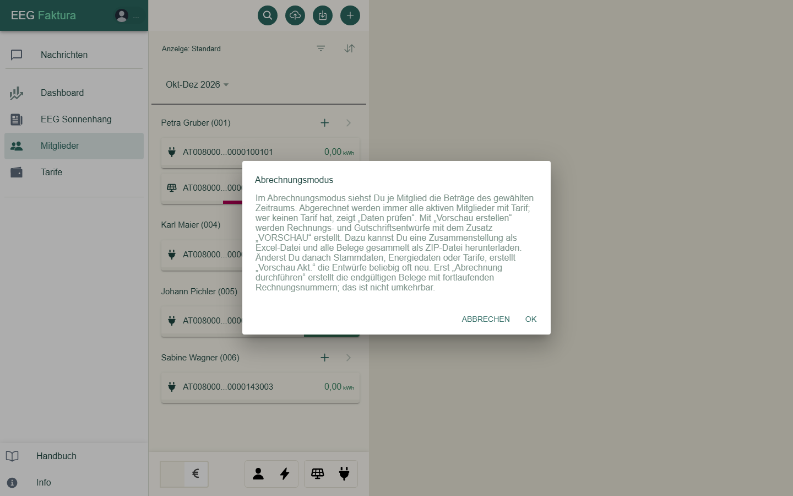
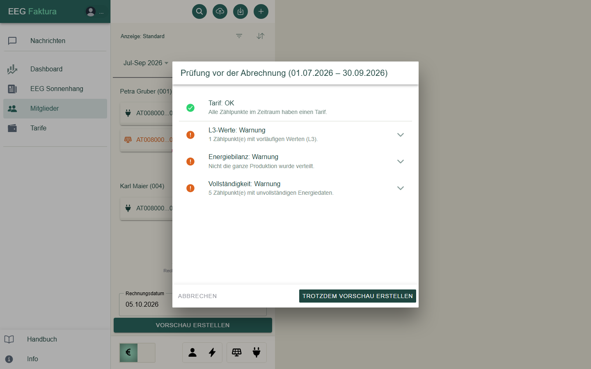
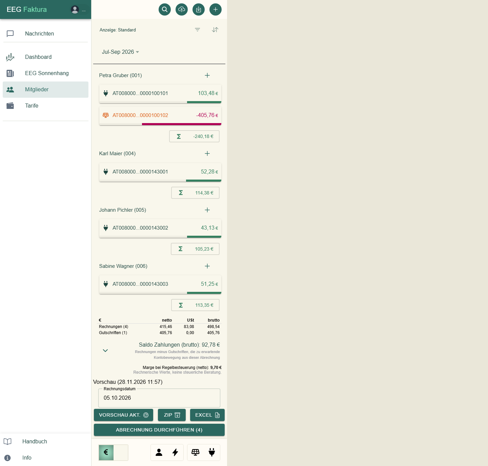
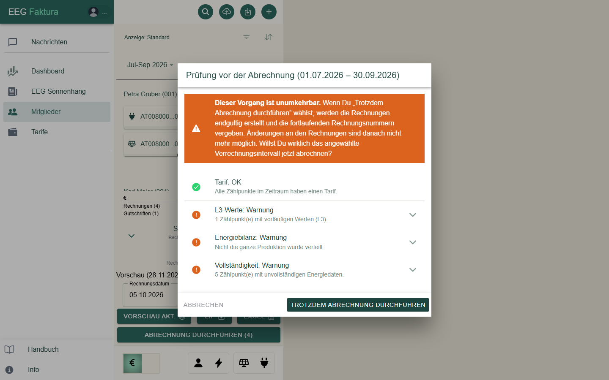
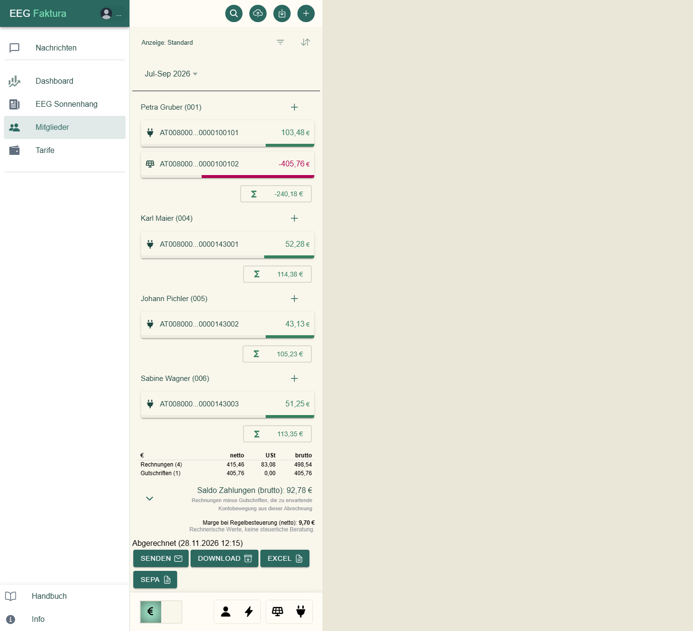
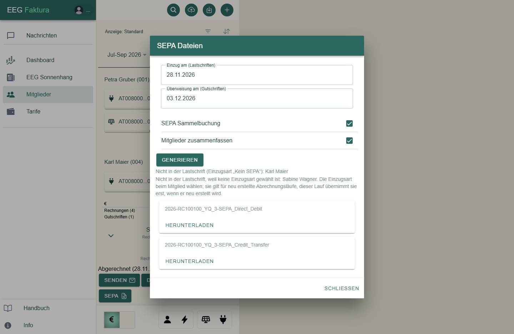
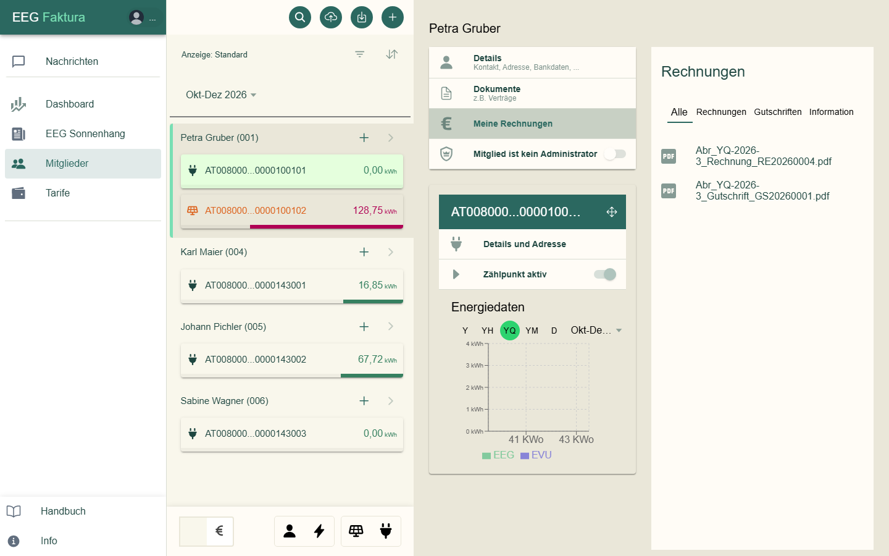

# Abrechnung

Am Ende jedes Abrechnungszeitraums erstellt eegFaktura für deine Mitglieder **Rechnungen** (Strombezug,
Mitgliedsbeitrag) und **Gutschriften** (Einspeisung). Abrechnen können nur EEG-Admins.

Der Ablauf in Kurzform:

1. [Abrechnungseinstellungen](#abrechnungseinstellungen) einmalig anlegen.
2. In der Mitgliederliste den Zeitraum wählen und den **Abrechnungsmodus** einschalten.
3. Eine **Vorschau** erstellen und prüfen — so oft du willst.
4. **Abrechnung durchführen** — endgültig, mit fortlaufenden Nummern.
5. Belege **senden**, als ZIP oder Excel herunterladen, **SEPA**-Dateien erzeugen.

## Abrechnungseinstellungen

Auf der **EEG-Seite** in der Karte **Abrechnungseinstellungen** (beim ersten Mal **Abrechnungseinstellungen
hinzufügen**):

| Feld | Wofür |
|------|-------|
| **Rechnungen: Text vor / nach Positionen, Abschlusstext** | Texte auf jeder Rechnung, z. B. Zahlungsbedingungen |
| **Präfix / Startwert für Rechnungsnummern** | Präfix + Jahr des Belegdatums + laufende Nummer, z. B. `RE20260004`. Die laufende Nummer beginnt jedes Jahr (und je Präfix) beim Startwert (vorbelegt 0 — trage 1 ein, wenn die erste Rechnung des Jahres auf 1 statt auf 0 enden soll) |
| **Gutschriften für Mitgliedstyp Privat: Texte** | Texte auf Gutschriften an Mitglieder **ohne UID** (siehe [Gutschriften und Umsatzsteuer](#gutschriften-und-umsatzsteuer)) |
| **Präfix / Startwert für Gutschriftennummern** | wie bei den Rechnungen, z. B. `GS20260001` |
| **Gutschriften für Mitgliedstyp Firma: Texte** | Texte auf Gutschriften an Mitglieder **mit UID** |
| **Text für Fußzeile** | steht unten auf jedem Beleg |
| **Dokumentennummer: Anzahl Stellen** | Länge der laufenden Nummer (1–6, mit führenden Nullen) |
| **Bild für Logo** | das Logo oben auf den Belegen |

Änderungen werden gespeichert, sobald du ein Feld verlässt.

In allen Texten der Abrechnungseinstellungen (und in den Tariftexten) erzeugt `##` einen Zeilenumbruch.

### Gutschriften und Umsatzsteuer

Welche Texte eine Gutschrift bekommt, hängt am Feld **UID** des Mitglieds, nicht an Privat oder Firma: Erzeuger ohne
UID bekommen die Texte „Gutschriften für Mitgliedstyp Privat“, Erzeuger mit eingetragener UID die Texte „Gutschriften
für Mitgliedstyp Firma“. Ob Umsatzsteuer auf der Gutschrift steht, bestimmt allein der Erzeugertarif
(**Umsatzsteuer anführen**). eegFaktura druckt von sich aus keinen Hinweis auf Reverse Charge; einen solchen Text
trägst du selbst ein, in den Texten für Mitgliedstyp Firma oder im
[Zusatztext des Tarifs](04-tarife.md#umsatzsteuer). Ob Reverse Charge anzuwenden ist, klärst du mit deiner
Steuerberatung.

### Was auf einem Beleg steht

Die Positionen sind je Zählpunkt gruppiert (siehe [Kopf je Zählpunkt](#kopf-je-zahlpunkt)):

- die **Energiemenge** mit Arbeitspreis (bei zeitbasierten Tarifen je Zeitraum),
- bei Verbrauchern mit Freikontingent eine Zeile „Menge (…) = Verbrauch (…) abzgl. freie kWh (…)“,
- die **Zählpunktgebühr**, wenn der Tarif eine hat: immer auf der Rechnung, auch für Erzeuger-Zählpunkte (ein reiner
  Erzeuger bekommt dafür eine Rechnung neben der Gutschrift). Bei Verbrauchern gilt die USt des Tarifs, bei Erzeugern
  **USt. für Zählpunktgebühr in %**,
- auf Rechnungen der **Mitgliedsbeitrag** des Mitglieds-Tarifs,
- einmal die **Beitrittsgebühr**, wenn sie fällig ist (siehe [Tarife](04-tarife.md#beitrittsgebuhr)),
- Umsatzsteuer und Summen, darunter die Texte aus den Abrechnungseinstellungen und die Fußzeile,
- die **Bankverbindung** des Mitglieds: der Name der Bank (falls eingetragen), der Kontoinhaber und von der IBAN nur
  die letzten vier Stellen („******1234“; ohne IBAN steht nur „******“); darunter die SEPA-Mandatsreferenz — ist
  keine eingetragen, steht dort die Mitgliedsnummer.

#### Kopf je Zählpunkt

--8<-- "pilot.md"

Über den Positionen eines Zählpunkts steht „Zählpunkt AT… – Anlagenname (Anlage-Nr. …)“. Hat der Tarif einen Rabatt,
steht er in derselben Klammer: „(Anlage-Nr. …, Rabatt 10 %)“. Fehlt der Anlagenname oder die Anlage-Nr., fällt der
jeweilige Teil weg. Schon erstellte Belege bleiben, wie sie sind.

Der Anlagenname des Zählpunkts erscheint auf dem Beleg — praktisch, wenn ein Mitglied mehrere Anlagen hat. Dort
kannst du z. B. auch eine Kostenstelle oder die Adresse der Anlage eintragen, etwa bei einer Gemeinde mit mehreren
Objekten. Soll jede Kostenstelle eine eigene Rechnung bekommen, legst du je Kostenstelle ein eigenes Mitglied an.
Jedes dieser Mitglieder bekommt dann einen eigenen Mitgliedsbeitrag (und gegebenenfalls die Beitrittsgebühr) —
wähle bei Bedarf einen Mitgliedstarif ohne Beitrag. Bestehende Zählpunkte verschiebst du mit dem Pfeilkreuz.

Alle Zahlen stehen mit Tausenderpunkt, z. B. „21.345,00 kWh“ oder „1.234,56“ €.

## Abrechnungsmodus

1. Öffne **Mitglieder** und wähle oben den **Zeitraum** (z. B. „Jul-Sep 2026“). Jeder Zeitraum hat seinen eigenen
   Abrechnungslauf. Die Anzeige **Standard** zeigt die Mitglieder dieses Zeitraums.
2. Schalte unten links den Schalter **€** ein. eegFaktura erklärt den Ablauf; bestätige mit **OK**.

Abgerechnet wird immer die **ganze Gemeinschaft**: alle aktiven Mitglieder mit Tarif (am Mitglied oder an einem
angemeldeten Zählpunkt). Auswählen musst du niemanden. Zählpunkte ohne Tarif nennt die
[Prüfung vor der Abrechnung](#vorschau-erstellen) unter **Tarif**.

Der Schalter **€** lässt sich einschalten, sobald die Energiedaten des Zeitraums geladen sind und darin mindestens ein
abrechenbares Mitglied vorkommt. Solange er gesperrt ist, steht der Grund da, wenn du mit der Maus darüberfährst.

Im Abrechnungsmodus zeigen die Zählpunkt-Karten Beträge in € statt kWh.

## Vorschau erstellen

Wähle das **Rechnungsdatum** (es darf nicht in der Zukunft liegen) und klicke auf **Vorschau erstellen**. Vorher
prüft eegFaktura die Daten des Zeitraums:

| Prüfung | Was sie zeigt |
|---------|---------------|
| **Tarif** | Zählpunkte ohne Tarif (für sie entsteht keine Position) |
| **L3-Werte** | Zählpunkte mit vorläufigen Werten des Netzbetreibers |
| **Energiebilanz** | ob Produktion, Verbrauch und Verteilung zusammenpassen |
| **Vollständigkeit** | Zählpunkte mit fehlenden Viertelstunden |

Die Prüfung umfasst alle aktiven Zählpunkte der Gemeinschaft. Die Pfeile klappen
die Details auf. Warnungen halten dich nicht auf (**Trotzdem Vorschau erstellen**), sie zeigen
aber, wo die Abrechnung noch unvollständig ist. Fehlende Daten forderst du unter
[Prozesse → Zählpunktdaten nachfordern](08-prozesse.md#zahlpunktdaten-nachfordern) an.

Sind die Energiedaten des Zeitraums noch nicht geladen oder gibt es darin kein abrechenbares Mitglied, startet
eegFaktura nach der Prüfung keinen Lauf und nennt unter „Abrechnung nicht möglich“ den Grund. Ein Zeitraum ganz ohne
Energiedaten wird also nicht abgerechnet.

Die Vorschau erstellt Belege ohne Nummer: Im PDF steht statt der Nummer „-- E N T W U R F --“, der Dateiname enthält
„Vorschau“.

- Die Tabelle zeigt Rechnungen und Gutschriften netto, USt und brutto; **Saldo Zahlungen (brutto)** ist die zu
  erwartende Kontobewegung. Der Pfeil links davon klappt die Aufstellung zu und auf.
- Darunter steht je nach euren Verbrauchertarifen **Marge bei Regelbesteuerung (netto)** (Tarife mit USt) oder
  **Marge bei Kleinunternehmerregelung (brutto)** (Tarife ohne USt), bei gemischten Tarifen beide. Bei
  Kleinunternehmerregelung oder gemischten Tarifen zeigt eegFaktura für Gutschriften ohne USt an Erzeuger mit UID
  zusätzlich „Rechnerische USt bei Reverse Charge (20 %)“; ist auf solchen Gutschriften USt ausgewiesen, steht dort
  ein gelber Hinweis. Das sind rechnerische Werte zur
  Orientierung, keine Buchungsbeträge und keine steuerliche Beratung.
- Den **Mitgliedsbeitrag** bekommt ein Mitglied nur, wenn es im Zeitraum mindestens einen Zählpunkt mit Energiedaten
  hat.
- Eine fällige [Beitrittsgebühr](04-tarife.md#beitrittsgebuhr) steht bei den Beträgen des Mitglieds in einer eigenen
  Zeile „Beitrittsgebühr:“ und ist in seiner Summe enthalten.
- **ZIP** lädt alle Vorschau-Belege als PDF herunter, **EXCEL** eine Aufstellung aller Positionen.
- **Vorschau Akt.** rechnet die Vorschau neu, z. B. nachdem du einen Tarif geändert oder Daten nachgefordert hast.

## Abrechnung durchführen

Bei Gemeinschaften mit dem Modell **P2P** oder **EVA** gibt es nur die Vorschau, keine endgültige Abrechnung (siehe
[Peer-to-Peer und Eigenversorgung](eeg-seite.md#peer-to-peer-und-eigenversorgung)).

Passt die Vorschau, klicke auf **Abrechnung durchführen** (die Zahl in Klammern am Knopf nennt die Mitglieder mit
Beträgen). Die endgültigen Belege werden dabei **neu berechnet** — mit den Tarifen, Stammdaten und Energiedaten im
Moment des Klicks. Hat sich seit der Vorschau etwas geändert, erstelle sie mit **Vorschau Akt.** direkt davor neu.

!!! warning "Rechnungsdatum noch einmal prüfen"
    Das **Rechnungsdatum** der endgültigen Belege steht im Feld über **Vorschau Akt.**: Es ist mit heute vorbelegt und
    übernimmt das Datum der ersten Vorschau nicht — stelle ein abweichendes Datum dort noch einmal ein. Ein Datum in
    der Vergangenheit ist erlaubt, eines in der Zukunft nicht. Rechnest du z. B. den Dezember erst im Jänner ab,
    kannst du den 31.12. wählen: Die Belegnummern tragen dann das Jahr des Rechnungsdatums und zählen in dessen
    Nummernfolge weiter. Welches Datum für eure Buchhaltung passt, klärst du mit deiner Steuerberatung.

eegFaktura prüft noch einmal und warnt ausdrücklich:

> **Die Abrechnung ist endgültig.** Die Belege bekommen fortlaufende Nummern und lassen sich danach nicht mehr ändern
> oder löschen.

Endgültige Läufe einer Gemeinschaft laufen nacheinander: Startest du einen, während ein anderer noch läuft (z. B.
für einen zweiten Zeitraum), bricht er ab mit „Ein endgültiger Abrechnungslauf dieser Gemeinschaft läuft gerade –
bitte nach dessen Ende erneut starten“.

Schlägt ein Lauf fehl, steht unten „Abrechnung fehlgeschlagen (…)“ mit dem Grund. Behebe ihn und erstelle die
Vorschau neu. Einen Zeitraum, der sich mit einem schon endgültig abgerechneten überschneidet, rechnet eegFaktura
nicht noch einmal ab.

Belege mit dem Betrag 0 werden nicht erstellt. Welche Texte eine Gutschrift bekommt und was für die Umsatzsteuer
gilt, steht unter [Gutschriften und Umsatzsteuer](#gutschriften-und-umsatzsteuer).

## Nach der Abrechnung

| Knopf | Was er tut |
|-------|------------|
| **SENDEN** | schickt jedem Mitglied mit E-Mail-Adresse seinen Beleg als PDF, mit der Gemeinschaft in Kopie. Text und Betreff kommen aus den [E-Mail-Texten](03-email-texte.md) („Rechnung / Gutschrift“) |
| **DOWNLOAD** | alle Belege als ZIP; die Dateien heißen wie die Belege, mit der Belegnummer |
| **EXCEL** | Aufstellung aller Belege und Positionen, z. B. für die Buchhaltung |
| **SEPA** | Dateien für die Bank (siehe unten) |

> **Vor dem Senden:** **SENDEN** fragt nach („Jetzt … Abrechnungsdokumente per E-Mail an die Mitglieder versenden?“)
> und geht pro Lauf nur **einmal**: Danach steht am Knopf „Bereits versendet (Datum)“. Nur wenn der Mailserver gar
> keine Mail bestätigt hat, heißt der Knopf **Erneut senden**. Einzelne Mails, die nicht zugestellt werden können
> (fehlende oder ungültige Adresse), zeigt eegFaktura nicht an, und sie lassen sich nicht nachsenden. Prüfe die
> E-Mail-Adressen deshalb vorher und gib Mitgliedern ohne Mail ihren Beleg aus dem **DOWNLOAD** (ZIP).

### SEPA-Dateien

**SEPA** öffnet den Dialog **SEPA Dateien**:

Voraussetzung sind IBAN und BIC der Gemeinschaft (EEG-Seite → Bankdaten), für Lastschriften zusätzlich die
Creditor-ID. Fehlt IBAN oder BIC, entsteht keine Datei, und eegFaktura meldet z. B. „Die BIC der EEG wurde noch nicht
konfiguriert.“

1. Wähle **Einzug am** (für die Lastschriften, voreingestellt heute) und **Überweisung am** (für die Gutschriften,
   voreingestellt fünf Tage später, nicht am Wochenende). Liegt die Überweisung vor dem Einzug, warnt eegFaktura.
   Passe das Einzugsdatum an das an, was eure Rechnungstexte versprechen.
2. Mit **SEPA Sammelbuchung** bucht die Bank die Datei als eine Sammelbuchung.
3. **Mitglieder zusammenfassen** **verrechnet** Rechnungen und Gutschriften je Konto (IBAN, Einzugsart, Mandat):
   Ist die Summe positiv, wird sie eingezogen, ist sie negativ, überwiesen, bei 0 gibt es keine Buchung. Beispiel:
   Rechnung 50 €, Gutschrift 20 € → Einzug 30 €. Ohne den Haken wird jeder Beleg einzeln gebucht. Beides ist
   voreingestellt.
4. Klicke auf **Generieren** und lade die Dateien mit **Herunterladen** herunter. Es entstehen bis zu drei Dateien:
   Lastschrift CORE, Lastschrift B2B und Überweisung (Gutschriften). Sie werden im Browser erstellt und nicht auf dem
   Server gespeichert.

Bankdaten, Mandat und Einzugsart stammen aus den Belegen des Laufs, also vom Stand beim Abrechnen. Änderst du sie
danach beim Mitglied, wirkt das erst im nächsten Lauf; diesen Fall wickelst du händisch ab.

Die Hinweise darunter nennen, was nicht in den Dateien ist, z. B.:

- keine Lastschrift-Datei, weil die Gemeinschaft keine **Creditor-ID** hat (EEG-Seite → Bankdaten),
- Mitglieder mit Einzugsart „Kein SEPA“ oder ohne Einzugsart,
- Mitglieder ohne IBAN — diese bitte händisch abwickeln.

#### Format der Dateien

--8<-- "pilot.md"

Die Dateien entsprechen ISO 20022 in der Version 2019: Lastschrift `pain.008.001.08`, Überweisung
`pain.001.001.09`. Fragt eure Bank nach dem Format, nenne diese Bezeichnungen. Nimmt eure Bank die Datei nicht an,
melde dich beim [Support](einrichtung-hilfe.md#hilfe-und-support).

### SEPA — Begriffe

- **Einzugsart CORE** (Basislastschrift): für alle Mitglieder; das Mitglied kann eine Lastschrift innerhalb von acht
  Wochen zurückbuchen lassen.
- **Einzugsart B2B** (Firmenlastschrift): nur für Firmen; das Mandat muss der Bank des Mitglieds vorliegen, eine
  Rückbuchung ist nur sehr kurz möglich.
- **Kein SEPA:** das Mitglied zahlt selbst (z. B. per Überweisung); es kommt nicht in die Lastschrift-Datei.
- **Mandatsreferenz** und **Mandatsdatum** (Datum der Unterschrift) stehen beim Mitglied unter Bankdaten; als
  Mandatsreferenz wird oft die Mitgliedsnummer verwendet.

Details zu Lastschriften klärt eure Bank.

## Belege eines Mitglieds

Beim Mitglied unter **Meine Rechnungen** stehen seine Belege, mit den Reitern Alle, Rechnungen, Gutschriften und
Information. Ein Klick öffnet das PDF:

Belege mit „Vorschau“ im Namen stammen aus einer Vorschau und sind nicht gültig.

## Abrechnungsintervall wechseln {#abrechnungszeitraum-wechseln}

Ob deine Gemeinschaft monatlich, vierteljährlich, halbjährlich oder jährlich abrechnet, stellst du auf der
**EEG-Seite** unter **Allgemeines → Abrechnungsintervall** ein. Ändern können das nur EEG-Admins.

Wählst du einen anderen Wert, öffnet sich der Dialog **Abrechnungsintervall wechseln**. eegFaktura prüft dort zuerst, ob
der Wechsel möglich ist, und zeigt:

- das bisherige und das neue Intervall,
- ab wann das neue Intervall gilt, oder warum der Wechsel noch nicht geht und wann er frühestens möglich ist,
- den Zeitraum, der zuletzt endgültig abgerechnet wurde.

Mit **Wechseln** speicherst du die Änderung, mit **Abbrechen** bleibt alles, wie es war. Nach dem Wechsel ist bei der
Abrechnung gleich der erste offene Zeitraum des neuen Intervalls ausgewählt, und die Meldung nennt ihn (z. B.
„Als Nächstes abzurechnen: 2. Quartal 2026.“).

### Ab wann das neue Intervall gilt

Das neue Intervall gilt ab dem Beginn des Zeitraums, der auf die letzte **endgültige** Abrechnung folgt. Dafür muss
alles bis dahin im bisherigen Intervall abgerechnet sein. So kann kein Zeitraum doppelt abgerechnet werden oder
übrig bleiben.

**Beispiel:** Deine Gemeinschaft rechnet monatlich ab und will auf vierteljährlich wechseln.

- **Bis März abgerechnet:** Der Wechsel gilt ab April. Als Nächstes rechnest du das 2. Quartal ab.
- **Bis Februar abgerechnet:** Der Wechsel geht noch nicht, denn das 1. Quartal enthält Jänner und Februar, die schon
  abgerechnet sind. Rechne zuerst März noch monatlich ab. Danach ist der Wechsel ab April möglich.

Genauso wirkt ein Wechsel auf halbjährlich zum 1. Jänner oder 1. Juli, auf jährlich zum 1. Jänner und auf monatlich zu
jedem Monatsbeginn. Wurde noch nie endgültig abgerechnet, gilt das neue Intervall sofort.

??? note "Was den Wechsel aufhält"
    - **Noch nicht abgerechnete Zeiträume** vor dem neuen Beginn (siehe Beispiel). Der Dialog nennt sie und den
      frühestmöglichen Beginn.
    - **Lücken in den letzten 12 Monaten:** Ist in den 12 Monaten bis einschließlich zum letzten endgültig
      abgerechneten Monat ein Monat nicht endgültig abgerechnet, geht der Wechsel nicht; die Meldung nennt den Monat
      (z. B. „Februar 2026 ist noch nicht endgültig abgerechnet.“). Ältere Lücken halten den Wechsel nicht auf, die
      Meldung weist aber darauf hin (z. B. „Hinweis: März bis Mai 2024 wurden nicht endgültig abgerechnet.“). Monate
      vor der allerersten endgültigen Abrechnung zählen nicht.
    - **Eine Berechnung, die gerade läuft** für einen Zeitraum, den der Wechsel betrifft, z. B. eine Abrechnung, die
      du eben gestartet hast. Warte, bis sie fertig ist, und versuche es dann noch einmal.

    Eine **fertige Vorschau** hält den Wechsel nicht auf. Sie ist nicht endgültig und zählt nicht als abgerechnet. Nur
    solange eine Vorschau gerade rechnet, wartet der Wechsel wie bei jeder laufenden Berechnung.

### Was sich ändert und was nicht

- Bestehende Belege, ihre Nummern und Exporte bleiben unverändert. Schon abgerechnete Zeiträume werden nicht neu
  berechnet.
- Nach dem Wechsel bietet eegFaktura bei der Abrechnung die Zeiträume des neuen Intervalls an.
- **Mitgliedsbeitrag, Zählpunktgebühr und kostenlose Energie (kWh)** gelten
  **je Abrechnungsintervall**, das heißt je Abrechnung. Bleibt der Tarif gleich, ändert sich mit dem Intervall also
  der Jahresbetrag: Ein Mitgliedsbeitrag von 5 € ergibt monatlich abgerechnet 60 € im Jahr,
  vierteljährlich abgerechnet 20 €. Prüfe deshalb vor dem Wechsel die [Tarife](04-tarife.md) und passe die Beträge an.
- Die einmalige [Beitrittsgebühr](04-tarife.md#beitrittsgebuhr) ist nicht betroffen.

### Sache der Gemeinschaft

Ob die Gemeinschaft das Intervall wechselt, entscheidet sie selbst. Auch die Mitglieder informiert die Gemeinschaft
selbst — eegFaktura schickt ihnen dazu keine Nachricht.
