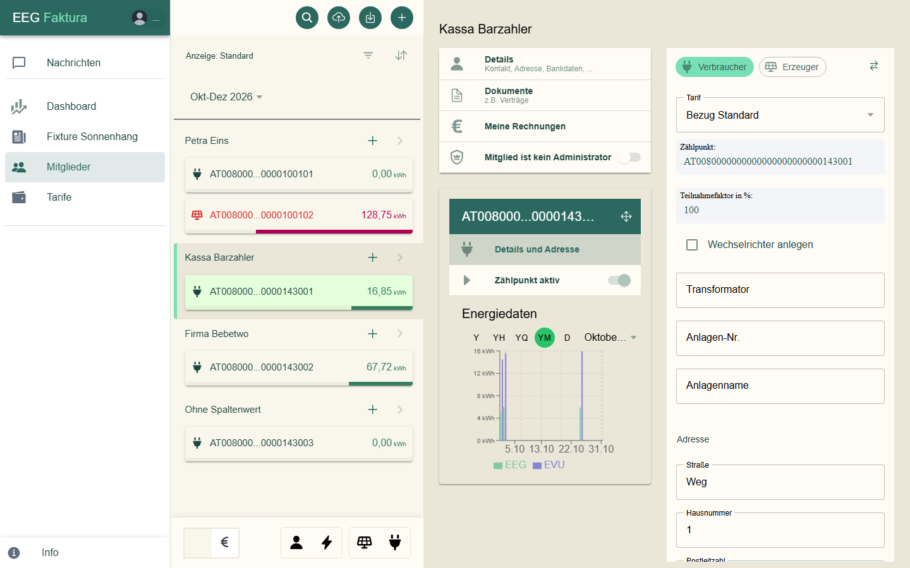
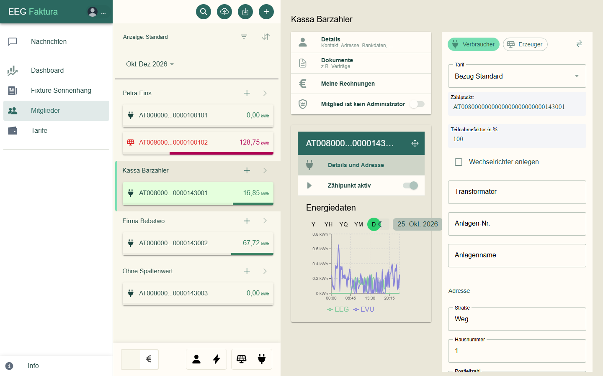
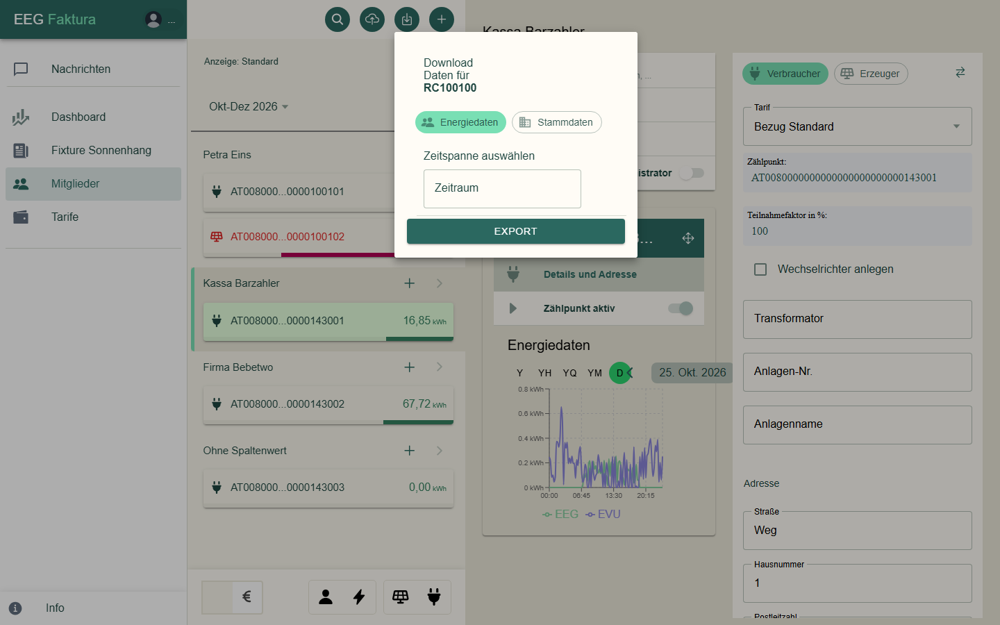

# Energiedaten

Der Netzbetreiber schickt für jeden aktiven Zählpunkt die Energiedaten in Viertelstundenwerten. eegFaktura speichert
sie und rechnet daraus die Anteile der Gemeinschaft.

## In der Mitgliederliste

Jede Zählpunkt-Karte zeigt die Energiemenge im gewählten Zeitraum:

- bei **Verbrauchern** den Anteil, den sie aus der Gemeinschaft bezogen haben,
- bei **Erzeugern** den Teil ihrer Einspeisung, der nicht in der Gemeinschaft verteilt wurde.

Den Zeitraum wählst du oben in der Liste.

## Diagramm eines Zählpunkts

Ein Klick auf einen aktiven Zählpunkt zeigt unter **Energiedaten** ein Diagramm:

| Knopf | Ansicht |
|-------|---------|
| **Y** | ein Jahr |
| **YH** | ein Halbjahr |
| **YQ** | ein Quartal |
| **YM** | ein Monat |
| **D** | ein Tag in Viertelstunden |

**EEG** (grün) ist der Anteil aus der Gemeinschaft, **EVU** der Rest vom Energieversorger bzw. ins Netz. In der
Tagesansicht blätterst du mit den Pfeilen; sie beginnt beim letzten Tag mit Daten:

## Energiedaten exportieren

Der Knopf mit dem Pfeil nach unten oben in der Mitgliederliste öffnet **Download Daten für …**:

1. Wähle **Energiedaten** (oder **Stammdaten** für die Mitglieder- und Zählpunktdaten).
2. Bei Energiedaten: Wähle unter **Zeitspanne auswählen** den **Zeitraum**.
3. Klicke auf **Export**. Du bekommst eine Excel-Datei.

Im **Stammdaten**-Export stehen im Blatt „Mitglieder“ nach „Mitgliedstarif“ die Spalten „Beitrittsgebühr (€)“ und
„Beitrittsgebühr Status“, mit denselben Texten wie beim
[Mitglied](02-mitglieder-zaehlpunkte.md#beitrittsgebuhr-eines-mitglieds). Ist die Abrechnung gerade nicht
erreichbar, sagt eegFaktura das; der Export enthält dann alle Mitglieder, nur die Status-Spalte bleibt leer.

Die Excel-Datei mit den Energiedaten hat zwei Blätter:

- **Summary**: Summen der Gemeinschaft (Verbrauch, Erzeugung, Eigendeckung, Überschuss, Mengenbilanz — sie sollte
  nahe 0 sein) und je Zählpunkt, ab wann und bis wann Daten da sind und ob sie **vollständig** sind.
- **Energiedaten**: alle Viertelstundenwerte je Zählpunkt.

Die Farben zeigen die Qualität der Werte:

| Kennung | Bedeutung | Farbe |
|---------|-----------|-------|
| L1 | gemessener Wert | ohne |
| L2 | Ersatzwert des Netzbetreibers (gilt als vollständig) | gelb |
| L3 | vorläufiger oder fehlerhafter Wert | rot |
| L0 | kein Wert | grau |

Werte mit L0 oder L3 machen einen Zählpunkt „nicht vollständig“. Für sie kannst du die Daten unter
[Prozesse → Zählpunktdaten nachfordern](08-prozesse.md#zahlpunktdaten-nachfordern) erneut anfordern — mit „Smart“
nur die fehlenden.

## Woraus die Werte entstehen

Der Netzbetreiber schickt je Zählpunkt mehrere Messreihen. eegFaktura verwendet:

| Zählpunkt | Messreihe | Bedeutung |
|-----------|-----------|-----------|
| Verbraucher | Gesamtverbrauch | was der Zählpunkt insgesamt bezogen hat |
| Verbraucher | Eigendeckung (G.03) | der Anteil aus der Gemeinschaft — **Grundlage der Rechnung** |
| Erzeuger | Erzeugung | was die Anlage insgesamt eingespeist hat |
| Erzeuger | Überschuss | was davon nicht in der Gemeinschaft verbraucht wurde |

Abgerechnet wird beim Erzeuger **Erzeugung minus Überschuss**, also der in der Gemeinschaft verteilte Teil. Das zeigen
auch die Karten in der Mitgliederliste.

### Typische Effekte

- **Zeitumstellung:** Ein Tag der Umstellung hat 92 bzw. 100 Viertelstunden statt 96 — beim Nachrechnen von Hand
  daran denken.
- **Korrekturen:** Vorläufige Werte (L3) ersetzt der Netzbetreiber später durch gemessene oder Ersatzwerte (L2).
  Kleine Differenzen von Bruchteilen eines Prozents zwischen zwei Abfragen sind dadurch normal.
- **Mengenbilanz** im Export und **Bilanzdifferenz** im Dashboard sollten nahe 0 sein. Größere Abweichungen deuten auf
  fehlende Daten hin — siehe [Bilanzdifferenz](01-anmeldung.md#dashboard).

## Energiedaten importieren

Der Knopf mit der Wolke öffnet **Upload Daten für …**. Mit **Stammdaten** liest du Mitglieder und Zählpunkte aus einer
Excel-Datei ein (Blatt „EEG Stammdaten“). Nur bei Gemeinschaften **ohne Online-Anbindung** gibt es zusätzlich
**Energiedaten** (Blatt „Energiedaten“). Heißt das Blatt in deiner Datei anders, trägst du seinen Namen unter
**Sheet-Name** ein. Wähle die Datei mit dem Stern oder ziehe sie in das Fenster (eine Datei je Import) und klicke auf
**Import**.
