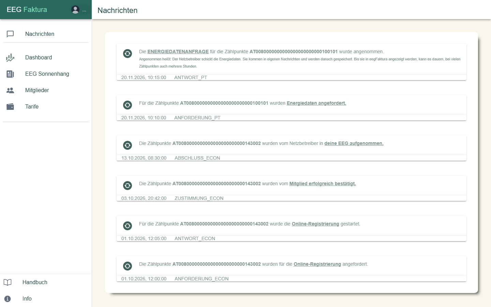

# Nachrichten

Unter **Nachrichten** (nur EEG-Admins) zeigt eegFaktura die Rückmeldungen des Netzbetreibers und eigene Hinweise,
die neuesten oben. Die Seite zeigt die letzten 30 Nachrichten.

Jede Nachricht hat unten Datum, Uhrzeit und ein technisches Kürzel für die Art (z. B. `ANTWORT_ECON`). Das Kürzel
hilft dem Support, du brauchst es sonst nicht. Die häufigsten Nachrichten:

| Nachricht | Bedeutung |
|-----------|-----------|
| Online-Registrierung angefordert / gestartet | eegFaktura hat einen Zählpunkt beim Netzbetreiber angemeldet, der Netzbetreiber hat sie angenommen |
| … vom Mitglied erfolgreich bestätigt | das Mitglied hat die Datenfreigabe bestätigt |
| … vom Netzbetreiber in deine EEG aufgenommen | der Zählpunkt ist aktiv |
| … abgelehnt (Code) | der Netzbetreiber hat abgelehnt; der Grund steht beim Zählpunkt und in der [Prozess History](08-prozesse.md#prozess-history) |
| Energiedatenanfrage … angenommen | eine Nachforderung wurde angenommen; die Daten kommen danach in eigenen Nachrichten, bei vielen Zählpunkten kann das Stunden dauern |
| **Energiedaten-Anforderung läuft** | Zwischenstand einer laufenden Nachforderung; Zählpunkte ohne Antwort stehen unter „Antwort noch offen“. Die Nachricht wird danach zur Zusammenfassung |
| **Zusammenfassung Energiedaten-Anforderung** | Ergebnis einer Nachforderung: wie viele Zählpunkte angefordert und angenommen wurden, darunter aufklappbar „Abgelehnt“, „Keine Antwort“, „Bereits angefordert“ (mit „frei ab …“), „Nicht angefordert“ und „Keine fehlenden Daten oder L3-Werte“. **Datenstand prüfen** zeigt, ob die Daten inzwischen da sind |
| Datenfreigabe aufgehoben | ein Zählpunkt ist nicht mehr Teil der Gemeinschaft |
| Antwort / Ablehnung zur Aufhebung | der Netzbetreiber hat eine Abmeldung bestätigt oder abgelehnt; eine Ablehnung nennt den Grund, z. B. „Keine Datenfreigabe vorhanden“ (siehe [Zählpunkt abmelden](08-prozesse.md#was-nach-dem-anfordern-passiert)) |
| Teilnahmefaktor … abgelehnt | der Netzbetreiber hat eine Änderung des Teilnahmefaktors abgelehnt; bei „Prozessdatum falsch“ zwischen 9 und 17 Uhr erneut senden. Eine Annahme erscheint nur in der [Prozess History](08-prozesse.md#prozess-history) (ANTWORT_CPF) |
| E-Mail-Texte: … | ein eigener Mailtext konnte nicht verwendet werden, es ging der Standardtext hinaus; oder eegFaktura hat den Standardtext einer Mail geändert, die ihr angepasst habt — eure Fassung gilt weiter (siehe [E-Mail-Texte](03-email-texte.md)) |
| Mailversand nicht bestätigt: … | der Mailserver hat nicht rechtzeitig geantwortet; die Mail ging vermutlich trotzdem hinaus. Frag beim Empfänger nach, bevor du sie noch einmal auslöst |
| Mailversand fehlgeschlagen: … | eine der Mails zu Zählpunkten (Freigabe-Aufforderung, aktiv, inaktiv) konnte nicht verschickt werden, mit Grund. Fehler beim Versand von Rechnungen erscheinen hier **nicht** (siehe [Abrechnung](05-abrechnung.md#nach-der-abrechnung)) |
| Excel Stammdaten importiert — Hinweise: … | ein Stammdaten-Import hat Hinweise oder Fehler ergeben (siehe [Stammdaten aus Excel importieren](02-mitglieder-zaehlpunkte.md#stammdaten-aus-excel-importieren)). Ohne Hinweise kommt keine Nachricht |

Nachrichten lassen sich nicht als gelesen markieren oder löschen. Läuft gerade eine Nachforderung, lädt die Seite
jede Minute neu.

Kommt nach einer Anmeldung oder Nachforderung auch nach Stunden nicht einmal die Bestätigung des Netzbetreibers
(„angenommen“ bzw. „gestartet“), wende dich an den [Support](einrichtung-hilfe.md#hilfe-und-support). Die
Energiedaten selbst brauchen länger (siehe [Wie lange dauert es?](08-prozesse.md#wie-lange-dauert-es)).
