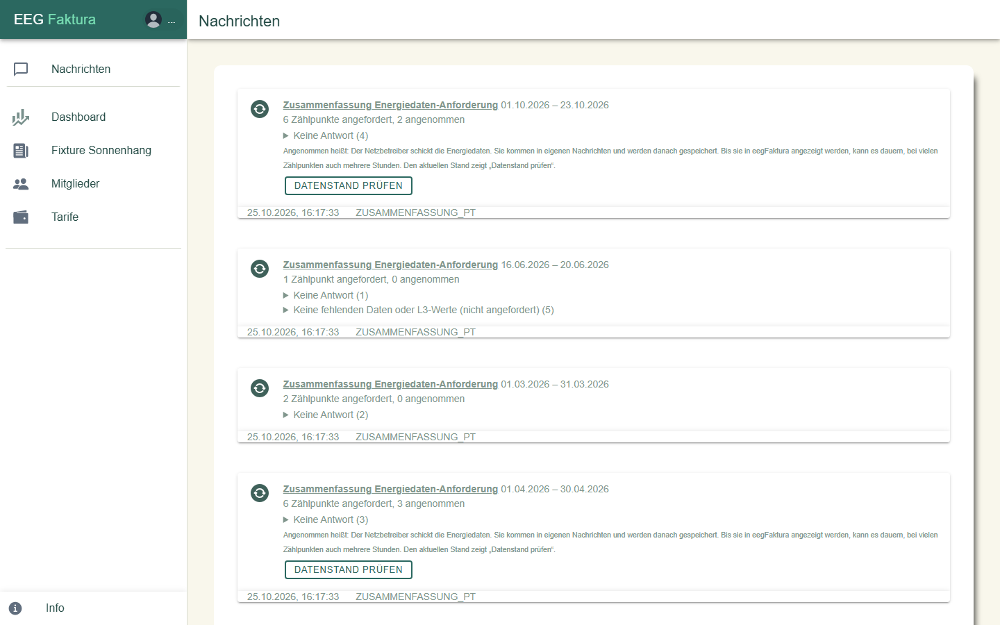

# Nachrichten

Unter **Nachrichten** (nur EEG-Admins) zeigt eegFaktura die Rückmeldungen des Netzbetreibers und eigene Hinweise,
die neuesten oben. Die Seite zeigt die letzten 30 Nachrichten.

Jede Nachricht hat unten Datum, Uhrzeit und die Art. Die häufigsten:

| Nachricht | Bedeutung |
|-----------|-----------|
| Online-Registrierung angefordert / gestartet | eegFaktura hat einen Zählpunkt beim Netzbetreiber angemeldet, der Netzbetreiber hat sie angenommen |
| … vom Mitglied erfolgreich bestätigt | das Mitglied hat die Datenfreigabe bestätigt |
| … vom Netzbetreiber in deine EEG aufgenommen | der Zählpunkt ist aktiv |
| … abgelehnt (Code) | der Netzbetreiber hat abgelehnt; der Grund steht beim Zählpunkt und in der [Prozess History](08-prozesse.md#prozess-history) |
| Energiedatenanfrage … angenommen | eine Nachforderung wurde angenommen; die Daten kommen danach in eigenen Nachrichten, bei vielen Zählpunkten kann das Stunden dauern |
| **Zusammenfassung Energiedaten-Anforderung** | Ergebnis einer Nachforderung: angefordert, angenommen, abgelehnt, keine Antwort. **Datenstand prüfen** zeigt, ob die Daten inzwischen da sind |
| Datenfreigabe aufgehoben | ein Zählpunkt ist nicht mehr Teil der Gemeinschaft |
| Teilnahmefaktor … | Antwort auf eine Änderung des Teilnahmefaktors |
| E-Mail-Texte: … | ein eigener Mailtext konnte nicht verwendet werden, es ging der Standardtext hinaus (siehe [E-Mail-Texte](03-email-texte.md)) |
| Mailversand fehlgeschlagen: … | eine Mail an ein Mitglied konnte nicht zugestellt werden, mit Grund |
| Excel Stammdaten importiert | ein Stammdaten-Import ist fertig, ggf. mit Hinweisen |

Nachrichten lassen sich nicht als gelesen markieren oder löschen. Läuft gerade eine Nachforderung, lädt die Seite
jede Minute neu.
