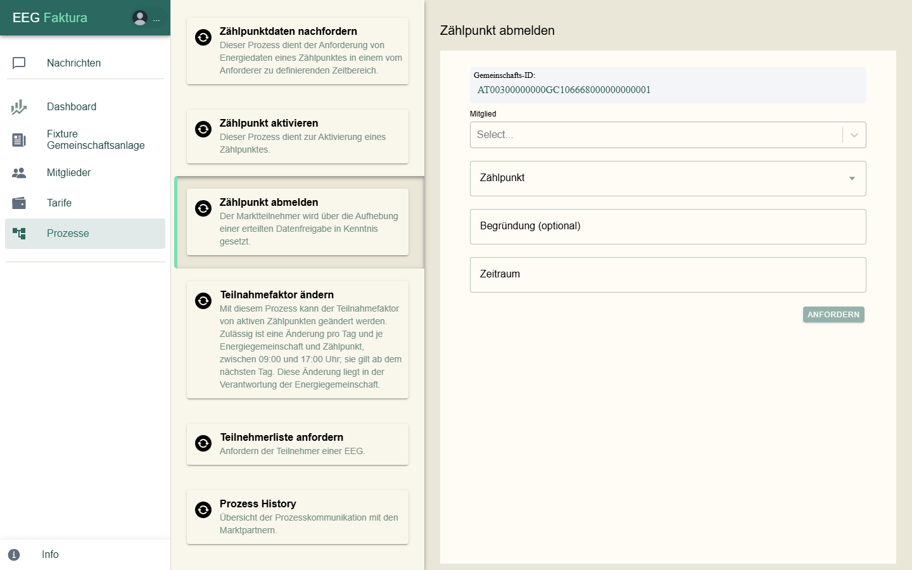
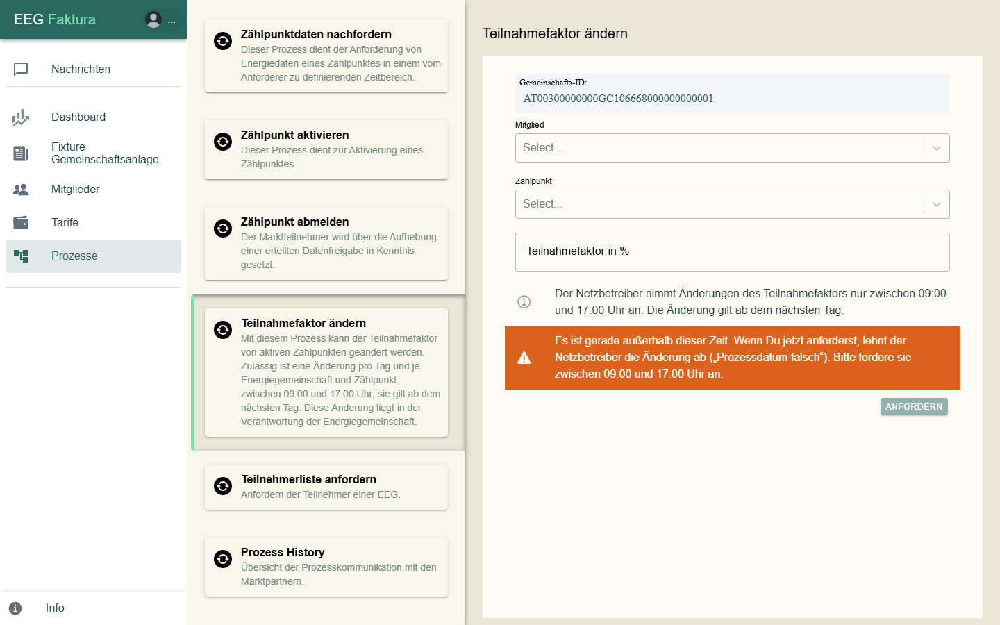
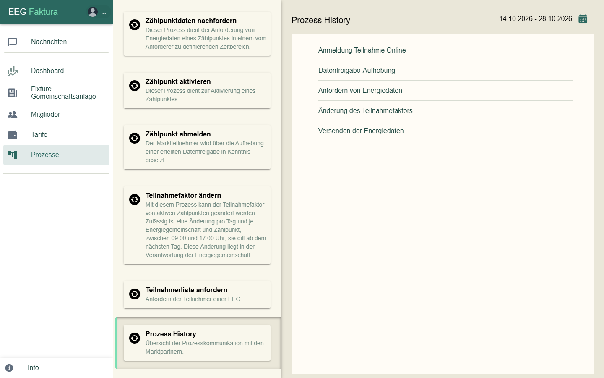

# Prozesse beim Netzbetreiber

Unter **Prozesse** löst du Vorgänge beim Netzbetreiber aus. Den Menüpunkt gibt es nur für EEG-Admins von
Gemeinschaften mit **Online-Anbindung**. eegFaktura verschickt die Anfrage über die Marktkommunikation (EDA); die
Antwort kommt später unter [Nachrichten](07-nachrichten.md).

Jedes Formular zeigt oben die **Gemeinschafts-ID**. Nach **Anfordern** meldet eegFaktura „Die Anforderung wurde an
den Netzbetreiber gesendet.“ oder den Grund, warum es nicht geklappt hat.

## Zählpunktdaten nachfordern

Fordert Energiedaten für einen Zeitraum erneut an, z. B. wenn Daten fehlen oder nur vorläufig (L3) sind.

1. Wähle **Mitglied** und **Zählpunkt** (mehrere möglich) — oder hake **Zählpunkte für die gesamte EEG
   nachfordern** an.
2. Wähle den **Zeitraum**.
3. Lass **Nur fehlende Daten oder L3-Werte anfordern (Smart)** angehakt: eegFaktura prüft zuerst, wo wirklich etwas
   fehlt, und schlägt vor, nur diese Zählpunkte anzufordern.
4. Klicke auf **Anfordern**.

Für heute und spätere Tage gibt es noch keine Daten. Zählpunkte, die in der letzten Stunde schon angefordert wurden,
überspringt eegFaktura und sagt das. Das Ergebnis kommt als **Zusammenfassung Energiedaten-Anforderung** unter Nachrichten.

## Zählpunkt aktivieren

Meldet einen noch nicht aktiven Zählpunkt (erneut) beim Netzbetreiber an, z. B. nach einer Abweisung, wenn der Fehler
behoben ist. Wähle **Mitglied** und **Zählpunkt**. Hast du vom Netzbetreiber einen **Aktivierungs-Code**, hake
**Offline-Registrierung** an und trage ihn ein. Bei der Online-Anmeldung muss das Mitglied die Datenfreigabe danach
bestätigen; es bekommt dazu die Mail „Freigabe-Aufforderung“.

## Zählpunkt abmelden

Hebt die Datenfreigabe eines Zählpunkts beim Netzbetreiber auf — der Zählpunkt verlässt die Gemeinschaft. Soll er
später wieder teilnehmen, ist eine neue Anmeldung nötig.

1. Wähle **Mitglied** und **Zählpunkt** (mehrere möglich).
2. Wähle unter **Zeitraum** das Ende der Teilnahme (frühestens morgen). Das Feld **Begründung (optional)** wird
   derzeit nicht an den Netzbetreiber übermittelt.
3. Klicke auf **Anfordern** und bestätige „Datenfreigabe aufheben“ mit **Aufheben**.

Fehlt eegFaktura die Kennung der Datenfreigabe, fordere zuerst die **Teilnehmerliste** an (siehe unten).

## Teilnahmefaktor ändern

Ändert, welchen Anteil ein Zählpunkt an der Gemeinschaft hat.

1. Wähle **Mitglied** und **Zählpunkt** (die Auswahl zeigt den aktuellen Faktor).
2. Gib den neuen **Teilnahmefaktor in %** ein (1–100) und klicke auf **Anfordern**.

> Der Netzbetreiber nimmt Änderungen **nur zwischen 9 und 17 Uhr** an, **eine pro Tag** je Zählpunkt; die Änderung
> gilt ab dem nächsten Tag. Außerhalb dieser Zeit warnt eegFaktura, weil der Netzbetreiber sonst mit „Prozessdatum
> falsch“ ablehnt.

## Teilnehmerliste anfordern

Fordert beim Netzbetreiber die Liste aller Zählpunkte der Gemeinschaft an. Die Antwort kommt später; die
verantwortliche Person der EEG bekommt eine E-Mail. Bei Bürgerenergiegemeinschaften wählst du zuerst die
**Netzbetreiber-ID**.

## Prozess History

Zeigt die Kommunikation mit dem Netzbetreiber, standardmäßig der letzten 14 Tage (Zeitraum oben rechts):

| Bereich | Inhalt |
|---------|--------|
| **Anmeldung Teilnahme Online** | Anmeldungen von Zählpunkten |
| **Datenfreigabe-Aufhebung** | Abmeldungen |
| **Anfordern von Energiedaten** | Nachforderungen |
| **Änderung des Teilnahmefaktors** | Änderungen des Faktors |
| **Versenden der Energiedaten** | Energiedaten, die der Netzbetreiber geschickt hat (von – bis) |

Jeder Bereich lässt sich nach Zählpunkt, Name, Mitgliedsnummer oder Conversation-ID durchsuchen. Je Zählpunkt stehen
die Schritte mit Datum, **Protokoll** und **Status** bzw. **Info**.

**Eine Ablehnung lesen:** In der Spalte Protokoll steht dann ABLEHNUNG, in Status oder Info der Grund, z. B.
„Zählpunkt nicht gefunden“, „Kunde hat Datenfreigabe abgelehnt“ oder „Prozessdatum falsch“.

### Nachrichtenarten in der Spalte Protokoll

| Bereich | Ablauf |
|---------|--------|
| Anmeldung Teilnahme Online | ANFORDERUNG_ECON (eegFaktura meldet an) → ANTWORT_ECON (Netzbetreiber bestätigt den Eingang) → ZUSTIMMUNG_ECON (Mitglied hat zugestimmt) → ABSCHLUSS_ECON (Zählpunkt aufgenommen); oder ABLEHNUNG_ECON |
| Datenfreigabe-Aufhebung | AUFHEBUNG_CCMS (eegFaktura hebt auf), ANTWORT_CCMS / ABLEHNUNG_CCMS; AUFHEBUNG_CCMC, wenn das Mitglied aufhebt; AUFHEBUNG_CCMI, wenn der Netzbetreiber aufhebt |
| Anfordern von Energiedaten | ANFORDERUNG_PT → ANTWORT_PT oder ABLEHNUNG_PT |
| Änderung des Teilnahmefaktors | ANFORDERUNG_CPF (mit neuem Faktor) → ANTWORT_CPF oder ABLEHNUNG_CPF |
| Versenden der Energiedaten | DATEN_CRMSG: Energiedaten sind eingetroffen (von – bis) |

Eine angenommene Anforderung (ANTWORT_PT) heißt noch nicht, dass die Daten da sind — das zeigt erst DATEN_CRMSG.

## Häufige Ablehnungsgründe

| Grund | Was meist dahintersteckt — und was du tun kannst |
|-------|---------------------------------------------------|
| Zählpunkt nicht gefunden | Tippfehler in der Zählpunktnummer: mit der Stromrechnung vergleichen, korrigieren, neu anmelden |
| Zählpunkt befindet sich nicht im Bereich der Energiegemeinschaft | der Zählpunkt liegt außerhalb des Gebiets der Gemeinschaft; häufig ist auch ein Einspeisezählpunkt beim Netzbetreiber noch nicht fertig eingerichtet |
| Kunde hat Datenfreigabe abgelehnt | das Mitglied hat im Portal abgelehnt (oft versehentlich): mit dem Mitglied klären, dann unter **Zählpunkt aktivieren** neu anmelden |
| Kunde hat auf Datenfreigabe nicht reagiert (Timeout) | das Mitglied hat nicht rechtzeitig zugestimmt: erinnern und neu anmelden |
| Kein Smart Meter / Noch kein fernauslesbarer Zähler eingebaut | ohne Smart Meter (bzw. ohne Fernauslesung) geht die Teilnahme noch nicht: Netzbetreiber fragen, wann getauscht wird |
| Kunde hat optiert | das Mitglied hat Viertelstundenwerte im Smart Meter abgelehnt (Opt-out): das Mitglied muss beim Netzbetreiber wieder einwilligen |
| Zählpunkt nicht versorgt | für den Zählpunkt gibt es keinen Liefervertrag mit einem Energieversorger |
| Zählpunkt nicht dem Lieferanten zugeordnet | oft liegt der angefragte Zeitraum vor dem Aktivierungsdatum: Zeitraum ab „Aktiv seit“ wählen |
| konkurrierende Prozesse | ein früherer Vorgang zum selben Zählpunkt läuft noch: abwarten und später erneut senden |
| Prozessdatum falsch | beim Teilnahmefaktor meist: außerhalb 9–17 Uhr gesendet |
| Teilnahmefaktor von 100 % würde überschritten werden / Summe … übersteigt 100% | der Zählpunkt nimmt schon an einer anderen Gemeinschaft teil: dort zuerst den Faktor senken |
| Teilnahme-Limit wird überschritten | der Zählpunkt nimmt schon an der höchstzulässigen Zahl von Gemeinschaften teil |
| Keine Daten im angeforderten Zeitraum vorhanden | der Netzbetreiber hat für den Zeitraum (noch) keine Werte: später erneut anfordern |

Unbekannte Gründe zeigt eegFaktura als Nummer. Kommt dieselbe Ablehnung immer wieder, prüfe Zählpunktnummer und
Netzbetreiber-ID auf Tippfehler oder Leerzeichen.

## Wie lange dauert es?

Erfahrungswerte aus der Praxis, je nach Netzbetreiber verschieden:

- **Anmeldung** eines Zählpunkts mit Smart Meter: einige Tage, sofern das Mitglied rasch zustimmt.
- **Energiedaten:** die ersten Werte kommen meist nach 1–3 Tagen; vorläufige Werte (L3) korrigiert der Netzbetreiber
  später noch. Rechne daher nicht unmittelbar nach dem Ende eines Zeitraums ab, sondern prüfe vorher die
  [Vollständigkeit](05-abrechnung.md#vorschau-erstellen).
- Fehlen Daten ein, zwei Tage nach einer Störung noch immer, fordere sie nach; erst danach lohnt ein Ticket.

