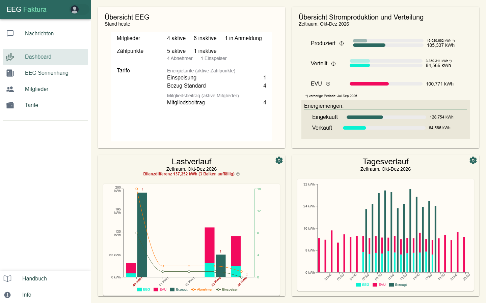

# Dashboard

Das **Dashboard** zeigt die wichtigsten Zahlen der Gemeinschaft, meist für den gewählten **Zeitraum**. Den Zeitraum
wählst du in der **Mitgliederliste**; das Dashboard übernimmt ihn. Für **Lastverlauf** und **Tagesverlauf** kannst du
einen anderen wählen (siehe [Anderen Zeitraum für eine Kachel wählen](#anderen-zeitraum-fur-eine-kachel-wahlen)).

| Bereich | Inhalt |
|---------|--------|
| **Übersicht EEG** | Mitglieder, Zählpunkte und Tarife mit dem Stand von heute (siehe [unten](#ubersicht-eeg)) |
| **Übersicht Stromproduktion und Verteilung** | **Produziert**, **Verteilt** und **EVU** im Zeitraum, mit der vorherigen Periode zum Vergleich; darunter die [Energiemengen](#energiemengen) |
| **Lastverlauf** | Verbrauch aus der Gemeinschaft (EEG) und vom Energieversorger (EVU) sowie Erzeugung über den Zeitraum; darüber die **Bilanz** (siehe [Bilanzdifferenz](#bilanzdifferenz)) |
| **Tagesverlauf** | Verlauf über den Tag (EEG, EVU, Erzeugt) |

Die Fragezeichen-Symbole neben den Werten erklären, wie eine Zahl entsteht.

**Produziert** ist die Erzeugung aller Erzeuger, **Verteilt** der Teil davon, der in der Gemeinschaft an die
Verbraucher ging (nicht der gesamte Verbrauch der Mitglieder), **EVU** der Rest, der ins Netz ging (Überschuss).

**Lastverlauf und Tagesverlauf lesen:** Über einen Zeitraum zeigen beide Kacheln gestapelte Balken für den Verbrauch
der Mitglieder — unten der Teil aus der Gemeinschaft (**EEG**), darüber der Bezug vom Energieversorger (**EVU**).
Daneben steht die Erzeugung (**Erzeugt**). Ist dieser Balken höher als der EEG-Teil, konnte die Gemeinschaft den Rest
nicht an ihre Mitglieder verteilen — oder es fehlen noch Daten (siehe [Bilanzdifferenz](#bilanzdifferenz)). Der
Tagesverlauf zeigt, zu welchen Tageszeiten das passiert — hilfreich, wenn ihr überlegt, welche Verbraucher gut zur
Gemeinschaft passen. Im Lastverlauf ist ein Balken bei einem Monat ein Tag, bei Vierteljahr und Halbjahr eine Woche,
bei einem Jahr ein Monat; auffällige Balken tragen ein „!“. Zwei Linien zeigen die Zahl der **Abnehmer** und
**Einspeiser** (rechte Achse). In der Ansicht eines einzelnen Tags zeigt der Lastverlauf Linien statt Balken.

## Übersicht EEG

Die Kachel zeigt alle Zahlen mit dem Stand von heute, unabhängig vom gewählten Zeitraum; oben steht „Stand heute“.

- **Mitglieder:** aktive, inaktive und, falls vorhanden, „in Anmeldung“.
- **Zählpunkte:** aktive, inaktive und, falls vorhanden, „in Anmeldung“ (Zählpunkte, deren Anmeldung beim
  Netzbetreiber noch läuft, zählen nicht zu den aktiven); darunter die aktiven Abnehmer und Einspeiser.
- **Tarife**, getrennt in **Energietarife** (Anzahl der aktiven Zählpunkte je Tarif) und **Mitgliedsbeitrag** (Anzahl
  der aktiven Mitglieder je Tarif, dazu „ohne Mitgliedsbeitrag“).

Die anderen Kacheln zeigen den gewählten Zeitraum.

## Bilanzdifferenz

Die Bilanzdifferenz ist Produktion minus Eigendeckung minus Überschuss. Sind alle Energiedaten da, ist sie 0, und
eegFaktura zeigt „Bilanz ausgeglichen“ (sehr kleine Werte sind Rundung). Eine Differenz steht rot da: **negativ**
heißt, vermutlich fehlen Daten von Einspeisern, **positiv**, vermutlich fehlen Daten von Beziehern. Für die
jüngsten Tage ist eine Differenz normal, solange noch nicht alle Daten eingetroffen sind. Fehlen ältere Daten,
kannst du sie unter **Prozesse → Zählpunktdaten nachfordern** anfordern.

## Energiemengen

„Eingekauft“ und „Verkauft“ zählen nur Zählpunkte mit einem gültigen Tarif der Gemeinschaft; ein Hinweis darunter
sagt, wie viele Zählpunkte deshalb fehlen und mit wie vielen kWh.

## Anderen Zeitraum für eine Kachel wählen

Das Zahnrad von **Lastverlauf** oder **Tagesverlauf** ändert den Zeitraum nur für diese Kachel; die Übersicht und die
Mitgliederliste behalten ihren. Zur Wahl stehen Jahr, Halbjahr, Vierteljahr, Monat oder ein einzelner Tag:

- **Tag:** Wähle ein Datum (Tage mit Energiedaten bis gestern); mit den Pfeilen blätterst du tageweise. Eine andere
  Zeile im Zahnrad-Menü führt zurück.
- **Halbjahr:** Neben den Kalender-Halbjahren gibt es das **Sommerhalbjahr** (April bis September) und das
  **Winterhalbjahr** (Oktober bis März). So vergleichst du etwa den Tagesverlauf im Sommer und im Winter, um Tarife
  nach Tageszeit zu planen.
