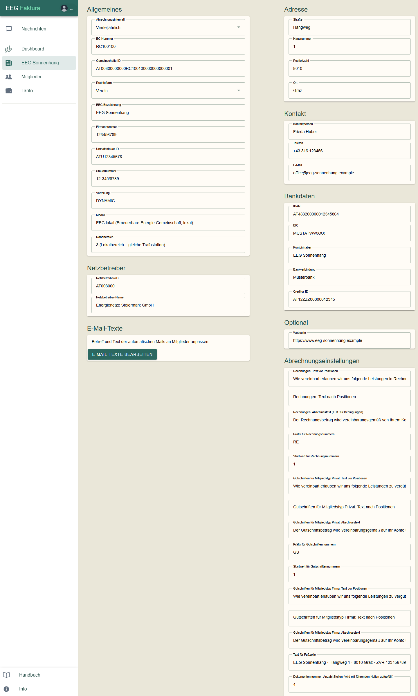

# EEG-Seite

Der Menüpunkt mit dem **Namen deiner Gemeinschaft** öffnet die EEG-Seite mit ihren Stammdaten:

| Bereich | Inhalt |
|---------|--------|
| **Allgemeines** | **Abrechnungsintervall** (siehe [Abrechnungsintervall wechseln](05-abrechnung.md#abrechnungszeitraum-wechseln)), EC-Nummer, Gemeinschafts-ID, Rechtsform, EEG Bezeichnung, Firmennummer, Umsatzsteuer ID, Steuernummer, Verteilung, **Modell** und **Nahebereich** (siehe [unten](#modell-und-nahebereich)) |
| **Netzbetreiber** | Netzbetreiber-ID und -Name |
| **E-Mail-Texte** | Zugang zu den [E-Mail-Texten](03-email-texte.md) (nur EEG-Admins) |
| **Adresse**, **Kontakt** | Anschrift, Kontaktperson, Telefon, E-Mail-Adresse der Gemeinschaft |
| **Bankdaten** | IBAN, BIC, Kontoinhaber, Bankverbindung, Creditor-ID |
| **Optional** | Webseite |
| **Abrechnungseinstellungen** | Einstellungen für Rechnungen und Gutschriften, z. B. das Logo |

Ändern können die Felder nur EEG-Admins. Eine Änderung wird gespeichert, sobald du das Feld verlässt; einen
eigenen Speichern-Knopf gibt es nicht. EC-Nummer, Gemeinschafts-ID und Verteilung lassen sich nicht ändern.

> **Tipp:** EEG Bezeichnung, Kontaktperson, Adresse, Telefon, E-Mail und Webseite der Gemeinschaft stehen im
> Kontaktblock der Mails an deine Mitglieder (siehe [E-Mail-Texte](03-email-texte.md)), und die E-Mail-Adresse
> bekommt diese Mails in Kopie. Halte die Angaben aktuell.

## Modell und Nahebereich

Unter **Allgemeines** stehen zwei weitere Felder, beide nur zur Anzeige: **Modell** und **Nahebereich**.

??? note "Was bedeuten Modell und Nahebereich?"
    - **Modell**: die Art der Gemeinschaft, mit Kurz- und Langform: EEG lokal (Erneuerbare-Energie-Gemeinschaft,
      lokal), EEG regional (Erneuerbare-Energie-Gemeinschaft, regional), GEA (Gemeinschaftliche Erzeugungsanlage), BEG
      (Bürgerenergiegemeinschaft), P2P (Peer-to-Peer) oder EVA (Eigenversorgungsanlage).
    - **Nahebereich**: die Netzebene, die alle Zählpunkte der Gemeinschaft verbindet, mit der amtlichen Bezeichnung
      laut ElWG. Der Wert ist aus dem Modell vorbelegt und wird mit jeder Zählpunktliste des Netzbetreibers
      aktualisiert; bei P2P und EVA steht er bis zur ersten Zählpunktliste auf „unbekannt“.

    | Nahebereich | Bezeichnung |
    |---|---|
    | 1 | Haupt-/Steigleitung |
    | 2 | Standortbereich – gemeinsame Sammelschiene |
    | 3 | Lokalbereich – gleiche Trafostation |
    | 4 | Regionalbereich – gleiches Umspannwerk eines Netzbetreibers |
    | 5 | Regionalbereich – gleiches Umspannwerk verschiedener Netzbetreiber |
    | 6 | Gebotszone – mehrere Umspannwerke eines Netzbetreibers |
    | 7 | Gebotszone – mehrere Umspannwerke verschiedener Netzbetreiber |

## Peer-to-Peer und Eigenversorgung

Für Gemeinschaften mit dem Modell **P2P** oder **EVA** gibt es alle Funktionen wie bei einer EEG, die Abrechnung aber
nur als **Vorschau**: Du kannst Tarife anlegen und zuweisen, eine [Vorschau erstellen](05-abrechnung.md#vorschau-erstellen)
und die Belege als ZIP oder Excel herunterladen, etwa als Vorlage-Rechnungen. Eine endgültige Abrechnung gibt es nicht;
statt **Abrechnung durchführen** steht ein Hinweis, und es werden keine Rechnungen per Mail verschickt. Energiedaten,
Zählpunkte und Prozesse funktionieren wie bei einer BEG: Zählpunkte können bei mehreren Netzbetreibern liegen, und
**Zählpunktliste anfordern** fragt nach dem Netzbetreiber.
